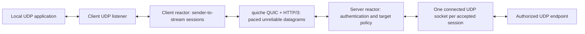

# Implementation Plan: Remora MASQUE UDP Tunnel

**Branch**: `001-masque-udp-tunnel` | **Date**: 2026-10-11 | **Spec**: [spec.md](spec.md)

**Input**: `specs/001-masque-udp-tunnel/spec.md` plus user constraints: Rust, Cloudflare quiche, Linux GNU x86_64 (ARM64 deferred by the owner on 2026-10-17), minimal modular architecture and evidence-led performance design.

**Status**: Research and Phase 1 contracts revised after the independent audit (R1–R6); specification/design readiness gate PASS for task generation and normal incremental implementation. The [decision record](proposed-amendments.md) identifies the corrections and remaining measurement risks. Selected designs still require their targeted implementation tests; this is not a claim that all engineering questions have been experimentally resolved. No executable, deployment, interoperability result or measured performance is claimed by this document.

## Summary

One Rust executable provides client/server commands for authenticated CONNECT-UDP over HTTP/3 and QUIC. A client mapping shares a connection while each UDP sender/local-destination pair gets its own HTTP request stream. A single reactor owns transport/session state and services bounded Linux UDP batches, fair queues and pacing deadlines. The server pins each authorized target to a connected UDP socket. No packet tasks, shared quiche mutexes or application-specific behavior. GSO/GRO are optional measured accelerations; baseline mmsg, CUBIC and timerfd pacing are complete initial paths.

## Technical Context

**Language/Version**: Rust 1.99.0, edition 2024; quiche 0.30.0 declares MSRV 1.88. Pin project toolchain and lockfile during implementation.

**Primary Dependencies**: quiche =0.30.0 with BoringSSL; Tokio 1.53.2 current-thread, socket2/libc; serde/TOML/JSON; tracing/subscriber/appender; sha2/hmac/subtle/getrandom. Optional sanitized qlog. Test-only proptest/cargo-fuzz and independent masque-go/quic-go fixture pinned in research.

**Storage**: TOML config, private token and PEM files, optional bounded filtered diagnostic output; in-memory bounded operational state. No database or prescribed socket-quarantine/reservation state. Any additional isolation mechanism must justify bounded lifecycle/resource costs in the architecture.

**Testing**: unit/property, parser/state fuzzing, deterministic clock/I/O component tests, real syscall tests, unprivileged process E2E, pinned independent interop, privileged network/MTU/WireGuard jobs and standalone release benchmark harness.

**Target Platform**: Linux 6.1+ GNU x86_64 only in the current required scope; separate IPv4/IPv6 sockets. ARM64/T072 is deferred outside completion/release gates, with prepared tooling retained as experimental. [ADR 0024](../../docs/adr/0024-defer-arm64-release-scope.md) supersedes earlier dual-target planning; reintroduction requires an explicit decision and native evidence. Optional GSO/GRO capability is probed. Runtime unprivileged on unprivileged ports.

**Project Type**: One production Rust package with library modules and one CLI; a separate test-only traffic tool and Go interop fixture.

**Performance Goals**: SC-003 >=80% matching direct payload throughput; SC-004 <=0.1 percentage-point added loss; SC-005 <=5 ms added p95 RTT; SC-007 <=128 MiB RSS and <=2 average cores per role at 32 sessions and 500 Mbit/s/direction. These are frozen targets, not achieved results; [benchmark contract](contracts/benchmarks.md) defines exact runs.

**Constraints**: No reliable payload fallback, private fragmentation, early-data access, insecure trust mode, VPN/TUN management or secrets in URLs/argv/logs. Global/identity/session/queue/FD/setup/diagnostic limits are explicit. Detection <=15 s, restored traffic <=10 s, stop <=5 s in specified profiles.

**Scale/Scope**: At least 32 active isolated sessions; defaults admit 128 total, 32 per identity, 32 per connection, 64 connections and 16 pending setups, subject to stricter byte/FD budgets. No unlimited Internet admission guarantee.

## Constitution Check

*Gate before research and after design. Evidence here is design evidence; runtime gates remain implementation/release obligations.*

| Principle | Before Phase 0 | After Phase 1 | Required evidence / resolution |
|-----------|----------------|---------------|-------------------------------|
| I Standards / independent interop | PASS: RFC scope explicit | PASS design | Wire contract, pinned quic-go fixture, both role tests; unsupported carrier handling explicit |
| II Correctness / invariants | PASS: failures and invariants explicit | PASS design | Client/session isolation, cancellable-versus-committed output boundary and close/EAGAIN tests; external UDP provenance limitations documented, no prescribed quarantine |
| III Security / bounds | PASS: threat boundaries explicit | PASS design | Auth before target allocation, explicit TLS verify, allowlist/DNS pinning, replay denial, redacted bounded diagnostics and negative tests |
| IV Rust / simplicity / ADRs | PASS: Rust required | PASS design | One production package, exclusive owner, audited syscall boundary, four ADRs; no speculative sharding |
| V Verification | PASS: testable functional matrix | PASS design | Automated unit/property/fuzz/component/E2E/interop and native target CI; no tests fabricated |
| VI Observability | PASS: required signals scoped | PASS design | Versioned JSON schema, bounded terminal summaries independent of ordinary log suppression, explicit coverage gaps, sanitized optional qlog and overhead/redaction checks |
| VII Measured performance | PASS research: no claims made | PASS design | Early E2E MVP and reproducible baseline measurements in normal implementation; frozen numeric release criteria, evidence-led optimization |

**Gate outcome:** PASS for task generation and incremental implementation. A1/A2 are accepted in their revised form and integrated into the specification. No separate prototype, pre-implementation measurements or ARM64 prerequisite blocks x86_64 development. Security/correctness/conformance checks apply to each implemented increment; full independent interoperability, numerical benchmarks and target-native qualification remain release obligations. This is a design-readiness pass, not a runtime acceptance pass; no constitutional exception is needed.

Audit corrections are specified, not runtime-verified: the first forwarding increment must test R1's commitment/close boundary with two streams and EAGAIN and its initial GOAWAY cutoff/draining behavior; the relevant protocol increment must cover R2/R3 response/Capsule negatives and R4 idle lifecycle; diagnostic increments must verify R5 correlation under suppression; task generation and execution follow R6 constitutional test requirements, with test-first order only on an explicit TDD request. Single-owner capacity, shared-queue fairness/control servicing and optional qlog costs remain evidence-led implementation risks. They do not create a new pre-implementation gate.

## Project Structure

### Documentation (this feature)

```text
specs/001-masque-udp-tunnel/
├── spec.md                       # requirements with accepted A1/A2 revision
├── plan.md
├── research.md
├── data-model.md
├── quickstart.md
├── proposed-amendments.md         # accepted A1/A2 decision record
├── contracts/
│   ├── masque-wire.md
│   ├── cli-config.md
│   ├── diagnostics.md
│   └── benchmarks.md
└── checklists/requirements.md     # existing spec-quality ownership unchanged

docs/adr/
├── 0001-transport-profile.md
├── 0002-runtime-and-linux-io.md
├── 0003-security-and-observability.md
└── 0004-verification-and-performance.md
```

### Source Code (repository root, planned only)

```text
Cargo.toml / Cargo.lock / rust-toolchain.toml
src/
├── main.rs                       # CLI wiring only
├── lib.rs
├── config.rs                     # typed validated settings/secret loading
├── policy.rs                     # canonical target authorization/credential checks
├── reactor.rs                    # exclusive owner, scheduling, deadlines, cancellation
├── transport.rs                  # public quiche QUIC/H3 adapter, settings, CIDs, stats
├── masque.rs                     # CONNECT headers, URI/datagram/Capsule codecs
├── session.rs                    # flow generations, lifecycle, destination association
├── udp.rs                        # Linux safe interface + isolated reviewed syscall code
├── buffers.rs                    # bounded pool/queue accounting, no generic framework
└── diagnostics.rs                # allowlisted events/counters/qlog filter

tests/{protocol,io,security,lifecycle,e2e}/
fuzz/fuzz_targets/
tools/traffic/                    # baseline relay, independent directional load, RTT probes
tools/interop/                   # pinned Go fixture, go.mod/go.sum
scripts/validate/                 # smoke, scenarios, interop, namespace and benchmark runners
.github/workflows/                # native target checks and scheduled qualification
```

**Structure Decision**: The initial planning snapshot had no Cargo implementation. Phase 1 supplies the package/build infrastructure; Phase 2 supplies configuration, buffers, diagnostics and fixtures. Remaining source/tool paths are proposed and tracked in the existing `tasks.md`. Keep one production package and concrete modules rather than separate service/crate frameworks; only benchmark and independent-peer tools need separate builds. [ADR-0005](../../docs/adr/0005-foundation-primitives.md) records foundation choices and boundaries.

## Architecture and ownership



The same reactor design serves either role. During GOAWAY draining a mapping may temporarily retain a draining connection alongside its new primary connection; both consume global connection budgets and each flow keeps its original generation/stream association. Each connection/H3 pair has exactly one mutable owner; the client owns persistent listeners separately from replaceable connection generations. The server routes received packets by owned destination CIDs, updates all issued/retired IDs, and drains path events. Unknown Initials undergo size/version/address validation and bounded stateless Retry before connection allocation. Retry tokens use maintained HMAC primitives, short expiry and client-address/original-DCID binding; never accept arbitrary peer-supplied CID state. Maintain anti-amplification limits. Bound pre-auth connection admission globally and per source bucket without unbounded source labels/maps.

Disable active migration in the initial profile while allowing safe NAT rebinding supported by quiche; explicit client network changes recreate the socket/connection and all sessions, revalidating trust and policy. Unsupported-path failures trigger bounded recovery. All CIDs belonging to a connection route to the same owner; SO_REUSEPORT connection sharding is deferred until a measured need and CID-routing ADR.

## Reactor and datapath

1. Check cancellation and due timers, then visit ready outer and application sockets in bounded rotating order. Decode only complete UDP datagrams with valid metadata.
2. Feed outer packets to quiche using their actual local/remote addresses. Poll H3 settings/events and drain datagrams with finite work; process remaining known work explicitly on the next turn so edge-triggered events cannot stall.
3. On a sender/local-destination pair's first packet create bounded setup state and drop/count that packet while not accepted; do not preserve it for setup/recovery replay. Retain the actual local destination from packet info as the reply source, including queued replies. Authenticate/authorize each server stream before allocating a destination relay and returning 2xx. A successful request does not prove target responsiveness.
4. Active application datagrams are scheduled fairly per session, validated against current payload ceilings, and accepted into a small quiche datagram queue only if connection byte/count capacity exists. Successful enqueue and actual socket transmission are distinct counters.
5. Reserve ciphertext descriptors, call quiche send within connection quotas only after applying due close/expiry events, retain SendInfo and generated bytes, and transmit only due packets. Successful packet generation commits its contents to the original transport association; enqueue into quiche alone is still cancellable. Preserve generated order within each connection so later close/control output cannot bypass an earlier retained packet; independent connections remain fairly scheduled. Partial mmsg success advances exactly the accepted prefix. Retryable EAGAIN preserves the suffix; hard PMTU/socket failure is classified, counted and handled without invented reliability.
6. Rearm the earliest timerfd deadline, schedule continued finite work, otherwise await readiness/setup completion. Coarse backoff/housekeeping may use Tokio timers. A full ciphertext queue stops further send generation and application enqueueing; control/timer servicing continues.

Application residence from role receipt to QUIC packet generation or relay submission is at most 20 ms, including outgoing datagrams queued inside quiche. Track a conservative earliest expiry per connection; on that deadline purge all still-queued native outgoing datagrams and count them. Clear the expiry only when its queue becomes empty, and take the minimum when admitting an older application descriptor. Early conservative discard of newer queued data is allowed best-effort behavior; no expired datagram can remain hidden behind congestion blockage. Test this with a blocked cwnd. After packet generation, ciphertext residence at most 100 ms before connection failure/recovery. These are initial tuning defaults, not measured latency evidence. Expiry never replays data into a new generation. Control traffic receives reserved work/storage so load cannot indefinitely suppress handshakes, ACKs, close or cancellation.

## Resource and recovery design

[ADR-0007](../../docs/adr/0007-review-corrections-and-contract-alignment.md)
records Phase 3 review corrections: bounded path-event draining, contracted
256 KiB initial/max connection windows, HTTP/3 semantic checks and the bounded
shutdown-only terminal-status cadence exception. Resource/schema limits remain
as contracted. T040 must add rotating body/Capsule service with a progress
regression for at least five continuously pending streams before full concurrency/fairness claims.

### Transmission commitment and session closure (R1)

Cancellable pending data includes application/relay queues, delayed setup work and outgoing native quiche DATAGRAMs not yet incorporated into a generated packet. Outer commitment occurs when a successful quiche.send()/send_on_path() returns the encrypted packet containing the datagram; destination/local UDP commitment occurs when its send syscall accepts the datagram. Commitment is distinct from kernel submission of an outer packet and from peer/target delivery. Single-owner close/expiry processing first disables flow eligibility, purges its application/relay queues and native outgoing DATAGRAMs with a checked stream-association predicate, then closes the stream/socket. No new packet generation may include that closed flow's uncommitted data. Incoming identifiable closed-flow datagrams and callbacks are discarded.

Generated ciphertext is immutable connection-owned transport output, potentially containing several streams and control frames. It cannot be selectively recalled by dgram_purge_outgoing, and the design neither decrypts/rewrites it nor drops a mixed packet solely because one session closes. Already committed packets may finish on the same connection generation in generated order, with the original source/destination and unchanged 100 ms deadline measured from generation; closing a session cannot extend it. A peer whose receive side is already closed discards that flow's datagrams. Before the peer observes close, committed data may still arrive on the original authorized association: local close is not an instantaneous remote-delivery cutoff. Neither internal commitment nor the separate opaque external-UDP limitation permits reassignment to another session/client.

On connection failure/replacement or process stop, discard that connection's unsent ciphertext and destroy its old transport state; never resubmit it on a new generation. If generated output exceeds its residence bound, fail that blocked connection rather than pretending a selective cancellation can preserve its accounting. This is a connection I/O failure, not a reason to close other streams merely for ordinary session cleanup. No additional transmission is promised once stopping begins; packets already accepted by the kernel/network cannot be recalled. Tests must distinguish uncommitted discard, committed original-association completion, kernel submission and no replay after replacement. API boundary: [quiche outgoing purge](https://docs.rs/quiche/0.30.0/quiche/struct.Connection.html#method.dgram_purge_outgoing).

### Resource budgets and recovery

All budgets are checked before expensive allocations and counted across active, pending and cleanup state. No retired-socket pool or quarantine duration is prescribed. The 8 MiB application pool, 4 MiB encrypted output pool, 2 MiB scratch pool and 2 MiB total diagnostics memory (1 MiB output queue, 512 KiB qlog filter scratch, 512 KiB status/record/format/snapshot storage, including a 64 KiB terminal ring and 448 KiB for all remaining live-status/parser/formatting capacities) bound retained capacity; transport/control state and per-connection worst cases are counted separately. Quiche DATAGRAM queues default 64 entries each direction per connection, outer payload cap 1452 (ADR 0031; previously 1350), with an additional 256 KiB/connection DATAGRAM byte budget; set_max_recv_udp_payload_size to the configured outer limit and reject larger complete outer UDP messages before quiche; configure stream/control windows explicitly rather than using large defaults. Derived count limits must fit the connection byte budget at worst-case UDP size. Actual heap/RSS/BoringSSL overhead must be measured. Kernel buffers are reported separately from RSS.

Session error/reset/expiry purges its application and queued quiche datagrams and terminates only that stream/socket. Already transport-committed ciphertext and kernel/network in-flight packets remain attributable to the old stream ID under the commitment rules above; they cannot be moved to a new flow. Failed shared connections affect their own flows; other admitted connections remain usable. Source/session generations invalidate late DNS completion and queued work. Session inactivity defaults to 120000 ms of valid UDP activity in either direction, separate from transport liveness probes; expiry closes both request stream and relay socket, following RFC 9298 §3.1. QUIC keepalives do not extend application session inactivity. Distinct active relay associations, generation-aware ownership and stale-work checks enforce routing isolation. Socket closure does not permit old queued data, source mappings or callbacks to be attached to another client. The reuse policy and inherent external UDP ambiguity are documented in ADR-0001; no absolute provenance claim after an indistinguishable endpoint-tuple reuse or restart is made. Additional mitigation is an architectural trade-off rather than a mandated 30-second socket retention mechanism.

Recovery configures a 5-second quiche idle timeout while preserving its RFC timer rules (including first ack-eliciting send reset and minimum three PTOs). A separate 10-second last-authenticated-peer-progress watchdog applies to active connections, so unproductive local sends cannot hide a blackhole. Every two seconds of otherwise idle active-flow traffic, schedule send_ack_eliciting, then generate/send the resulting packet under normal pacing. Include probe/watchdog deadlines in timerfd; no application payload/private wire ping. Retry delay has a deterministic 100 ms floor plus uniform jitter up to min(2000 ms minus floor, 100 ms times 2^attempt), with checked capped exponent; at most ten attempts/second per process/mapping and one handshake attempt in flight. Handshake/setup deadlines are five seconds. Session-specific auth/policy/capability rejection closes only that stream and never exits the process or closes unrelated accepted sessions. On the client it also sets a fixed-size admission latch for that immutable mapping (same credential/target/profile), preventing new setup until controlled restart; flow cleanup, source-tuple changes and transient recovery cannot clear it. On the server rejected requests are reclaimed under normal bounds, with no unbounded rejection tombstones. Mapping-wide identity/configuration failures before any usable session may exit with fatal status; after startup they stop new setup, report Rejected and await operator restart while preserving unrelated accepted flows. Transient errors recover automatically; existing local listeners stay bound. Schedule/test worst-case detection/recovery against SC-006; retry constants alone are not proof. Stop admission immediately on SIGINT/SIGTERM, cancel setup/recovery and discard data; release all resources within five seconds.

## Verification and sequencing

Phase 0 research and Phase 1 design are complete, with A1/A2 integrated. Start normal implementation on x86_64: implement the authenticated end-to-end MVP and same-topology unencrypted-relay baseline harness as the first usable increment. Measure as soon as the basic tunnel works and record directional throughput/loss/latency, CPU/RSS and test settings even if release targets are not yet met. Use observed bottlenecks to refine runtime/I/O/buffer decisions while continuing implementation. No disposable or separately approved feasibility prototype is required. ARM64 validation is deferred outside the current scope; it is not remaining work for this feature checkpoint. Preserve failed results and release targets rather than retrospectively relaxing them.

Implementation sequencing for task generation: reproducible x86_64 build, validated config/auth/trust/policy and bounded state; minimal codecs/UDP/transport path with relevant negative tests and safe diagnostic counters; early authenticated E2E MVP plus reproducible baseline/load harness; immediate directional baseline measurements; then recovery/concurrency/diagnostic completion, independent interop and measured datapath refinement. Safe counters/status and applicable tests accompany the MVP; optional filtered qlog follows it and does not delay first forwarding. Optional offloads/sharding/backend comparisons need evidence of benefit and preserve correctness. Complete operator/WireGuard documentation and full x86_64 reference benchmarks/platform qualification before release; optional ARM64 experiments create no acceptance gate. Security and standards requirements apply from the first forwarding increment; larger acceptance matrices can grow with supported functionality. ADRs/contracts/FR-SC traceability define evidence without a new process gate.

The checked first MVP/measurement checkpoint is T034 in [tasks.md](tasks.md). It explicitly permits dependency-ready US2/US4 work while named independent-peer/prepared-WireGuard qualification tasks T035–T037 remain pending external prerequisites; early instructions T038 use the available evidence. Preserve unchecked qualification markers and missing-evidence records, and require the relevant evidence before full US1/release claims. A failure of checks for implemented behavior cannot be deferred as missing external qualification. Spec Kit execution must follow this declared checkpoint/dependency graph rather than treating every earlier phase's qualification task as a development prerequisite. These repository workflow rules also apply to local/generated skill copies; regeneration must not restore unconditional TDD or contradict the declared transition.

After the first measurements, freeze a pre-change Remora revision/reference-manifest and workload-specific regression bounds before critical-path changes or candidate measurements, using reference variability as evidence; perform applicable paired checks at the affected increment's checkpoint. The benchmark contract defines fields and failed/inconclusive outcomes separately from matching-relay release criteria. No tolerance is invented before MVP evidence, and no full matrix/ARM64 measurement is needed to start x86_64 development. Offload `auto` remains accepted when implementation is deferred, with effective `off` and fixed `not_implemented`; implemented `auto` probes capability and reports its actual state/reason under the config/diagnostics contracts.

## Requirement-to-design traceability

| Requirements | Design boundary | Verification evidence |
|--------------|-----------------|-----------------------|
| FR-001/003/004 | CLI roles, opaque datagram boundary and empty payload | Generic responder/WireGuard E2E, byte/boundary equality |
| FR-002/005/026 | MASQUE wire profile, settings/Capsules, independent peer | Conformance/property/fuzz cases and both-role pinned interop |
| FR-006/007/008/009 | TLS/credentials/DNS policy and early-data gate | Monitored negative matrix, revocation/trust tests, security review |
| FR-010/011/013/014 | Stream/generation ownership, distinct active associations and fair admission | Close/EAGAIN/commitment tests, 32-session isolation/churn, unrelated-flow failure, stale-work rejection and documented UDP ambiguity |
| FR-012/015/016/028 | Byte/count/FD ledgers, drop/age policy, no-fragment two-leg PMTU | Saturation, partial I/O, blocked-cwnd expiry, size/path/resource tests |
| FR-017/018/019 | Persistent listeners, bounded retries/probes/watchdog, permanent-error scope | Fake-clock minimum-RNG sequence and real blackhole/restart/address changes |
| FR-020/024 | Safe bind defaults, separate address families, cancellable ownership | Native syscall/process tests and five-second stop in all states |
| FR-021/022/023 | Fixed diagnostics schema and sanitized qlog | Sentinel, terminal correlation under log suppression, explicit overflow/slow-sink coverage gaps and failure-class matrix |
| FR-025/029 | CLI/config/quickstart and explicit excluded scope | Clean operator walkthrough, independent peer example, no VPN management |
| FR-027 | Matched baseline and immutable run manifests | Early x86_64 baseline comparisons, full paired release reference measurements |

## Complexity Tracking

No constitutional exception or speculative abstraction is introduced. The Linux syscall boundary is necessary for batch/ancillary/deadline control and must document unsafe invariants and target-native tests. Runtime/transport integration complexity is evaluated in ADR-0002. Revised A1/A2 are accepted specification decisions with no new quarantine subsystem or feasibility process; they do not waive correctness/security.

## Endpoint usability amendment (2026-10-18)

The initial configuration uses schema_version=1 with explicit
`proxy = "https://host[:port]"` and client `target`, with no compatibility aliases.
[ADR 0026](../../docs/adr/0026-endpoint-configuration.md) and the updated
[CLI/config contract](contracts/cli-config.md) define derivation, optional
numeric dial override, bounded off-owner proxy DNS, sequential family fallback,
re-resolution/cancellation, TLS reference identity and redacted diagnostics.
Reuse existing resolver permits/setup deadlines; do not change target policy,
reactor ownership, packet queues, pacing or the UDP syscall boundary. Public
operator reference/TLS/WireGuard guides replace qualification-only setup gaps.
Validate parser negatives, DNS lifecycle, certificate SAN failures, E2E forwarding,
configuration rejection cases, independent interop and applicable performance comparison.
