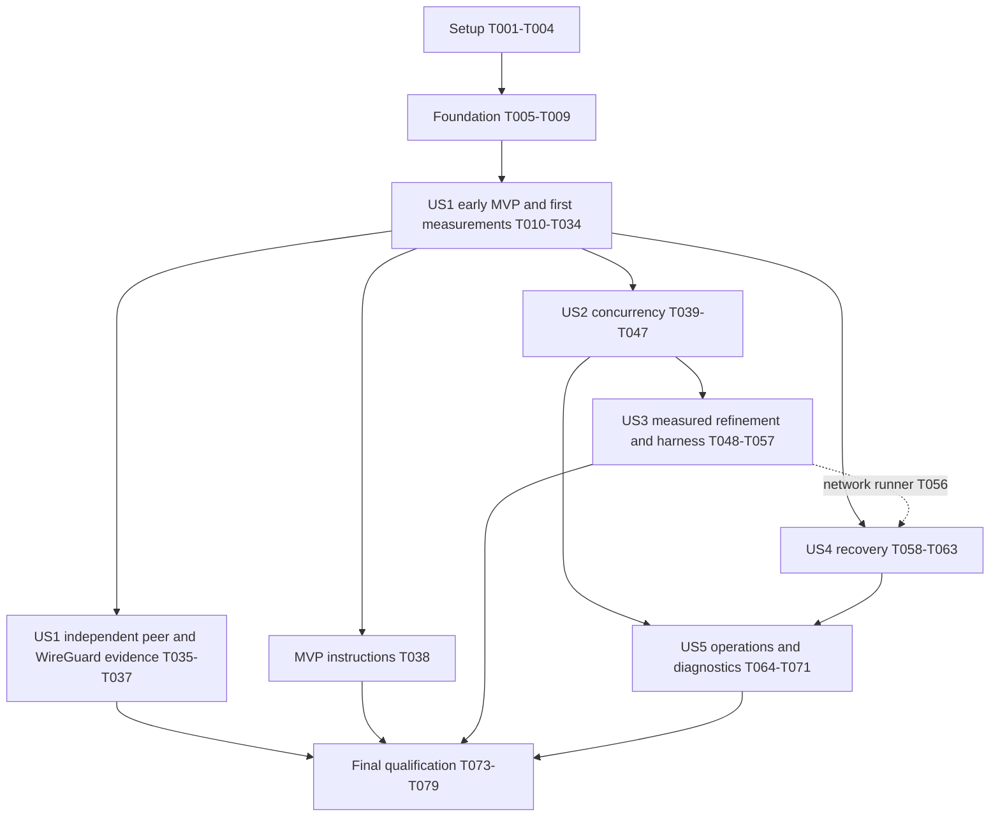

# Tasks: Remora MASQUE UDP Tunnel

**Input**: Design documents from `/specs/001-masque-udp-tunnel/`.
**Prerequisites**: [plan.md](plan.md), [spec.md](spec.md), [research.md](research.md), [data-model.md](data-model.md), [wire](contracts/masque-wire.md), [configuration](contracts/cli-config.md), [diagnostics](contracts/diagnostics.md) and [benchmark](contracts/benchmarks.md) contracts; constitution v1.0.0 and ADR-0001–0004.
**Created**: 2026-10-11. Completed tasks are marked only after their scoped checks; unchecked tasks remain planned work. Phase 1 completion is not tunnel or release acceptance.

**Tests**: Automated verification of every behavioral change and relevant failure modes is mandatory under Constitution V and review correction R6. No TDD ordering was requested: implementation and its checks follow actual dependencies, and applicable checks must pass before accepting an increment. Pure documentation receives static review. Never substitute self-interoperation or source inspection for independent interoperability or measured performance.

**Organization**: Setup and a small foundation precede five story phases in specification priority order. The first authenticated end-to-end MVP and immediate reproducible measurements are an internal checkpoint of US1; independent-peer/WireGuard qualification follows that checkpoint. Later tasks complete concurrency, performance, recovery and operations. Numeric targets remain release acceptance criteria; unmet early targets inform further work and do not halt normal development. Linux GNU x86_64 is the sole current required platform; ARM64 is deferred outside this task set by ADR 0024.

## Format: `[ID] [P?] [Story] Description`

- All tasks start unchecked, with globally sequential IDs.
- `[P]` identifies work on separate files that can run together **after the named prerequisites**; it never overrides a dependency or authorizes concurrent edits to shared production modules.
- `[US1]`–`[US5]` map to the specification's stories. Setup, foundation and final tasks have no story label.
- File paths are repository-relative and exact; they identify files to create when absent. Use the current design artifacts for the complete referenced contract, not just the quoted constraint.
- Tests under `tests/<domain>/` are registered through `tests/<domain>.rs`; reusable fixture support lives in `tests/common/mod.rs`. The traffic tool is a separate test-only Rust package, and interoperability uses a separate Go module. Production remains one Rust package and one executable.

## Phase 1: Setup (Shared Infrastructure)

**Purpose**: Establish the reproducible x86_64 development path and assess existing I/O reuse before adding unsafe code.

- [X] T001 Initialize the single production package in `Cargo.toml`, `Cargo.lock`, `rust-toolchain.toml`, `src/lib.rs` and `src/main.rs`: Rust 1.99.0/edition 2024, quiche =0.30.0/BoringSSL, Tokio 1.53.2 current-thread features and the justified dependencies in research; declare the required Linux GNU x86_64 platform, with any existing aarch64 build hints treated as optional/unqualified compatibility, and keep optional qlog disabled by default.
- [X] T002 [P] Record pinned C/C++/CMake/BoringSSL build prerequisites, build-image inputs and locked release commands in `tools/build/Dockerfile` and `docs/build.md` after T001; document how each input is reproduced without runtime privileges or changes to operator hosts.
- [X] T003 [P] Create native x86_64 locked build, rustfmt, Clippy `-D warnings` and implemented-contract test jobs in `.github/workflows/ci.yml` after T001; register the test entry points in `tests/protocol.rs`, `tests/io.rs`, `tests/security.rs`, `tests/lifecycle.rs` and `tests/e2e.rs`, with explicit reporting for privileged checks that run separately.
- [X] T004 [P] Assess the exact compatible Cloudflare datagram-socket source for truncation, mmsg, pktinfo/source selection and PMTU/error handling; record reusable parts versus the necessary local syscall boundary in `docs/adr/0002-runtime-and-linux-io.md` after T001, without adding another runtime/backend or claiming measured superiority.

**Checkpoint**: Locked project and x86_64 checks exist; the Linux adapter's reuse decision is documented. T002–T004 may proceed together after T001.

**Phase 1 evidence (2026-10-11)**: T001–T004 completed. Native x86_64 and the pinned build container passed locked release build, rustfmt, Clippy with warnings denied, and all-feature test-target compilation/execution (zero behavioral tests at this setup stage). The Dockerfile built successfully; its check commands ran with an unprivileged UID and read-only dependency cache. CI is configured but no hosted CI run is claimed. See [build evidence](../../docs/build.md) and [I/O assessment](../../docs/adr/0002-runtime-and-linux-io.md#phase-1-datagram-socket-reuse-assessment). At that checkpoint T005 onward remained unchecked; requirements-checklist markers were unchanged.

## Phase 2: Foundational (Blocking Prerequisites)

**Purpose**: Supply only validated settings, bounded storage, safe diagnostic primitives and test fixtures required by the first forwarding increment.

- [X] T005 Implement typed schema_version=1 settings and secure file loading in `src/config.rs` using the CLI/config contract: exactly one role, reject unknown fields/versions, relative paths, loopback exposure opt-in, regular private files checked at secure open without symlink substitution, canonical token text, PEM validation and checked numeric/FD-derived budgets; accept offload off/auto independently of implementation availability as the config contract requires; preserve the model constraint "Immutable after startup; restart replaces an entire policy generation" and expose no secret-bearing CLI/environment overrides.
- [X] T006 Implement the application/ciphertext/scratch pool and count/byte/FD/setup ledgers in `src/buffers.rs`, using contract defaults 8 MiB/4 MiB/2 MiB and explicit native DATAGRAM budgets; carry datagram offsets, lengths, directions, generations and deadlines under "Opaque bytes; zero length valid; no per-packet secret/payload diagnostic fields" and ledger constraint "Single-owner accounting; checked allocation/return, no saturating arithmetic hiding overshoot"; charge retained capacity before allocation and return ownership exactly once.
- [X] T007 [P] Establish fixed failure/drop enums, opaque process-scoped IDs, JSON event/snapshot schema and nonblocking writer primitives in `src/diagnostics.rs` after T005–T006: stdout status/stderr events, ordinary 20 events/s with burst 40, 1 MiB/1024-record queue with 256 KiB/256-record status reservation and a total 2 MiB diagnostic ceiling; prohibit raw config/header/payload/peer-error formatting and forwarding arbitrary upstream trace targets.
- [X] T008 [P] Build reusable fake-clock/scripted-I/O and child-process fixture support in `tests/common/mod.rs`, plus `scripts/validate/fixtures.sh`, after T005–T006: generated local CA/DNS SAN remora.test, random private token and canonical-text digest, explicit target permission, unique unprivileged ports, mode-0700 output directory, mode-0600 private files, no overwrite of existing directories and bounded runner-owned cleanup.
- [X] T009 Add foundation tests in `tests/security/config.rs`, `tests/io/buffers.rs` and `tests/security/diagnostic_primitives.rs` after T005–T008 for schema/permissions/symlink and arithmetic failures, zero-length/slab ownership, count-and-capacity exhaustion, queue reservations, safe error text and all-level secret sentinels; connect them to the registered test entry points and run the applicable x86_64 checks before accepting the foundation.

**Checkpoint**: The first story can use validated immutable configuration, finite storage, privacy-safe output and deterministic fixtures. Full telemetry, optional qlog/offloads, independent-peer matrices and ARM64 qualification are not foundation prerequisites.

**Phase 2 implementation evidence (2026-10-11, before independent review)**: The implementation originally recorded T005–T009 as completed. Native x86_64 and the updated pinned build container passed locked release build, rustfmt, Clippy with warnings denied and 33 unit/component/property/security tests. The fixture script passed shell syntax and real CA/SAN/private-file/no-overwrite checks. See [foundation validation](../../docs/validation/phase2.md) and [ADR-0005](../../docs/adr/0005-foundation-primitives.md). T010 onward remains unchecked; requirements-quality checklist markers are unchanged. CLI/forwarding, complete failure correlation, independent interoperability, benchmarks and ARM64 qualification are not claimed.

**Phase 2 independent review snapshot (2026-10-11, before corrections)**: Foundation acceptance was incomplete. Retain T005–T007; reopen T008 for surviving child-process descendants (F1), and T009 for the cleanup regression and missing configuration-parser property/fuzz coverage (F2). See the [full read-only review](../../docs/validation/phase2-review.md). Existing 33-test native/container passes remain historical evidence. All 40 readiness and 16 specification-quality criteria remain satisfied; they certify written requirements, not implementation acceptance. Correct F1/F2 and rerun affected checks before marking T008/T009 complete.

**Phase 2 correction evidence (2026-10-11)**: F1/F2 are corrected and T008/T009 complete again. Owned-group cleanup now observes leader exit without reaping, signals the group while its identifier is reserved, then reaps; four regression tests cover success/failure, timeout, Drop and invalid-deadline cleanup. Eight bounded parser properties cover config/credentials, host/authority and CIDR semantics. Native x86_64 and the existing pinned container passed locked release build, rustfmt, Clippy with warnings denied and all 45 tests. The successful-leader regression fails against the pre-fix guard in a scratch copy and passes against the fix. See [resolution evidence](../../docs/validation/phase2.md#review-finding-resolution). This closes the foundation checkpoint by implementation verification; no second independent audit is claimed. Requirements-quality markers and the original review report remain unchanged. T010 onward remains unchecked.

## Phase 3: User Story 1 — Securely Relay an Existing UDP Application (Priority: P1) — Early MVP

**Goal**: Deliver an authenticated application-agnostic client/server path, with correct unreliable forwarding and immediate reproducible baseline measurements.

**Independent Test**: An unprivileged client/server pair exchanges unchanged generic UDP payloads in both directions, including empty and maximum supported payloads, and negative cases produce zero monitored unauthorized destination datagrams. Two-stream close/EAGAIN and bounded diagnostics checks accompany first forwarding. Later in this phase, both independent peer directions and independently prepared WireGuard peers verify the supported profile.

### Implementation and required verification

- [X] T010 [US1] Implement credential verification, target canonicalization, default-deny rules and bounded asynchronous resolution in `src/policy.rs`: constant-time SHA-256 comparison of canonical ASCII token text; enforce "Identity unique in config; token secret loaded only by client, digest only by server; identity not an unbounded metric label", "Exact host/port rule plus resolved-address permission; wildcard host/port permissions excluded initially" and "One pinned address/session; all DNS answers authorized before selection; no automatic target change"; normalize case/trailing dots and enforce "DNS names are ASCII canonical form; non-ASCII/zone identifiers and ambiguous numeric forms are rejected in v1." and "IP literals use standard parsed addresses, including normalized mapped addresses."; preserve "Port 1..65535; no multicast/broadcast/unspecified targets. Loopback/private/link-local require explicit numeric permissions; unscoped IPv6 link-local is rejected."
- [X] T011 [P] [US1] Add policy unit/property and deterministic resolution tests in `tests/security/policy.rs` after T010 for missing/invalid/revoked tokens, canonical text versus decoded-byte hashing, duplicate IDs/digests, exact host/port/CIDR permissions, aliases, private/loopback/link-local, mixed/changed DNS answers, resolution failure/timeout/cancellation and ignored stale-generation completion.
- [X] T012 [P] [US1] Implement CONNECT-UDP URI, required headers, request validation, HTTP Datagram encoding/demultiplexing and response acceptance in `src/masque.rs` after Phase 2: RFC 9298/RFC 6570 template constraints, encode/decode once, canonical default route and IPv6 substitution, bounded unique pseudo/auth headers, documented HTTP rejection statuses, informational responses and only valid final 2xx excluding 204/205/206; reject Content-Length (including zero), Content-Type and Transfer-Encoding with H3_MESSAGE_ERROR before eligibility, parse capsule-protocol Boolean/parameters/absence according to the wire contract (R2), and validate checked quarter-stream/Context ID framing before routing any HTTP Datagram.
- [X] T013 [P] [US1] Add request/response/datagram codec contract and property tests in `tests/protocol/masque.rs` after T012 for template validation, encoding attacks, v4/v6 literals, duplicate/forbidden fields, 1xx/final status handling, all R2 negatives, absent/invalid capsule-protocol compatibility, checked quarter-stream association (H3_DATAGRAM_ERROR), truncated Context ID counted discard, unknown context and exact Context 0 payload/empty boundaries.
- [X] T014 [US1] Implement bounded incremental Capsule parsing in `src/masque.rs` after T012: checked varints/association arithmetic, unknown-type streaming skip, complete Context ID within DATAGRAM Capsule length, Context 0 payload bound 65527 before unsupported-carrier discard, H3_MESSAGE_ERROR for malformed/incomplete FIN, H3_DATAGRAM_ERROR for the selected oversized semantic case, and continuation after fully skipped valid capsules without reliable payload forwarding (R3).
- [X] T015 [P] [US1] Add Capsule fragmentation/property and conformance tests in `tests/protocol/capsules.rs` after T014: split at every byte, declared huge length without allocation, missing/truncated Context ID, incomplete FIN on skip paths, Context 0 lengths 65527/65528 at different varint widths, unknown-context semantics and valid unsupported carrier followed by another valid capsule; assert bounded retained state and no payload forwarding.
- [X] T016 [US1] Implement the selected safe Linux socket/mmsg interface in `src/udp.rs` after T004 and Phase 2: nonblocking separate v4/v6/IPV6_V6ONLY sockets, recvmsg/sendmsg comparison path and recvmmsg/sendmmsg batch default 32/range 1..64, immediately available receive batches, pktinfo source/local metadata, RX overflow deltas, explicit kernel buffers, no-fragment PMTU policy and a reviewed CLOCK_MONOTONIC timerfd create/rearm/read interface; for deferred offloads accept auto with effective off/not_implemented, distinguish configured off, and do not fabricate capability probes; retain suffix after partial prefix sends/EAGAIN and reset reusable headers; document every unsafe necessity/borrow/alignment/lifetime invariant, including relay constraint "One live session; receives only configured peer; closure invalidates the association and releases resources within bounded cleanup".
- [X] T017 [P] [US1] Add real Linux syscall and scripted error tests in `tests/io/linux_udp.rs` after T016 for zero-length UDP, partial acceptance, EAGAIN/EINTR/hard errors, mutable-header reuse, MSG_TRUNC/MSG_CTRUNC/malformed ancillary input, wildcard pktinfo/source selection, separate families, wrong-peer filtering, requested/effective kernel buffers, overflow wrap, timerfd deadline/rearm semantics, deferred-auto/configured-off state reporting without a capability probe, and EMSGSIZE without duplicate submission; document runner requirements for kernel-induced cases that cannot execute in ordinary CI.
- [X] T018 [US1] Implement the public quiche QUIC/H3 adapter in `src/transport.rs` after T010/T014/T016: verified CA+server_name TLS before sending secrets, h3 ALPN, DATAGRAM/Extended CONNECT/settings processing, 0-RTT disabled, explicit queue/byte/control/window/QPACK limits, CUBIC and pacing, receive/send outer caps and PMTU/path events; process valid GOAWAY cutoffs by stopping excluded/new requests while existing accepted flows drain (replacement is completed in T059); bounded CID routing/issuance/retirement, HMAC Retry expiry/address/original-DCID validation and anti-amplification; preserve "One owner; connection generation never reused; request stream IDs unique within its connection" and disable active migration while allowing supported validated rebinding.
- [X] T019 [P] [US1] Add transport/settings/admission tests in `tests/protocol/transport.rs` after T018 for verified/mismatched/expired/untrusted TLS, no credentials before trust, missing/late settings, absent required capabilities, early-data denial, malformed/unknown/version/undersized Initials, Retry expiry/address/DCID tampering, CID updates, finite source/admission state, H3/control limits and actual local/remote address metadata; include initial GOAWAY cutoff handling, refusal of new/excluded requests, accepted lower-ID stream continuation and no reassignment/replay before the MVP checkpoint, without requiring replacement recovery.
- [X] T020 [US1] Implement sender-to-request and identity-to-relay state in `src/session.rs` after T010/T018: "One mapping/process initially; source tuple plus listener_id identifies local flow; fixed-size client latch survives flow cleanup until controlled restart", client "Starting -> AwaitingAcceptance -> Active" and server "Starting -> Authenticating -> Authorizing -> Active", and "Client map (listener_id, source IP/port) -> live generation; server map (connection generation, stream_id) -> accepted identity/target/socket"; allocate a distinct connected relay only after auth/policy, pin its approved target, keep setup traffic dropped/counted, set the permanent-rejection latch and use the 120000 ms valid-UDP inactivity default.
- [X] T021 [US1] Implement the exclusive-owner current-thread loop in `src/reactor.rs` after T018/T020: AsyncFd readiness, bounded setup completions, rotating socket/session/connection work (32 per service visit, 256 total before timer/cancellation checks), explicit continuation on budget exhaustion, readiness clearing only on EAGAIN and reserved control/timer work; CLOCK_MONOTONIC timerfd schedules earliest pacing/transport/setup/expiry/stop deadline, with checked Instant-to-clock conversion and no busy spin or waiting to fill batches.
- [X] T022 [US1] Integrate commitment, queue expiry and cancellation in `src/reactor.rs`, `src/transport.rs`, `src/session.rs` and `src/buffers.rs` after T021 (R1): purge a closing stream's cancellable native DATAGRAMs before next packet generation with a validated association predicate; enforce 20 ms application residence including conservative earliest-expiry purge of native queues; reserve ciphertext before quiche send and obey "Successful packet generation is transport commitment; immutable connection-owned output may mix streams/control, survives individual session close only on its original generation; FIFO and <=100 ms residence, never recreated or selectively rewritten"; honor SendInfo.from/to/at, unchanged generation-time deadline and exact accepted prefix, fail a truly output-stalled connection, and discard unsent old-generation output on replacement/stop.
- [X] T023 [P] [US1] Add deterministic two-stream lifecycle/reactor tests in `tests/lifecycle/commitment.rs` and `tests/lifecycle/reactor.rs` after T022: close/expiry before generation discards cancellable data; close after generation with EAGAIN/partial sends preserves immutable mixed output only on its original association/deadline; no rewrite, packet recreation, unrelated-flow close or cross-generation replay; include blocked-cwnd native expiry, reserved control servicing, future pacing, edge-triggered continuation, late callbacks and shutdown during setup.
- [X] T024 [US1] Wire the client/server/check-config/version/help commands and forwarding path in `src/main.rs` and `src/lib.rs` after T022: contract exit codes, safe bind defaults, no check-config network activity, no relay traffic before server acceptance commitment or client valid acceptance, dynamic negotiated payload ceiling, unchanged datagram boundaries including empty payloads, best-effort counted drops and graceful signal cancellation; expose none of the excluded VPN/fallback/admin features.
- [X] T025 [US1] Integrate MVP counters, live failure classes and terminal status in `src/diagnostics.rs`, `src/reactor.rs` and `src/session.rs` after T024 (R5): record failures before cleanup/log attempts with "Fixed 256-entry ring within 64 KiB; independent of log bucket; completed output retires acknowledged entries, overflow is explicit coverage loss, not unbounded history" and snapshot constraint "No credentials, headers, payloads, user source tuples or target names; ordinary period at least one second with the bounded shutdown-only exception in the diagnostics contract; status queue reservation and writer acknowledgement preserve terminal correlation under ordinary event suppression"; keep one <=256 KiB status batch in flight, <=64 KiB chunks, coalesce only repeated same classes, retain newer updates across old ACKs and account all status/format/ACK storage within the 512 KiB non-qlog reservation.
- [X] T026 [P] [US1] Add initial diagnostic correlation/privacy/bounds tests in `tests/security/diagnostics.rs` after T025 for all levels and supplied secrets/payloads, short-lived failures after event-bucket exhaustion and cleanup before snapshot, distinct pending classes, old ACK versus updated summary, reserved writer space and blocked/broken sink; require complete class/session correlation with zero coverage loss for in-capacity collection and explicitly failed/invalid coverage with bounded state for deliberate overflow.
- [X] T027 [P] [US1] Build independent-direction test traffic generation/collection and a generic responder in `tools/traffic/Cargo.toml`, `tools/traffic/Cargo.lock` and `tools/traffic/src/main.rs` after Phase 2: commands for responder/sender/receiver, fixed test-only session/sequence/integrity payloads, empty/mixed sizes, one/32 sessions, independent simultaneous streams, sparse RTT probes, duplicate/reorder/corruption and generator-failure accounting; production Remora never interprets these payload fields.
- [X] T028 [US1] Implement the test-only unencrypted client/server relay baseline in `tools/traffic/src/baseline.rs` after T027, wired through `tools/traffic/src/main.rs`: same two-leg role locations, destination/session association, I/O mode, limits/buffers and diagnostic settings as the tunnel; support both directions independently and simultaneously without using an echo-only capacity baseline or a shorter route.
- [X] T029 [US1] Implement the early benchmark runner in `scripts/validate/bench.sh`, `tools/traffic/src/measurement.rs` and `benchmarks/mvp-x86_64.toml` after T028: immutable per-run manifest/counters/histogram/samples/summary, revision/locks/hardware/path/config/diagnostic settings and requested/effective offload states/reasons, optional frozen regression-policy/reference fields (absent for the first baseline), offered versus delivered traffic, RTT/CPU/RSS/drop statistics and owner-thread CPU/headroom; allow explicitly declared short/one-session MVP coverage, preserve failed/invalid results and never label it a full SC pass.
- [X] T030 [P] [US1] Add benchmark-tool tests in `tools/traffic/tests/accounting.rs` after T029 for unique sequence accounting, datagram integrity, direction separation, probe/sample percentiles, declared drain window, generator enqueue failures and matching baseline/tunnel manifests; assert tools flag invalid topology/coverage rather than manufacture capacity or loss evidence; regression comparison fixtures reject missing/unmatched references or unfrozen policies, while initial baseline runs make no regression claim.
- [X] T031 [P] [US1] Implement unprivileged process smoke/forwarding tests in `tests/e2e/forwarding.rs` and `scripts/validate/e2e.sh` after T024/T025/T027: local CA fixtures, IPv4/IPv6, empty/mixed/boundary sizes, two isolated senders, exact bidirectional byte/boundary equality, counted first-packet/setup loss, rejection/close behavior, no startup deadlock and complete runner-owned cleanup; runners implement the quickstart's `--fixtures`/`--scenario` interface.
- [X] T032 [P] [US1] Implement monitored negative process tests in `tests/e2e/security.rs` after T024/T025/T027 for the applicable SC-002 matrix: missing/bad/revoked credential, trust mismatch/expiry/untrusted CA, forbidden/private/aliased/mixed/changed-DNS target, early-data attempts, malformed request and missing capabilities; capture controlled target traffic to require zero unauthorized datagrams and scan collected output for secret/payload sentinels.
- [X] T033 [US1] Complete the first-forwarding x86_64 checks and explicit protocol/security/unsafe-boundary review in `scripts/validate/mvp.sh` and `docs/validation/mvp.md` after T009/T011/T013/T015/T017/T019/T023/T026/T030/T031/T032: locked build, formatting, Clippy and applicable automated tests; record revision, outcomes and unresolved evidence, including R1–R3/R5 and initial GOAWAY tests, without spawning the independent reviewer automatically or claiming broader release qualification.
- [X] T034 [US1] Run and preserve the first paired x86_64 baseline/tunnel measurements in `benchmarks/results/mvp-x86_64/` with `scripts/validate/bench.sh` immediately after T033: each direction separately and simultaneous, delivered throughput/loss/RTT/CPU/RSS plus owner headroom, exact coverage/interval/topology and unmet targets; record pre-change reference variability and establish prospective workload-specific throughput/loss/p95 RTT/CPU/RSS regression bounds in the comparison manifest before subsequent critical-path changes, following the benchmark contract rather than inventing values now; document bottlenecks and next engineering choices in `docs/performance.md`, with no separate prototype, ARM64 dependency or retrospective target relaxation.

**Early MVP checkpoint (T034)**: Authenticated generic-UDP forwarding, enforceable isolation, first-forwarding contract tests (including initial GOAWAY), finite resources and safe status work on x86_64; reproducible early measurements exist. Continue normal implementation when release targets remain unmet. Optional qlog/offloads and full independent/WireGuard matrices follow this checkpoint. ARM64 evidence is outside the current scope.

**Deferred US1 qualification (T035–T037)**: Implement/run these tasks when their prerequisites are available. A missing independent peer/toolchain or independently prepared WireGuard fixture may leave the corresponding qualification task unchecked with the limitation recorded; it does not prevent dependency-ready T039/T058 or publication of T038 after the checked T034 milestone. A failing check of implemented behavior is not missing external qualification and must be corrected before accepting its increment. The full US1/SC-001/FR-026 claims and final qualification still require the relevant evidence (or the explicitly allowed independent-peer limitation with alternative evidence); no unavailable test is counted as passed.

- [X] T035 [P] [US1] Create the independent Go fixture in `tools/interop/go.mod`, `tools/interop/go.sum` and `tools/interop/main.go` after T034: Go 1.27.2, masque-go c1cf0e4dd6439aea94d5491b27439a4736f00246 and quic-go 0.63.0, both roles with compatible Bearer/target policy and normal CA validation; use Transport.DialAddr for numeric loopback dialing while retaining ServerName remora.test/RootCAs, and leave all wire framing to the independent libraries.
- [X] T036 [US1] Implement and run both-role independent compatibility cases in `scripts/validate/interop.sh` and `tests/protocol/interop_cases.rs` after T035: positive v4/v6/empty/mixed/max/multiplexed traffic and the benchmark contract's role-specific negatives/settings/profile limits, plus R2/R3 conformance injections; record actual target byte/boundary evidence and peer/module/toolchain hashes in `docs/validation/interop.md`, with explicit limitations/alternative evidence if a required peer case is unavailable.
- [X] T037 [P] [US1] Implement a runner for independently prepared WireGuard peers in `scripts/validate/wireguard.sh` and its operator-owned fixture interface in `docs/wireguard.md` after T034: verify handshake and bidirectional traffic for 30 minutes using peer counters and Remora evidence, document effective-payload MTU and external prerequisites, and never configure existing peers/keys/routes/firewalls from Remora; record generic UDP and WireGuard SC-001 results in `docs/validation/application-compatibility.md`.
- [X] T038 [US1] Publish the working MVP build/run instructions and supported wire/trust/UDP guarantees in `README.md` and `specs/001-masque-udp-tunnel/quickstart.md` after T034 without waiting for external qualification; publish pending T035–T037 evidence explicitly and incorporate results as available (final documentation is T079); distinguish verified cases from pending release evidence, setup first-packet loss, committed-output recall limits and indistinguishable external UDP replies after tuple reuse/restart, with no fixed quarantine promise.

**US1 status before review corrections**: The first implemented increment is accepted at T034 with its stated coverage. T035–T037 now provide the declared independent-peer and local x86_64 WG/generic duration evidence. Their profile limits remain explicit; full final-revision functional, performance and platform claims await final qualification. Development follows the declared checkpoint graph.

**Phase 3 execution evidence before review corrections (2026-10-11)**: T010–T038 are complete for their incremental scope; see [MVP validation](../../docs/validation/mvp.md), [independent peer evidence](../../docs/validation/interop.md) and [performance](../../docs/performance.md). T036's pinned peer executes both roles, v4/v6/mixed/empty/max/multiplexed traffic and 29 monitored protocol/security cases, including hostname/mixed answers, early/context/settings and R2/R3 injections. Remaining final-revision release-duration, native ARM64, controlled DNS replacement and adversarial/load matrices remain their later qualifications, not inferred passes. T037's operator-authorized [local two-VM fixture](../../docs/validation/local-kvm.md) passed the full 1800-second WG/generic run: 18,000/18,000 measured datagrams per direction/channel, zero measured errors, fresh handshakes, growing peer counters and stable Remora units. [Application evidence](../../docs/validation/application-compatibility.md) records the exact profile, separate warmup observations and verified cache reuse/resource cleanup. No Phase 4+ task is marked complete, and requirements-quality checklists are unchanged.

**Independent review corrections (2026-10-11)**: See the nine-finding
[remediation record](../../docs/validation/review-remediation.md) and
[ADR-0007](../../docs/adr/0007-review-corrections-and-contract-alignment.md).
T023 now exercises the actual owner flush/timer paths; T025's ordinary cadence
has the documented bounded shutdown-only terminal drain. T040 includes the
deferred five-pending-stream body/Capsule fairness test. T037's archived duration
result remains tied to its recorded binary; corrected/final-revision duration
qualification is required by T076, without turning VM tests into a routine
incremental gate. No Phase 4+ or release checklist is advanced by these fixes. The original final correction comparison failed CPU bounds in both simultaneous tunnel runs and one baseline run (9/12 passed). The project owner subsequently authorized a separate provisional MVP development policy with 0.5-core process/owner ceilings per role; all other bounds and release criteria remain unchanged. The saved final measurements pass 12/12 under that policy as a retrospective development exception, not prospective no-regression proof. The original policy/failure are retained, and additional profiling/load runs are not a development gate. Historical T034/T037 evidence does not qualify the corrected binary for release or final-duration acceptance. See [the policy and assessments](../../docs/performance.md).

## Phase 4: User Story 2 — Run Concurrent Sessions Without Interference (Priority: P1)

**Goal**: Complete 32-session isolation, bounded admission/churn and progress for admitted flows, extending the MVP's existing safe associations.

**Independent Test**: Thirty-two tagged sessions across multiple clients, senders and credentials share/distinguish destinations with zero cross-delivery. Closing, overloading or recreating one association leaves others usable. Ten-minute configured-budget saturation preserves ceilings and SC-009 probe progress without saturating the external link.

### Implementation and required verification

- [X] T039 [US2] Complete concurrent session/identity/connection/setup/relay-FD admission and generation-safe cleanup in `src/session.rs`, `src/policy.rs` and `src/buffers.rs` after T034: count pending/active/cleanup against global limits, preserve one connected target socket per accepted stream and all quoted model relationships, reject newest arrivals on full queues and release closed associations without quarantine or retained payload reassignment; retain the fixed mapping rejection latch while accepted unrelated flows continue.
- [X] T040 [US2] Extend scheduling/admission integration in `src/reactor.rs` and `src/transport.rs` after T039 for per-session deficit/round-robin progress before the small shared native queue, bounded connections/source buckets and setup work, reserved control servicing and per-connection output FIFO; rotate body/Capsule servicing across all pending streams instead of repeatedly selecting the first four HashMap entries, and test at least five continuously pending streams for bounded progress without starving the fifth, alongside timer/cancellation/control progress; a session fault must not close unrelated streams, while genuine shared-connection failure affects only that connection's flows.
- [X] T041 [US2] Complete application-idle expiry in `src/session.rs` and `src/reactor.rs` after T040 (R4): 120000 ms of valid UDP activity in either direction, keepalives excluded, joint stream/socket close and bounded closed-resource reclamation distinct from idle retention; validate positive finite overrides and document shorter values as RFC SHOULD deviations with operational rationale.
- [X] T042 [P] [US2] Add lifecycle/property/component tests in `tests/lifecycle/sessions.rs` after T041 for admission/debit/credit invariants, source/stream/connection generation uniqueness, duplicate/stale events, cancellation during DNS/cleanup, mapping latch surviving source churn and reconnect, sparse UDP activity inside two minutes, keepalive-only expiry, unrelated flow progress and joint stream/socket release.
- [X] T043 [P] [US2] Add 32-session process isolation cases in `tests/e2e/concurrency.rs` after T041, wired to the existing concurrency runner: multiple processes/listener senders/credentials, identical and distinct destinations, both directions, reset/closure/individual overload and recreated flows; verify tagged byte equality and zero cross-delivery across live associations.
- [X] T044 [P] [US2] Add controllable old-reply/stale-work cases in `tests/lifecycle/udp_reuse.rs` after T041 and document observed reuse behavior in `docs/adr/0001-transport-profile.md`: assert rejection of identifiable old queued responses/callbacks/closed-stream data, separately characterize indistinguishable authorized replies after tuple reuse/restart and same-tuple application restart, and never assert impossible unconditional external provenance or a 30-second quarantine guarantee (A1).
- [X] T045 [P] [US2] Add admission/queue/malformed-input saturation and low-rate probe scenarios in `tests/e2e/overload.rs` after T041: 128-byte probes at one request/s/session, 10-minute budget saturation, finite diagnostics/FD/setup/queue state and >=99% responses within 1 second for each admitted probe under the responsive reference path, preserving exact failures and excluding external link exhaustion from the claim.
- [X] T046 [P] [US2] Add 1000-cycle session churn and reclamation accounting in `tests/e2e/churn.rs` after T041: retained slab/native/control/diagnostic capacities and kernel socket memory recorded separately, bounded cleanup interval <=60 seconds, stable counts and no leaked FDs/listeners; report RSS against the warmed baseline and unchanged <=10 MiB release criterion rather than hiding retained capacity.
- [X] T047 [US2] Run the US2 isolation/overload/churn suites and 30-minute isolation scenario through `scripts/validate/e2e.sh`, preserving revision/config/counters/outcomes in `docs/validation/concurrency.md` after T042–T046; investigate any unauthorized/cross-delivered traffic or unbounded growth before accepting the increment, compare affected implemented workloads against their frozen pre-change regression reference, and feed owner/control/fairness bottlenecks and regression outcomes into the existing performance record.

**Phase 4 execution evidence before independent review corrections (2026-10-12)**: T039–T047 are complete for their US2 increment;
see [concurrency validation](../../docs/validation/concurrency.md),
[ADR-0008](../../docs/adr/0008-concurrent-admission-and-fair-service.md) and
[performance](../../docs/performance.md). The final native x86_64 binary passes
1800-second/32-session isolation with zero cross-delivery/integrity errors,
600-second configured-budget saturation with worst per-flow timely forward
progress 598/600 and reverse 600/600, and 1000-cycle churn with cleanup in
0.4904 seconds and maximum warmed RSS growth 0.1641 MiB. Release build,
formatting, Clippy and 114 verified Rust tests (113 full-suite plus one added
targeted regression), 28 Python tests and 29 separately run independent Go
peer cases pass. The unchanged prospective development comparison passes 12/12.
Original churn, premature FIN cleanup and writable-continuation failures remain
recorded; corrected native collection and bounded control service are regression
tested, with a separate allocator investigation. Diagnostic overflow under
hostile saturation remains an explicit coverage gap, not SC-010 correlation
qualification. No later phase or requirements-quality checklist is advanced;
native ARM64 and full release qualification remain pending their later tasks.

**Phase 4 independent review corrections (2026-10-12)**: The requested read-only
audit confirmed the recorded T047 outcomes and reported two P2 issues. T040 now
handles local control/QPACK STOP as H3_CLOSED_CRITICAL_STREAM at connection scope,
retains close generation, and services commitment/active-capacity work with
independent four-Session cursors and progress-only continuation. ADR-0006/0008
remove the unsupported 32-native-operation/256-operation guarantee and state
per-class selected-item bounds. Regression tests reproduce both findings before
their fixes; the hostile-peer test covers all three critical streams in both
roles and owner integration checks actual unaffected-connection UDP delivery.
The final full Rust suite passes 117 tests with one separate independent-peer
case; [the concurrency record](../../docs/validation/concurrency.md) distinguishes
new checks from the original duration/allocator qualification tied to its binary.
The final correction binary passes 12/12 unchanged development comparisons,
29/29 independent peer cases, a 60-second/32-session isolation smoke and 1000
churn cycles (cleanup 0.6757 seconds, max warmed RSS growth 0.1680 MiB).
No additional phase/checklist is advanced and no commit/publication is performed.

**Checkpoint**: US2's active/stale association guarantees and resource invariants are checked; external UDP provenance limits remain explicit. US2 needs the MVP checkpoint, not independent-peer or WireGuard tool availability.

## Phase 5: User Story 3 — Sustain Fast Bidirectional Traffic (Priority: P1)

**Goal**: Complete size/congestion behavior and the full reproducible performance methodology; refine the datapath from observed evidence.

**Independent Test**: Matching direct/tunnel runs distinguish separate and simultaneous directional throughput/loss/RTT, and size/impairment tests preserve payloads and responsiveness. The final candidate must meet SC-003/004/005/007 per run on each claimed target; early failures remain visible and guide engineering.

### Implementation and required verification

- [X] T048 [US3] Complete changing outer/target payload ceilings and error-queue PMTU handling in `src/udp.rs`, `src/transport.rs` and `src/reactor.rs` after T047: query current writable DATAGRAM capacity and subtract only association/context prefixes, enforce configured/destination limits at enqueue and actual relay send, keep outer probes separate from application drops, reject complete outer messages above receive cap and prevent IPv4/IPv6 fragmentation without reliable fallback.
- [X] T049 [P] [US3] Add dynamic-size/PMTU/burst/congestion tests in `tests/io/pmtu.rs` and `tests/e2e/sizes.rs` after T048: empty/at/above limits, path reduction between enqueue and send, EMSGSIZE and malformed metadata, blocked cwnd expiry, corruption/truncation/private-fragment prohibition and separate local/kernel/outer-loss counters.
- [X] T050 [US3] Profile the working x86_64 path and run paired single-vs-mmsg, batch 1/8/16/32/64, CUBIC-vs-explicit bbr2_gcongestion (Reno diagnostic), pool/queue and pacing experiments through `scripts/validate/profile.sh` and `benchmarks/experiments.toml` after T048/T034; freeze the pre-change revision/manifest, workload-specific metric bounds, units and comparison/noise method before any candidate datapath change (T051); record syscalls/wakeups/allocations/copies, owner-thread CPU/headroom, 32-session fairness/control servicing, queue age, burst/lateness and delivery/resource trade-offs in `docs/performance.md` before selecting changes.
- [X] T051 [US3] Implement only justified measured datapath refinements in `src/udp.rs`, `src/buffers.rs` and `src/reactor.rs` after T050, updating `docs/adr/0002-runtime-and-linux-io.md`: if outer GSO/GRO is selected, probe per socket/path, use only compatible already-due groups <=64 segments with optional shorter last segment, retain group ownership through partial/failing submission and split validated GRO in bounded 64 KiB scratch before quiche; otherwise accept auto with effective off and fixed reason not_implemented, without a capability probe or a hardware-unavailable claim; implemented auto reports requested/effective state and capability_unavailable/path_ineligible/enabled as appropriate. Sharding/io_uring/SO_TXTIME/backend changes require a recorded need and prospective ADR, not a mandatory implementation detour.
- [X] T052 [P] [US3] Add targeted regression/offload ownership and fallback tests in `tests/io/offloads.rs` after T051: exercised selected changes, unknown/malformed GRO ancillary data, empty/mixed/probe/future-deadline baseline paths, logical segment versus syscall accounting, deferred implementation versus actual capability failure, requested/effective modes and fixed reason reporting without fabricated probes, EMSGSIZE, accepted-prefix preservation and no duplicate replay; compare off/auto natively only where implemented/supported, and mark unsupported cases explicitly.
- [X] T053 [US3] Extend the runner/harness in `scripts/validate/bench.sh`, `tools/traffic/src/measurement.rs` and `benchmarks/reference-x86_64.toml` after T050 for the complete benchmark contract: one/32 sessions; 128/512/1200 bytes; matching separate/simultaneous sustainable baselines at <=0.1% loss; declared 1% bottleneck search steps; 50% subcapacity loss/RTT runs; >=five paired repetitions with randomized order, 60-second warmup/five-minute measurement, spread/sample counts, 500 Mbit/s/direction resource load and 1000-cycle churn.
- [X] T054 [P] [US3] Add deterministic benchmark-result validation tests in `tools/traffic/tests/results.rs` after T053: each applicable run separately enforces >=80% throughput, <=0.1 percentage-point added loss, <=5 ms added p95 RTT, per-role peak RSS <=128 MiB/average CPU <=2 cores and churn <=10 MiB/<=60 seconds; fail/invalid on generator saturation, wrong topology/diagnostics, insufficient samples/pairs or bad clock evidence, with no averaging away failures or retrospective thresholds; validate separately frozen regression reference/policy and per-metric bounds, rejecting missing/unmatched evidence and preserving failed/inconclusive comparisons without changing SC criteria.
- [X] T055 [US3] Run post-refinement paired x86_64 regression measurements with `scripts/validate/bench.sh`, retaining selected optimization A/B evidence in `benchmarks/results/refinement-x86_64/` after T049/T052/T054; compare against the frozen pre-change revision/reference-manifest selected before T051 (using T034 only when still applicable), enforce its predeclared per-metric regression bounds under matching workload/settings, preserve unsuccessful choices/results, and record remaining release-target gaps and next actions in `docs/performance.md`. Full final-revision reference qualification remains T077.
- [X] T056 [P] [US3] Implement isolated network scenario setup/teardown in `scripts/validate/network.sh` after T048: controlled 1 Gbit/s/20 ms reference path plus 50/100 ms RTT, 0.1%/1% loss, asymmetry, bursts and reduced MTU, requiring capabilities only for runner-owned namespaces; record all qdisc/NIC/offload settings, reject generator/link mismatch, and never change production/operator network state.
- [X] T057 [US3] Run size/impairment characterization through `scripts/validate/network.sh` after T049/T056, preserving outcomes in `docs/validation/network.md`: payload integrity, counted loss/pressure, responsive timer/control work and effective PMTU; disclose environment limits and avoid extending reference throughput guarantees to every impaired path.

**Phase 5 outcome (2026-10-12)**: T048/T049 add current route/native payload
limits, bounded validated error queues, no-fragment policies, native/error/
blocked-cwnd/size tests and separate local/kernel/outer observations. Native
impairment failures exposed ENOBUFS connection closure and legal request-before-
SETTINGS ordering; both are fixed with original failures retained, exact-prefix/
no-replay and pending-setup/cancellation/expiry regression tests. All 129 Rust
tests pass with one separately qualified independent-peer case; the separate
traffic package passes ten tests, Python validators/runner guards pass 33 tests,
and the final binary passes all 29 pinned independent Go cases. Formatting,
locked release builds and both package Clippy checks pass.

T050 retains 120 valid low-rate parameter measurements, a separate 60s/32-flow
fairness/control experiment and a five-pair prospective pre-T051 reference.
No performance acceleration/default switch is selected; auto remains off/
not_implemented. T053/T054 implement the complete schema-2 reference method,
18 searches/185 full pairs, loaded warmup, bounded sequence tracking and
per-run numeric/evidence validation, with native short methodology checks
explicitly invalid for release. T056/T057 isolate all shaping to owned fresh
namespaces and pass nine declared IPv4 scenarios, integrity/actual-endpoint
size rejection, control progress, PMTU and zero observed/capture-dropped IPv4
fragments; evidence is bound to the recorded binary and IPv6 limitations.

**T055 is measured, not a strict regression pass**: original candidate 24/30,
pre-review trust/0 candidate 25/30 under the unchanged prospective policy. CPU alone fails,
including the unchanged plaintext baseline; all delivery/loss/RTT/RSS bounds
pass. Strict failures/policy remain retained. Under the already authorized
ADR-0007 one-session low-rate 0.5-core development exception, a separately
labelled retrospective assessment passes 30/30 with every other Phase 5 bound
unchanged. This existing exception permits incremental development acceptance;
it is not proof of no regression and changes no release target. The checked
T055 task records execution, enforcement/failures and the allowed development
assessment; it does not certify performance. See `docs/performance.md` and
`docs/validation/network.md`. Complete final-revision SC-003/004/005/007 and
claimed-platform qualification remain required by T077. No later phase or
requirements-quality checklist is advanced, no independent reviewer is invoked
for Phase 5 without a new explicit request, and no commit/publication occurs.

The owner subsequently requested independent Phase 5 review and authorized
fixing its five findings. Shared-socket and relay send ICMP errors now preserve
unrelated connections/the pinned association; only checked active-path metadata
can revalidate PMTU. Native regressions cover six queued errors beyond a bounded
drain, two connections, immediate/queued relay sends, fresh delivery/no replay
and retained hard-error handling. The reference runner retains namespaces until
teardown, detects holder exit, and tolerates verified traffic completion only
after measurement without fabricated resource samples. SC-007 now requires
actual >=500Mbit/s/direction delivery and matched per-session evidence for all
32 Sessions plus a sustainable baseline; synthetic one-packet resource results
are rejected. Root/tool/Python suites, native selected methodology smoke,
reduced-MTU characterization and independent Go interoperability pass for the
corrected tree; see `docs/validation/phase5.md`. The full matrix/resource/duration
acceptance remains T077; no later phase or checklist is advanced.
The corrected executable's clean frozen-reference comparison is 26/30 strict
checks passed (overall FAIL, owner CPU only), with all non-CPU bounds passed.
The separately labelled existing ADR-0007 development assessment is 30/30; no
strict failure/reference/threshold is rewritten. Original and clean-series
artifacts are retained with their exact binary scope in `docs/performance.md`.

**Checkpoint**: The measured datapath and complete reference methodology exist. First MVP measurements have already occurred; optional accelerations are evidence-driven. Full numerical qualification applies to the final release revision.

## Phase 6: User Story 4 — Recover After Connectivity Interruptions (Priority: P2)

**Goal**: Preserve local listeners, recover only through renewed trust/auth/policy, and bound unavailable traffic and retry work.

**Independent Test**: A 10-second blackhole/server restart is detected <=15 seconds from failure onset; new traffic resumes <=10 seconds after continuous restored availability, using the same listener without replay. Address changes and longer outages remain bounded; permanent identity/credential/policy/capability failures remain denied.

### Implementation and required verification

- [X] T058 [US4] Complete client recovery state/timers in `src/session.rs`, `src/transport.rs` and `src/reactor.rs` after T034: "Starting -> Handshaking -> Negotiating -> Active", transient "Active/Handshaking/Negotiating -> Recovering -> Handshaking" with new generations, permanent Rejected scope and "Stopping -> Stopped"; preserve listeners, discard unavailable traffic/old state, revalidate all security, quiche 5000 ms idle/PTO rules, 2000 ms paced active-flow keepalive, 10000 ms authenticated-peer-progress watchdog, 5000 ms setup deadlines and 100 ms floor plus capped jitter <=2000 ms/<=10 attempts per second/one handshake in flight.
- [X] T059 [US4] Implement GOAWAY draining and replacement request placement in `src/transport.rs` and `src/reactor.rs` after T058: respect stream-ID cutoff, keep accepted lower-ID flows on their original bounded draining connection, count draining and primary against global budgets, move only new/excluded requests to a fresh verified connection and never replay rejected/setup/outage payloads; distinguish validated NAT rebinding from fresh network-address recovery.
- [X] T060 [P] [US4] Add fake-clock/scripted-I/O recovery tests in `tests/lifecycle/recovery.rs` after T059 for minimal RNG jitter/floor/capped exponent, repeated PTO/probe sends without authenticated progress, finite deadlines, permanent mapping latch despite cleanup/new senders, accepted unrelated streams, GOAWAY cutoffs/draining, replaced generations, cancellation and idle-versus-application activity separation.
- [X] T061 [P] [US4] Add process/network recovery scenarios in `tests/e2e/recovery.rs` and `scripts/validate/recovery.sh` after T059/T056: blackhole/restart/address change/long outage, exact SC-006 timing origins, unchanged listener, zero outage replay, renewed TLS/auth/policy and revoked/permanent rejection remaining denied; wire the existing e2e recovery scenario to this runner and preserve measured outcomes in `docs/validation/recovery.md`.
- [X] T062 [P] [US4] Add signal/shutdown tests in `tests/e2e/shutdown.rs` after T059: SIGINT/SIGTERM during Starting/Active/Recovering/setup, stop admission immediately, cancel all setup/retry work, discard unsent old ciphertext without extra transmission promises, consume writer flush within the shared <=5-second budget and verify released listeners/FDs/children; wire the e2e shutdown scenario.
- [X] T063 [US4] Validate recovery/shutdown checks and compare the enabled watchdog/probe path against its frozen pre-change Remora reference and workload-specific regression policy using `scripts/validate/bench.sh` after T060–T062; retain evidence in `docs/validation/recovery.md` and `docs/performance.md`, including timing failures and local-drop/retry counters, without weakening trust or redefining the recovery profile to obtain a pass.

Phase 6 evidence after independent-review P1 correction (2026-10-13): root
Rust 143 passed/2 ignored, traffic 11, Python 38, locked builds/fmt/Clippy;
independent interop 29/29, corrected-executable recovery 9/9 and shutdown 8/8
with exact debug executable hash. Permanent rejection cancels queued Starting
and AwaitingAcceptance generations; a new real-QUIC regression verifies late
200/CONNECT guards, released setup permits and preserved accepted traffic.
Native detection 5.002–5.022s; ten-second blackhole/restart fresh replies
0.368/0.521s after restored availability, address change 5.380s and thirty-second
outage 3.245s. Listener unchanged; outage replay/corruption/duplicates zero.
T063 corrected-candidate strict comparison 30/30 PASS with original frozen
bounds/reference/traffic. Exact hashes, counters and pre-review results remain
in `docs/validation/recovery.md` and `docs/performance.md`. Full release/native
ARM64 qualification remains pending.

**Checkpoint**: US4 is independently verified on the MVP transport. Its implementation can follow T034 alongside US2/US3 on separate test files, but production edits to shared modules must be serialized.

## Phase 7: User Story 5 — Operate and Diagnose the Tunnel (Priority: P2)

**Goal**: Complete usable operator documentation, actionable bounded telemetry and optional privacy-safe QUIC diagnostics.

**Independent Test**: A clean supported Linux walkthrough establishes an authorized unprivileged session. Every in-capacity injected observable failure is class/session-correlated from collected diagnostics with zero coverage loss, including ordinary log suppression/early cleanup. Sentinels remain absent at every level; deliberate broken-sink/overflow cases report explicit gaps and remain bounded.

### Implementation and required verification

- [X] T064 [US5] Complete operational counters, bounded histograms/live summaries, <=5-second QUIC stat sampling and fixed schema in `src/diagnostics.rs` with hooks in `src/reactor.rs`/`src/transport.rs` after T047/T063: all contract signals/drop enums, setup/Active/recovery/rejection/stop, queue/pool/FD high-water marks, batch/offload/pacing metadata including requested off/auto, effective off/on and configured_off/not_implemented/capability_unavailable/path_ineligible/enabled reasons, separate kernel overflow and outer loss estimates, session acceptance distinct from destination responsiveness, no arbitrary reason labels or indefinite session history.
- [X] T065 [US5] Extend the entire failure-class/status-writer matrix in `tests/e2e/diagnostics.rs` and `tests/security/status_writer.rs` after T064: auth/policy/DNS/socket/connection/size/resource faults, suppressed events plus cleanup before collection, old ACK/new class, event/qlog reservation saturation, one status batch, repeat coalescing and ring/lost-sequence/output-failure counters; enforce SC-010's functioning collector/in-capacity zero-loss correlation separately from intentional blocked-sink/overflow robustness.
- [X] T066 [US5] Implement optional fail-closed qlog filtering in `src/diagnostics/qlog.rs`, integrated through `src/diagnostics.rs`/`src/transport.rs`, after T064 and the MVP checkpoint: bounded incremental JSON-SEQ allowlist reconstructs only permitted transport/recovery fields before any persistence, drops every H3/header/raw-frame/payload/custom/unknown/reason-text field, disables on invalid/oversize/schema failure, forbids keylog/SSLKEYLOGFILE; enforce <=64 KiB scratch/connection, <=8 traced connections/512 KiB filter pool within total 2 MiB diagnostics, <=1000 events/s and <=1 MiB/s, <=16 MiB retained files per connection and <=128 MiB/process directory.
- [X] T067 [P] [US5] Add qlog/privacy/pressure regressions in `tests/security/qlog.rs` after T066 for partial JSON-SEQ writes, huge/malformed/new-schema records, H3 Authorization and payload sentinels, all log levels/upstream trace targets, fail-closed output, scratch/queue/file/rate caps and churn/cardinality; prove raw upstream records never touch disk, even temporarily, and saturating qlog cannot consume reserved status capacity or block packet work.
- [X] T068 [P] [US5] Complete Linux operator documentation and non-secret examples in `docs/operations.md`, `docs/troubleshooting.md`, `examples/client.toml` and `examples/server.toml` after T064: install/build/trust/token provisioning, target rules, check-config/exit codes, safe exposure, limits/PMTU/MTU, measured status meanings, controlled restart/revocation completion at old exit plus new readiness, deliberate rollback policy restoration, external UDP/committed-output limitations and independently managed WireGuard; preserve FR-029 scope and no secrets in argv/URLs/logs.
- [X] T069 [P] [US5] Add config/update/provisioning walkthrough scenarios in `tests/e2e/operations.rs` after T064, using the existing fixture generator: candidate check-config performs no bind/peer traffic; unsafe permissions/occupied port fail clearly; atomically replace private files, stop old/start validated new, deny removed credentials/permissions after completion, attribute prior in-flight traffic and restore only the explicitly selected rollback policy; cleanup touches only runner-owned paths.
- [X] T070 [US5] Run the clean-install and collected failure walkthrough through `scripts/validate/operations.sh` after T065/T067/T068/T069, updating `specs/001-masque-udp-tunnel/quickstart.md` and `docs/validation/operations.md` with actual commands/revisions and SC-010 evidence; require no elevated Remora runtime privileges, record prerequisites/unavailable observations and distinguish silent UDP nonresponse from an observed socket error.
- [X] T071 [US5] Measure diagnostics off/default/verbose/filtered-qlog overhead and blocked-sink responsiveness using `scripts/validate/bench.sh` and `benchmarks/diagnostics.toml` after T070; enforce the prospective diagnostic-mode trade-off/metric bounds recorded before its critical-path changes and candidate measurements, using a matching pre-change reference; preserve results in `docs/performance.md`, including owner CPU, RSS, delivery/latency, queue/event/status loss and tracing caps, without accepting missing failure correlation as SC-010 success or delaying the already-completed MVP.

**Phase 7 scoped evidence (2026-10-13)**: T064–T070 complete; T071 explicitly
excluded by the user and remains unchecked. Fixed additive telemetry, bounded
histograms/peaks and five-second active-path statistics, cumulative failure
classes and session-correlated size/resource faults are implemented. Optional
qlog reconstructs typed allowlisted metadata before writer persistence, shares
the ordinary queue, preserves status reservation and enforces scratch/rate/file
caps. A failed-first-chunk/later-ACK regression now preserves pending summaries.
Operator docs/examples, atomic update/revocation/explicit rollback tests and the
ordinary-user clean-install/failure walkthrough pass. Final native checks:
locked default/qlog release builds, rustfmt, Clippy -D warnings, 165 Rust tests
plus both externally enabled tests, 42 Python tests; independent interop 29/29.
Walkthrough `phase7-operations-20261013-r3`: 8/8 release scenarios plus five check
groups PASS, zero status coverage loss/write failures and no secret/payload
sentinels. Its exact release SHA-256 is
`c30a4983d18def84f643eaafaa98079208a59fb12db4bc76e5911bee84a4742c`;
process tests use separately recorded debug hash. DNS/setup fault completion,
intentional overflow/blocked-sink robustness and normal collected coverage are
distinguished in [operations evidence](../../docs/validation/operations.md).
Failed/intermediate runs remain preserved. The existing idle test's two-peer
probe assumption was corrected without production recovery changes. T071
diagnostic overhead/reference-policy measurements, explicit final security
review, native ARM64 and Phase 8 release qualification remain pending. Checklist
markers are unchanged; no independent reviewer, commit or publication is claimed.

**T071 partial measurement evidence (2026-10-13)**: Repeatability measured on the declared
one-Session/128-byte/100pps native loopback profile in `benchmarks/diagnostics.toml`.
Immutable pre-T071 Phase 7 production/traffic binaries were copied before harness
edits; production Rust is unchanged. Four safe diagnostic modes and separate
unread-collector cases produced 70 valid reference and 70 candidate rows.
Versioned `benchmarks/policies/phase7-diagnostics.json` was frozen from reference
variability before candidate measurement; all 70 candidate rows PASS unchanged
per-run CPU/owner/RSS/RTT/delivery/loss bounds. All active flows deliver 500/500
messages per run. Normal collection has zero event/status/coverage loss, with
active unstopped qlog. Ten blocked candidate runs preserve full traffic,
observe real writer blocking and finish in 1.006–1.009s with explicitly incomplete
collection/exit 1, not SC-010 success. 49 Python tests and proportional static
checks pass. [Performance report](../../docs/performance.md#phase-7-t071-diagnostics-measurement-method--2026-10-13)
records mode meanings, exact hashes, ranges and limits. **At this historical checkpoint T071 remained pending**:
reference and candidate use the same already instrumented Phase 7 executable.
The runs establish repeatability, not instrumentation regression acceptance.
A matching pre-Phase-7 implementation, prospective trade-off limits and a new
candidate cycle are still required. The missed freeze before the original
critical-path edits cannot be reconstructed retroactively; no requirement
exception has been approved. These runs also do not establish high-rate
tracing/capacity, native ARM64 or Phase 8 release qualification. Earlier T071
exclusion statements remain historical descriptions of the previous invocation.

**Phase 7 review corrections (2026-10-13)**: Reverse truncation/ancillary faults
and received-DATAGRAM size/egress slab/queue drops now retain known opaque
Session/connection correlation. The lost-sequence envelope retains its maximum
across non-monotonic live coalescing/session-finalization evictions. Three new
regressions, the full Rust suite (168 pass; two external-peer tests ignored),
49 Python tests, locked release builds (default/qlog), formatting and Clippy
pass. [Correction evidence](../../docs/validation/operations.md#review-corrections--2026-10-13)
records exact executable hashes and failing-before/passing-after checks.
T071 was unchecked at this correction checkpoint; its historical same-binary runs remain partial evidence.

**T071 cross-revision acceptance (2026-10-13)**: Completed for the declared
native x86_64 one-Session / 128-byte / 100pps profile. Exact Phase 6 revision
`34d4a8f` supplies 50 valid pre-change reference runs. The final policy
`benchmarks/policies/phase7-diagnostics-regression-final.json` (SHA-256
`4ea5872a3dddad6e62d7c1dfde65eb0ab753d587d49afdbd432b0865a0089cc6`)
was frozen before candidate source reconstruction/build/measurement. All 70
adjacent alternating baseline/candidate pairs PASS per-run absolute limits,
paired deltas and the reference stationarity gate. Different exact executables
and source identities are verified, with matched compiler/features/locks,
profile/platform/clock/CPU affinity and child summaries. Every active flow
retains 500/500 messages, normal collection has zero event/status/coverage loss,
and normal qlog remains active within caps. Ten blocked candidate cases retain
full delivery and stop in 1.006–1.008s with exact incomplete-collection failure,
never SC-010 success. Four physical cores and interleaved reference rounds
address the preserved earlier baseline-drift failure; bounded taskset readiness
fixes the preserved startup-validation race. Cost budgets were not enlarged.
64 Python tests and applicable static checks pass. The
[final report](../../docs/performance.md#final-t071-cross-revision-results)
records full hashes, noise allowances and retained failures. This is a new
controlled acceptance cycle for the known proposal, not a claim that the
original T064–T070 authorship followed its missed freeze. High-rate tracing,
stopped-filter CPU/capacity, native ARM64 and Phase 8 release remain unqualified.

**Checkpoint**: The documented operations and failure classes are reproducible; optional diagnostics satisfy the same privacy and resource obligations as normal operation.

## Phase 8: Polish & Cross-Cutting Release Qualification

**Purpose**: Qualify the currently required Linux GNU x86_64 behavior with recorded evidence. ARM64 is deferred outside this scope; earlier dated ARM64-pending statements are historical and do not create a current gate.

- **T072 — Deferred / outside current scope (2026-10-17):** Native ARM64 qualification is not a requirement or completion gate for this feature. Retain `.github/workflows/arm64.yml` as manual-only experimental tooling and `benchmarks/reference-arm64.toml` as a future profile. Do not mark unexecuted checks passed. Reintroduce this task only with explicit scope approval and native evidence; see [ADR 0024](../../docs/adr/0024-defer-arm64-release-scope.md).
- [X] T073 [P] Add/run maintained fuzz targets in `fuzz/Cargo.toml`, `fuzz/fuzz_targets/masque.rs`, `fuzz/fuzz_targets/policy.rs`, `fuzz/fuzz_targets/ancillary.rs` and `fuzz/fuzz_targets/lifecycle.rs`, plus `.github/workflows/fuzz.yml`, after T010/T014/T016/T041/T052/T059: malformed lengths/fields/GRO/control input and lifecycle event sequences must remain bounded, panic-free and free of unauthorized/cross-generation forwarding; preserve crashing inputs/seeds/toolchain, with CI smoke and longer scheduled campaigns.
- [X] T074 [P] Run applicable pure-Rust Miri/property ownership checks and document the syscall/FFI safety audit in `scripts/validate/safety.sh` and `docs/validation/safety.md` after T017/T023/T042/T052/T060; verify cancellation/borrows/slab lifetimes and selected offload ownership without claiming Miri qualifies real Linux syscalls or BoringSSL.
- [X] T075 [P] Audit resolved Rust/Go dependency graphs, known applicable vulnerabilities and reproducible build inputs in `scripts/validate/dependencies.sh` and `docs/validation/dependencies.md` after T035 and final dependency changes: archive lock hashes/advisory timestamps and justified dependency purposes, remediate or explicitly mitigate applicable advisories before release, and verify the currently claimed native x86_64 target with the pinned build procedure.
- [X] T076 Run final-revision locked formatting/Clippy/applicable automated suites and full functional/security/protocol/interop/operator/network qualification through `scripts/validate/release.sh` after US1–US5 and T073–T075, for each target claimed: SC-001 generic/WireGuard 30 minutes, SC-002 monitored negatives/redaction, SC-006 recovery, SC-008 shutdown, SC-009 isolation/10-minute probes and SC-010 correlation; retain results/limitations in `docs/validation/release.md`, explicitly separating missing peer/privileged/native evidence from passes.
- [X] T077 Run the final full reference benchmark matrix with `scripts/validate/bench.sh` and `benchmarks/reference-x86_64.toml` after T076 on each claimed native target, preserving immutable manifest/counters/histogram/samples/summary/profile/lock hashes in `benchmarks/results/release/`: enforce every applicable SC-003/004/005/007 threshold in each of three bounded-reference-v2 paired runs, report separate simultaneous directions, variance, owner-thread headroom, kernel memory and churn, and retain failures/invalid runs. ARM64 is outside current requirements; experimental profiles are not support evidence.
- [X] T078 Resolve release evidence against FR-001–029/SC-001–010 in `docs/validation/release.md` after T076–T077, recording explicit protocol/security/unsafe/performance review, residual risks and known profile/provenance limitations; fix failures with targeted regressions and repeat affected qualification on the changed revision, or prospectively review architecture/target changes before a release claim. Do not change reviewer-owned checklist markers or treat planning readiness as successful runtime acceptance.
- [X] T079 Finalize the verified build/operation/WireGuard/compatibility/performance instructions and changelog in `README.md`, `docs/build.md`, `docs/operations.md`, `docs/wireguard.md`, `docs/performance.md`, `CHANGELOG.md` and `specs/001-masque-udp-tunnel/quickstart.md` after T078; state the actual qualified targets/evidence, remaining limitations and migration/revocation behavior, and statically check document links/commands without adding unrelated deployment automation.

**Current scope update (2026-10-17, owner requested):** Linux GNU x86_64 is
now the sole required platform. T072 is deferred outside the active task set,
not passed or left as an unfinished Phase 8 acceptance gate. T073–T079 remain
complete; Phase 8 has no remaining active task for the current scope. Earlier
ARM64 requirements and pending-status notes below describe the previous scope.
Existing source/build compatibility hints and prepared ARM64 tools are not
release-support promises. See [ADR 0024](../../docs/adr/0024-defer-arm64-release-scope.md).

**T079 completed (2026-10-17, newly authorized scope):** Final README,
build/operation/WireGuard/performance instructions, quickstart and Unreleased
changelog now match the selected native x86_64 CUBIC executable and recorded
qualification. Static links/anchors, fenced shell syntax, CLI flags and read-only
reference/functional plan checks pass; current buffer/default/migration,
revocation, compatibility and evidence limitations are explicit. Historical
performance records remain labelled as history. No production source/dependency,
VM state or benchmark result changes; no new runtime qualification is claimed.
See [current release/documentation status](../../docs/validation/release.md) and
local `benchmarks/results/phase8-t079-docs-20261017/` checks/snapshots.
T073–T079 are complete for the declared native x86_64 scope. T072 remains
unchecked/unqualified; prepared ARM64 CI/profile do not constitute execution.
Earlier T079-exclusion notes below describe their historical invocation scope.

**Post-qualification implementation review corrections (2026-10-17):** The two
P2 findings are corrected and verified: early-ceiling bounded search validation
and lifecycle fuzzing of actual owner transitions with independent oracles.
See [the correction record](../../docs/validation/phase8-implementation-review-fixes.md).
Final checks pass 183 native/24 traffic tests and four ASan smoke campaigns;
the saved T077 still passes. All selected production inputs and qlog executable
remain identical, so T076/T077/T078 retain their measured native x86_64 scope.
An earlier isolated churn test failure remains disclosed with successful repeats
and no causal-fix claim. T072 and T079 remain unchanged.

**Final qualification restart (2026-10-16)**: T076/T077/T078 remain unchecked.
The combined candidate `1229d87f…e78cdee` passed all nine focused comparison
checks. Fresh prerequisite/functional execution is tracked at
`benchmarks/results/phase8-final-qualification-20261016/progress.json`, with
separate 30-minute preparation and 90-minute functional/VM-cleanup budgets.
ADR 0020 prospectively extends only the three 32-session simultaneous capacity
pairs to 60 seconds per member before T077 collection; nominal intervals total
4965 seconds, deadline remains 5400 seconds, all numerical gates unchanged.
T077 waits for exact-input T076 success; T078 waits for both and final review.
Native ARM64 remains unqualified and T079 remains excluded.

**T076 completed (2026-10-16)**: all 23 full functional stages passed for the
current native x86_64 candidate `1229d87f…e78cdee`; total preparation plus
qualification/VM cleanup 80m50s, functional/VM phase 77m40s. Fresh T073–T075
evidence and all 100 frozen runner/test/profile inputs match. VM generic and
WireGuard measured channels delivered 72000/72000 datagrams with no integrity,
duplicate, send or skipped errors; 47 warmup send errors are retained separately.
Both owned guests are shut off. Overload intentionally saturated queues and
lost 28 diagnostic records; it makes no correlation completeness claim, with
normal diagnostic correlation checked separately by operations. T077/T078
remain pending, ARM64 remains unqualified, T079 remains excluded. Evidence:
`benchmarks/results/phase8-final-qualification-20261016/summary.json` and
`functional/summary.json`.

**T077 started (2026-10-16)** after exact-input T076 success. Coordinator:
`benchmarks/results/phase8-final-reference-20261016/progress.json`; raw matrix:
`benchmarks/results/release/phase8-x86-final-20261016/reference/benchmark/`.
18 bounded calibration searches, 75 pairs, 1000-cycle churn, ADR 0020 intervals,
5400-second wall budget. Production binary remains `1229d87f…e78cdee`; traffic
tool with the reviewed interval validator is `cb2f0d71…cb866f50`.
T077/T078 remain unchecked pending numerical results and final reconciliation.

**T077 completed unsuccessfully (2026-10-16)**: all 75 pairs/150 runs and churn
finished in 84m42s, with unchanged inputs/executables. Invalid baseline capacity
32×1200 simultaneous repeat 0: 0.115706% forward loss exceeds 0.1%. Additional
SC-004 failure: 1×512 simultaneous repeat 2 reverse tunnel loss 1.974980%,
baseline zero; measured bracketing server snapshots add 26923 reverse queue-full
and 28 queue-expired drops. All three resource repetitions and 1000-cycle churn
have no reported numerical failure. Retain
`benchmarks/results/phase8-final-reference-20261016/analysis.json` and raw data;
T076 remains complete, T077/T078 remain unchecked, T079 excluded. Diagnose with
focused repeats before another full cycle; do not waive numerical thresholds.

**Focused loss diagnosis (2026-10-16)**: 27 diagnostic runs on the unchanged
candidate establish outer-loss amplification: exactly five injected outer
packets cause 2.78–2.87% reverse application loss in three repeats. Equal 5ms
client pauses yield 2.10–2.22% with the 256KiB outer request, about 0.020–0.021%
with explicit 1MiB request; the latter has no outer kernel drops. All six
unperturbed 512-byte pairs meet the loss bound and three repeated capacity
baselines have zero loss, without superseding full-cycle failures. Original
host-trigger cause and final buffer/default/baseline qualification are pending.
See `docs/validation/phase8-final-loss-diagnosis.md`. Production source/defaults
are unchanged; T076 stays complete, T077/T078 pending, T079 excluded.

**Outer-buffer candidate and CC comparison (2026-10-16)**: three repeated
control/drop-five pairs per CC confirm reverse injected-run loss CUBIC
2.04–2.77%, Reno 10.96–11.42%, BBR2 0.00066–0.00073% (9–10 datagrams).
See `docs/validation/phase8-cc-comparison.md`. ADR 0021 implements the 1MiB
outer request default, explicit 256KiB compatibility override and matched
baseline CLI; application queues and CUBIC default remain unchanged.
The new qlog binary `a766bdb7…5633add` passes short automated checks; T076 is
reopened for this changed source. A 48-row focused matrix is running with
three repeats of four workloads across direct/control/candidate/BBR2, retaining
preceding numeric regression bounds and adding <=0.1% candidate capacity loss.
Coordinator: `benchmarks/results/phase8-outer-buffer-20261016/resume1/progress.json`;
rows: `comparison-r2/progress.json` in its parent. Initial comparison exited
before traffic because the new CLI flag was missing from its allowlist; retain
that failed attempt, its fix and CLI regression. T077/T078 remain pending,
native ARM64 unqualified, T079 excluded.

**Outer-buffer focused matrix completed (2026-10-16)**: all 48 rows retained,
34m49s. CUBIC candidate passes 10/12 frozen checks; capacity repeat 0 reverse
loss 0.019732% exceeds historical 0.003676%, and small repeat 2 server CPU
0.408422 exceeds 0.402575. Adjacent old control CPU 0.406689 also exceeds that
historical bound; no waiver is applied. Capacity still has 92 measured server
outer drops. BBR2 passes 12/12 general SC checks (not the historical CUBIC CPU
bounds), with 10.1–12.5% more small-packet CPU and worst 512-byte forward loss
0.086727%. Both algorithms' resource repeats deliver 500.736Mbit/s/direction
without loss; every matched baseline is sustainable. Candidate remains
unqualified; T076/T077/T078 unchecked, T079 excluded. See
`docs/validation/phase8-outer-buffer-comparison.md` and raw `comparison-r2/analysis.json`.

**Phase 8 scoped evidence (2026-10-13)**: T073–T075 complete for the implemented
native x86_64 qualification scope. Four ASan fuzz smoke targets (30 seconds
per target; about 30.95 million final inputs) pass; scheduled 900-second CI
campaigns are configured, not claimed executed. Two actual-source ownership
Miri tests and applicable native properties/syscalls/lifecycle suites pass.
Four Rust locks/current RustSec and Go symbol/import applicability audits pass;
ten module-only Go advisories affect packages absent from the fixture graph.
Locked native default/qlog/traffic/peer builds pass. Final local check runner:
168 Rust tests plus both externally enabled tests, 29/29 independent interop,
8/8 operator scenarios and five check groups; final targeted tooling checks:
72 Python and 12 traffic Rust tests, formatting/Clippy/release build. Preserved
failures include sandbox UDP denial, the corrected bounded holder-exec test
race and the ARM64 planner/validator x86-only regression. The test-only
validator/profile now support both declared native architectures without
changing thresholds; each plan contains 18 searches/185 pairs, not measurements.
T072 workflow/profile are prepared but native ARM64 evidence is absent. Full
T076 preflight is blocked by a missing prepared private WireGuard fixture;
T077 measurements and final T078 reconciliation/reviews remain dependency
blocked and unchecked. T079 is explicitly excluded by the user. No release,
ARM64 support, performance acceptance, independent reviewer audit, commit or
publication is claimed. See [release status](../../docs/validation/release.md),
[safety](../../docs/validation/safety.md) and
[dependency audit](../../docs/validation/dependencies.md). Checklist markers,
production Rust and its lock remain unchanged.

**Phase 8 VM continuation (2026-10-14, in progress)**: A new owned KVM lab
was created from the verified image cache because all historical Remora labs
were destroyed. Private fixture and installed current-release hash are
verified; 10-second VM WG/generic smoke passes. Full T076 passed 30-minute
32-session isolation, 10-minute overload with 100% timely probes in both
directions, and 1000 churn cycles with <=0.22 MiB RSS growth/role and 0.736-second
settlement. A preserved network dispatch harness failure was fixed with
failing-before/passing-after tests. Exact source/executable/command-bound
continuation preserves passed evidence without rerunning long intervals.
All 76 Python tests, nine network scenarios, nine recovery scenarios and
shutdown checks pass; final 30-minute VM WG/generic traffic is running.
T076–T078 remain unchecked until required final evidence exists. No production
Rust, target threshold, checklist marker or T079 document was changed.

**T076 native x86_64 acceptance (2026-10-14)**: Complete on unchanged production
source and release SHA-256 `b548cada020465f3399da6244e770b48dafd26d6ea8d432e0313f3152c6bef32`.
The resumed full matrix preserves the original failed network harness run and
exact passed prefix. 30-minute VM WireGuard/generic qualification delivers
72000/72000 measured datagrams across both channels/directions, with zero
integrity/duplicate/send/skipped errors, fresh handshakes, growing counters and
unchanged Remora process identities. Full network/recovery/shutdown,
functional/security/protocol/interop/operator, 30-minute isolation, 10-minute
overload and 1000-cycle churn evidence is recorded in
`benchmarks/results/phase8-full-20261013` and `phase8-full-r2-20261013`.
T077 reference measurements are next; T078 final release resolution and native
ARM64 remain pending. This is functional qualification, not numerical
performance/release acceptance. T079 remains excluded.

**T077 generator continuation (2026-10-14)**: The first two complete reference
attempts remain invalid (48 omitted slots at 128-byte forward; two at 512-byte
reverse). ADR 0012 and the benchmark contract define prospective explicit 100us
micro-batch pacing in matching baseline/tunnel profiles without changing SC
thresholds. Eight matching direct reverse trials each submit 373533/373533 with
zero generator failures. All 16 traffic tests and 77 Python tests pass, with
Clippy/locked release build. A fresh full cycle runs in
`benchmarks/results/release/phase8-x86-r3-20261014`; T077/T078 stay unchecked
until complete valid numerical evidence exists. T079 remains excluded.

## Dependencies & Execution Order

### Phase dependencies and completion graph

- Setup precedes foundation; only T005–T009 are common blocking prerequisites. T012/T016 and other story implementation do not require completed later acceptance tools.
- Default single-contributor execution follows task IDs and P1 story order subject to actual prerequisites. The accepted T034 checkpoint explicitly permits moving to dependency-ready US2/US4 while T035–T037 remain pending external qualification; complete T038 from available evidence without waiting for them. This is an allowed incremental transition, not a full US1 acceptance claim or a general permission to skip failing tasks. T034 remains the first measurement checkpoint before complete later matrices and qlog.
- US2 and US4 implementation may start after T034; US1 compatibility work may continue independently. US3 requires US2's completed concurrency behavior for 32-session characterization. US4's process/network scenario requires T056; deterministic recovery work does not.
- US5 completeness requires concurrency/recovery behavior for its failure/status matrix; minimal safe diagnostics and correlation already accompany the MVP. Optional qlog never delays first forwarding.
- T072 is deferred outside the current dependency graph and release/completion criteria; optional manual experiments do not reopen Phase 8.
- T073–T075 can grow alongside implemented behaviors rather than waiting for all stories. T076/T077 qualify the final revision; only Linux GNU x86_64 is currently required; ARM64 is deferred rather than pending acceptance work. All earlier evidence remains explicitly incremental. Applicable constitution checks accompany each accepted behavioral increment.
- Shared production files (`src/reactor.rs`, `src/transport.rs`, `src/session.rs`, `src/diagnostics.rs`, `src/udp.rs`) require serialized edits/integration across stories. Branching or separate test files does not make conflicting production changes parallelizable.

### Within each user story

Validated types/ownership and codecs precede transport/reactor integration; applicable automated checks accompany their behavior; process tests follow executable behavior; measurements follow a working checked path. Required tests pass before increment acceptance. An explicit later TDD request may change test-first order, without changing coverage. Each task's named prerequisites and the explicit T034 transition remain authoritative when working out of ID order. After the initial baseline, freeze a workload-specific pre-change regression reference/policy before critical-path changes and run applicable paired checks before accepting the affected logical increment (T047/T055/T063/T071); record incomplete evidence honestly and never relax release criteria.

## Parallel Execution Examples

These examples are scheduling opportunities, not instructions to spawn subagents. The independent reviewer is invoked only on explicit user request.

| Story | Prerequisites | Tasks that can proceed together | File separation |
|-------|---------------|----------------------------------|-----------------|
| US1 | T010/T014 complete | T011 and T015 | `tests/security/policy.rs` versus `tests/protocol/capsules.rs` |
| US1 | T024/T025/T027 complete | T031 and T032 | `tests/e2e/forwarding.rs` + runner versus `tests/e2e/security.rs`; production modules stable |
| US1 | T034 complete | T035 and T037 | Go fixture versus WireGuard runner/docs |
| US2 | T041 complete | T042, T043, T045 and T046 | Separate lifecycle/concurrency/overload/churn test files |
| US3 | T048 complete | T049 and T056 | PMTU/size tests versus network runner |
| US3 | T051/T053 complete | T052 and T054 | Offload tests versus test-only benchmark result validator |
| US4 | T059/T056 complete | T060, T061 and T062 | Separate deterministic recovery, process recovery and shutdown suites |
| US5 | T064 complete | T065, T068 and T069 | Diagnostic tests, operator examples/docs and update tests |
| US5 | T066 complete, other prerequisites met | T067 and pending T068/T069 | Qlog tests versus documentation/update tests |

Tests that need exclusive CPU/network resources or mutate a shared fixture run in isolated environments or sequentially; parallel authoring does not justify contaminated performance measurements. Foundation T007/T008 and final T073–T075 also have disjoint outputs once their prerequisites are met.

## Implementation Strategy

### MVP first

Complete setup/foundation, then T010–T033 for the checked authenticated client/server path and baseline/load tool. Immediately perform T034 on a recorded x86_64 environment. Use limited declared coverage if needed, preserving all results. This is the normal product implementation, not a separate feasibility prototype, and failed numeric targets do not impose a new development stop.

### Incremental delivery

After the MVP checkpoint, continue dependency-ready concurrency/isolation, recovery and other work in the graph above, completing independent compatibility qualification as its external prerequisites become available. Keep T035–T037 pending and explicitly scoped if they cannot run; full US1/release acceptance still requires the applicable evidence. Preserve security, standards, cancellation/commitment and resource tests for every change. qlog/offloads are later bounded work; adopt performance complexity only when measurements justify it. Add native ARM64 checks during this process without withholding initial x86_64 progress.

### Release qualification

Run the complete unchanged acceptance matrix on the final candidate and each claimed native platform; preserve failures and unavailable evidence. Release targets are acceptance criteria, not already achieved guarantees. Do not publish/deploy from this task list automatically. Only affected checks need repeating after corrective changes, and a final performance claim must identify the revision it actually measured.

## Requirement and Review Traceability

| Requirement / decision | Main tasks and evidence |
|------------------------|-------------------------|
| FR-001/003/004; SC-001 | T016–T024, T027/T031, T037, T076 |
| FR-002/005/026; standards and independent compatibility | T012–T019, T035/T036, T073/T076 |
| FR-006/007/008/009; SC-002 | T005/T010/T011/T018/T019/T032, T061/T069, T075/T076 |
| FR-010/011/013/014; A1 and R1 | T020–T023, T039–T047, T058–T062; committed-output bounds distinct from external UDP provenance |
| FR-012/015/016/028; SC-007/009 | T006/T016/T018/T021–T023, T039–T057, T077 |
| FR-017/018/019; SC-006 | T020/T039, T058–T063, T076 |
| FR-020/024; SC-008 | T005/T016/T017/T024/T031/T062/T069, T076 |
| FR-021/022/023; R5 and SC-010 | T007/T025/T026, T064–T071, T076 |
| FR-025/029; clean operation and excluded scope | T024/T037/T038/T068–T070/T079 |
| FR-027; SC-003/004/005; A2 | T027–T030/T034, T050–T055/T071/T077; early x86_64 measurement and native ARM64 before its claim |
| R2/R3 response and Capsule corrections | T012–T015/T023/T036/T076 |
| R4 two-minute application idle | T020/T041/T042/T060 |
| R6 constitutional behavioral tests | T009 and each story's contract/failure tests, T033/T073/T074/T076; mandatory verification, TDD only on explicit request in generation and execution |
| Analyze C1/C2 | T029/T030/T034 and per-increment T047/T050/T054/T055/T063/T071 regression policies; initial GOAWAY tests in T019 required by T033 |
| Analyze I1/I2/U1 | Actual test dependencies and T034/deferred T035–T037 transition; offload auto contract in T005/T016/T017/T051/T052/T064 |
| SC-001–SC-010 final qualification | T076–T078 with the immutable targets in spec.md/contracts/benchmarks.md |

## Notes

- All checkboxes represent implementation tasks and start unchecked. The custom requirements checklist has separate reviewer ownership; task generation does not evaluate or modify its markers.
- A1/A2 and R1–R6 remain accepted design requirements. No fixed socket quarantine, disposable feasibility prototype, pre-implementation benchmark or dual-architecture development gate is introduced.
- Missing runner/peer/collector evidence is recorded honestly; a failing or invalid run cannot be relabelled as a pass. Existing numerical thresholds remain unchanged.
- Commit completed logical groups under the user's chosen Git workflow; optional extension hooks do not override disabled auto-commit configuration.
- Files and tools in task descriptions are planned outputs. This invocation creates only this task list and performs proportional document/format checks.

**User-approved T077 method revision (2026-10-14)**: The user requested a
complete measurement cycle of at most 60–90 minutes and authorized prospective
method revision. ADR 0013/spec/benchmark contract now select schema 3,
18 bounded searches/75 pairs, three repetitions, 3s warmup/15s measurement
(60s resource), and a 90-minute wall budget including cleanup. Numerical SC
thresholds are unchanged. The long r3 cycle was interrupted and preserved;
no earlier results are relabelled. T077/T078 remain unchecked until fresh
numerical evidence and final review exist. T079 remains excluded. Historical
T053/T054/schema-2 evidence above describes the earlier implemented method.

**T077 bounded continuation (2026-10-14)**: First bounded cycle retained as
invalid before pairs: 174 unscheduled sender slots at simultaneous/128-byte/
218.75 Mbit/s calibration. Receive service now checks outgoing slot deadlines
between packets; four matching direct trials submit exact counts in both
directions. All 18 traffic tests/83 Python tests and applicable static checks
pass. Fresh `phase8-x86-bounded-r2-20261014` cycle uses the same 90-minute
budget/SC gates; T077/T078 remain pending, T079 excluded.

**T077 32-session diagnosis (2026-10-14)**: Second bounded cycle is retained
invalid: nine sender slots omitted at 32-session/128-byte/simultaneous/125Mbit/s
with complete delivery of submitted packets. Four exact namespace repeats
reproduce errors 0/4/36/0 and final service gaps up to 2070us. One-session tests
were insufficient. ADR 0014/spec/contract define prospective explicit 20ms
completion reserve (schema 4 / bounded-reference-v2), with exact counts and
unchanged SC/invalid gates. No full cycle starts before targeted 32-session
8/15/60-second checks finish. T077/T078 remain unchecked; T079 excluded.

**T077 reserve verification (2026-10-14)**: Nine native 32-session simultaneous
probes pass (4×8s, 4×15s, 1×60s); no generator/integrity/clock/coverage errors.
Resource baseline delivers 500.4288 Mbit/s per direction with zero measured loss.
All 20 traffic tests/85 Python tests and applicable static checks pass. A fresh
schema-4 `phase8-x86-bounded-r3-20261014` cycle uses the same 90-minute budget.
This is fixture readiness, not candidate SC acceptance; T077/T078 remain pending.

**T077 full measured result (2026-10-14)**: r3 retains 108 calibration points
and all 75 pairs, zero measured generator errors; final churn failed because
private setup loopback was DOWN. Owned-only loopback initialization is fixed,
and integrated 1000-cycle churn passes without rerunning pairs. Ordinary event
suppression was erroneously included in status coverage loss; the contract-based
accounting fix is derived from preserved raw snapshots, with hash provenance.
Strict evaluation remains invalid/unsuccessful: 30 insufficient RTT-sample runs,
one unsustainable baseline, 18 SC-004 checks and two SC-007 delivery directions
fail across 16 paired workloads. 87 Python tests pass; production is unchanged.
No complete repeat is active. T077/T078 remain unchecked pending targeted
performance/evidence corrections; no averaging, threshold waiver or T079 work.

**T078 targeted production correction (2026-10-15, in progress)**: Five matching
old-binary diagnostic repetitions reproduce actual small/resource loss. Frozen
`benchmarks/policies/phase8-reactor-service.json` predates production edits;
absolute SC targets and its per-metric bounds remain unchanged. Candidates gate
idle reads on owner-local readiness and split finite receive/enqueue/generate
visits with fair packet rounds. Failed prototypes and their RSS/loss evaluations
are retained in `phase8-performance-fix-20261015`; see ADR 0015. Packet-dependent
active-session membership was rejected because it destabilized the positional
owner cursor; current candidates preserve stable active-session membership.
173 native Rust tests pass (two external-peer cases remain separately invoked),
including real readiness and coalesced-DATAGRAM regressions; Clippy passes.
These are candidate checks, not final qualification. T076 is reopened because
production source changed; original T076 binary-bound passes remain historical.
T077/T078 stay unchecked, native ARM64 unqualified and T079 excluded.

**T078 dependency root cause (2026-10-15, in progress)**: Isolating the collector
is necessary method hygiene but did not fix a fresh source12 reverse-resource
failure (44.392% loss). Numeric boundary traces identify malformed 36-byte
PING-only QUIC packets, physically sent and received without outer/kernel/qdisc
loss but discarded before accepted-packet accounting. Official quiche 0.30.0
can skip required minimum padding after its congestion-credit clamp. A 24-case
native regression fails before and passes after a minimal guard; all 1164
quiche library tests pass on the imported source. ADR0016 records a checksum-
verified local 0.30.0 patch, unchanged transitive production versions, source
integrity gates and pending application/resource/interop qualification. T073 and
T075 are reopened for source-bound fuzz and dependency validation; original
passes remain historical. No numerical threshold, queue capacity, CUBIC/HyStart
setting or T079 document is changed. T076/T077/T078 remain unchecked.

**Candidate13 targeted resource milestone (2026-10-15)**: The uninstrumented
padding-corrected qlog binary passes three paired60s probes: both directions
>=500.72352Mbit/s, forward loss<=0.002492%, reverse zero, p95<=20.589ms,
per-role CPU<=0.916/RSS<=12824576bytes; all generator/integrity/clock/coverage
and sample checks pass. 173 application/1164 dependency/92 Python checks pass.
Guarded background comparison and conditional VM qualification are retained in
`phase8-padding-followup-20261015`; first failure stops the chain. This milestone
does not close T073/T075/T076/T077/T078 or qualify ARM64; T079 stays excluded.

**Candidate13 source-bound continuation (2026-10-15)**: The targeted comparison
passes all ten candidate checks (five repetitions each of small-forward and
resource-simultaneous); the five resource runs deliver 500.736 Mbit/s in each
direction with zero measured loss. This remains diagnostic evidence, not T077.
The first qualification attempt passed all four fuzz targets and safety, then
stopped on crates.io TLS/RustSec fetch failures; its artifacts remain unchanged.
`phase8-packet-fix-qualification-resume1-20261015` verifies identical production
inputs/binary, retains that fuzz/safety evidence, and passes all 22 dependency
checks with explicit Cargo/HTTPS proxy settings. T073/T075 are complete for the
current native x86_64 scope; scheduled fuzz campaigns and native ARM64 are not
claimed executed. RustSec reports no vulnerabilities; the upstream quiche test
lock has a retained yanked `yoke-derive` 0.8.3 warning, documented separately.
The owned VM pair is started/configured and source-bound full T076 runs in the
background with a 90-minute budget including cleanup. T076/T077/T078 remain
unchecked until their required results exist. No T079 work or commit is made.

**Candidate13 final functional acceptance (2026-10-15)**: The source-bound
continuation `phase8-packet-fix-qualification-resume1-20261015` finishes
`T076-passed` in 4757 seconds (79m17s), including successful owned-VM shutdown.
All 23 full functional stages pass on native x86_64, with unchanged production
inputs and qlog release SHA-256
`ff75ff9fd493235e16affca4b8827d6514ebb6617b6ae160381c2bbd3312bc76`.
173 ordinary Rust tests, one explicit external-process case, 1164 quiche tests,
93 Python and 20 traffic tests pass; independent interoperability, operator,
network/recovery/shutdown, 30-minute isolation, 10-minute overload and 1000-cycle
churn pass. The separate 30-minute two-VM WireGuard/generic test delivers all
72000 measured datagrams, without duplicates, integrity or measured send/skipped
errors; warmup counters are retained separately. T076 is complete for this
native x86_64 scope. T077 full numerical matrix and T078 final evidence/reviews
remain unchecked; no ARM64, release acceptance, independent review or T079 claim.

**Candidate13 T077 full matrix — running (2026-10-15)**: After exact-input
T076 acceptance, the unchanged schema-4 bounded-reference-v2 x86_64 profile
starts in `benchmarks/results/release/phase8-x86-patched13-20261015`.
The source/binary-bound guard and archived plan are in
`benchmarks/results/phase8-patched13-reference-20261015`; it binds the passed
T076 summary, production/build/source/runner/profile hashes and both measured
executables. The full 18-search/75-pair matrix retains all original numerical
criteria, three repetitions, 15s ordinary/60s resource measurements and the
90-minute wall budget. Calibration has started. Earlier successful targeted
comparisons and functional tests are not rerun or substituted for this matrix.
T077/T078 stay unchecked until complete required evidence; T079 stays excluded.

**Candidate13 T077 completed but unsuccessful (2026-10-15)**: The full cycle
retains all 108 calibration points, 75 pairs and valid 1000-cycle churn, finishing
in 80m12s within budget. Final validation is `invalid`: capacity 32x1200
simultaneous repeat 0 has 30 sessions below 100 RTT samples (minimum 74),
forward 594.5024 versus baseline 874.9056 Mbit/s and 32.049538% measured loss.
Two additional valid pairs fail numeric gates: subcapacity 1x128 simultaneous
repeat 0 adds 0.596154 percentage points forward loss (0.604584% tunnel versus
0.008430% baseline), and resource simultaneous repeat 1 delivers only
485.01696 Mbit/s forward (3.139187% loss), versus 500.736 Mbit/s reverse.
All pair generator error counts are zero. Owned UDP socket drop increments,
outer QUIC losses and local queue expiry/full counters are preserved for
analysis; cumulative diagnostics include warmup/drain and are not substituted
for measured traffic loss. Cause of intermittent receive/service deficits is
not yet established; this is not proof of another malformed-PING defect.
Raw evidence remains unchanged; derived hash-bound analysis is in
`benchmarks/results/phase8-patched13-analysis-20261015/summary.json`.
T076 remains passed for its exact binary; T077/T078 remain unchecked.
The separately queued fork check then passes all 1164 library tests and verifies
published SHA 154ce1995f23efa434e72dac269f707145be2015. Remora still uses the
vendored source; Git-source integration is pending. T079 stays excluded.

**Quiche Git-source migration (2026-10-15)**: At the user's request, before
further performance investigation, root/traffic/fuzz resolve the separate fork
`https://github.com/0xf836/quiche` at
`154ce1995f23efa434e72dac269f707145be2015`. All other resolved package entries
are identical to the preceding locks. The old vendored tree and validator are
archived outside the project; source/hash/symlink policy and the published test
manifest/lock remain as metadata under `dependencies/`. CI and provenance,
release, fuzz/dependency/reference runners use the actual pinned Git source.
All 16 short native check stages pass (173 ordinary Rust, one explicit external
process, 1164 quiche, 94 Python, 20 traffic, operator/interop), as do all
22 dependency checks and four new 30s ASan fuzz targets. T073/T075 are complete
for the new native x86_64 check scope; T074's unchanged Miri ownership inputs
remain applicable. Qlog release SHA-256 is
`3912e2574812ae86af4d3da580511409ed972f1eeef8c3ef9e52c295a24cccba`.
T076 is reopened for final source-bound long qualification; historical
vendored-binary T076 remains passed for its archived executable. T077's full
matrix remains unsuccessful and T078 pending. No new long measurement,
production Rust change, numerical-threshold change or T079 work is included.
No Remora commit/push is made.

**Post-migration loss research (2026-10-15, recorded 2026-10-16)**: Four short
diagnostic series (27 rows, 848 seconds total) reproduce server outer-UDP drops
on the Git-source binary. Increasing outer socket buffers alone still loses
traffic. A numeric service probe exposes permanently reduced receive quotas
after coalesced short DATAGRAMs; the native probe-to-large-packet transition
regression fails on the current high-water estimator (quota 4 rather than 32)
and passes on an experimental recent-density source copy. Matched two-repeat
A/B reduces large-packet loss/RTT but introduces small-packet losses up to
0.007299%, so the simple replacement is not accepted. Production Rust source,
binary, buffers, dependency pin and numerical gates remain unchanged. See
`docs/validation/phase8-loss-research.md` and the hash-bound aggregate under
`benchmarks/results/phase8-git-loss-research-20261015/`. Temporary instrumentation
and regression sources remain in ignored result directories. All diagnostic
jobs have completed; owned namespace holders are cleaned up. T076/T077/T078
remain unchecked, T079 excluded; no commit or push.

**Receive-density correction authorized (2026-10-16, in progress)**: The user
approved bounded recent history as the first correction, with coordinated
receive/native-drain scheduling as a fallback if needed. ADR 0017 selects a
fixed 32-observation nonempty history with a cached maximum, preserving native
queue and owner-work bounds, control-only retention and active-flow isolation.
The archived Git-source executable and source precede edits. A fresh three-repeat
reference and a prospectively declared method precede numeric policy freeze and
candidate measurements; check both directions and reject any failed repeat,
including a strict adjacent small-packet gate. Native transition/property/shared-
listener tests and normal Rust checks are required. No threshold waiver, buffer
default change, quiche edit or T079 work is authorized by this increment.
T076/T077/T078 remain pending; no commit/push or independent review is implied.

**Receive-density correction implemented (2026-10-16)**: ADR 0017 replaces the
lifetime maximum with a bounded 32-observation nonempty history. The first
candidate passes native checks but fails a prospective small-packet comparison
with six measured session-queue drops. ADR 0018 services queued native output
and admitted application queues before producer reads, with finite per-connection
continuations across owner windows. Its native regression delivers all 102
ordered payloads instead of dropping six; missing continuation found by E2E is
corrected. The combined no-buffer-change candidate then fails a strict repeat
on 13 client application-socket kernel drops, with no measured software queue
increase or outer QUIC loss. These original failures remain retained.

A separate config-only crossover observes seven server application kernel drops
with 64 KiB requested buffers and zero loss/drops in three 128 KiB repeats.
The prospective author review in ADR 0019 selects the existing application
socket default at 131072 requested bytes, preserving explicit 65536 overrides.
This extends the initial no-buffer-change candidate with a declared kernel-memory
trade-off: at 32 server sockets, combined configured RX/TX limits rise by 8 MiB;
client listener limit rises by 256 KiB. No user-space/native queue, packet expiry,
admission threshold or numeric performance tolerance is enlarged.

Final qlog binary SHA-256 is
`1229d87f5fe1fbfbf5c0ccf231d033af2e96f1645184d05cd7f826c94e78cdee`.
Locked default/qlog builds, formatting, Clippy, 179 ordinary Rust tests, one
independent-peer process test and 20 traffic tests pass. A fresh 27-row focused
comparison passes all nine candidate checks under policy
`e16362935def466725f5862fe23a9803a92b36abc9201ecadea0c696a1709dd6`,
whose preceding delivery/loss/RTT/CPU/RSS bounds remain unchanged. All three
small/resource repeats have zero measured endpoint loss in both directions;
capacity delivers >=874.89536 Mbit/s/direction with <=0.001171% loss. Worst
per-role CPU is 0.918404 core and RSS is 12726272 bytes. New direct UDP baseline
buffers match the candidate; generator/responder source and locks stay unchanged.
Production inputs are stable during measurement; owned namespaces are closed.

See `docs/validation/phase8-density-window.md` and
`benchmarks/results/phase8-density-window-20261016/drain-order/receiver-buffer/summary.json`.
This completes the focused correction increment, not final qualification.
T076/T077/T078 stay unchecked for full source-bound qualification/evidence;
ARM64 remains unqualified, T079 excluded. No independent review, commit or push.

**Output visit order correction (2026-10-16)**: Instrumented BBR2 diagnostics
observe ready committed ciphertext alongside full native/application queues.
ADR 0022 drains the eligible committed prefix before native generation, sharing
the existing 16-descriptor submission budget across both call opportunities.
Expiry/PMTU preparation, FIFO/pacing and the 16-generation limit remain intact.
The native six-ingress-message regression fails before with six queue-full
drops and passes after with zero. Locked default/qlog builds, format, Clippy,
182 ordinary Rust tests, one explicitly run independent-peer process test,
23 traffic-tool tests and 95 Python tests pass.

The new qlog executable is
`7f7a3c4de7341b8edf0860ff3c8457642ff423cf4658f9aa93076db678cfe3b1`.
A 60-row focused old/new CUBIC/BBR2 comparison is running under
`benchmarks/results/phase8-output-order-fix-20261016/` with prospectively frozen
policy `benchmarks/policies/phase8-output-order.json`; all modes use identical
socket buffers, medium/capacity/resource measurements last 60 seconds and the
whole comparison is bounded to 66 minutes including coordinator teardown.
Historical CUBIC bounds remain unchanged; BBR2 has separate paired/general SC
checks. The earlier rare outer overflow is not yet causally resolved.
See `docs/validation/phase8-output-order.md`. T076/T077/T078 stay unchecked for
new-executable full qualification; T079 remains excluded. No commit/push or
independent review is implied.

**Output-order comparison completed, acceptance failed (2026-10-16)**: All
60 rows complete in 54m44s with stable production/policy inputs and valid
generator/integrity/calibration checks. CUBIC passes 9/12 frozen checks; all
three small repeats fail historical process/owner CPU bounds. Adjacent old
CUBIC exceeds those historical bounds too; corrected small process CPU adds
0.04–4.98% against adjacent control. Medium endpoint losses aggregate 50720
old versus 413 corrected, with individual directions not uniformly improved.
All corrected CUBIC medium/capacity/resource checks pass. Both corrected
algorithms deliver 500.736Mbit/s/direction losslessly in all resource repeats.

BBR2 passes 9/12 separate checks: two medium repeats fail paired loss bounds;
one resource repeat fails the full-lifetime socket count on a single startup
sample 4965ms before measurement. Measured socket counts are expected, but
the startup socket identity/cause is unavailable and the failed gate remains.
One old BBR2 resource control separately loses 13.31%/6.01% with substantial
queue expiry; it is not a healthy equal-delivery CPU control. Raw failures
and frozen thresholds remain unchanged. See `docs/validation/phase8-output-order.md`
and the source-bound derivative `analysis.json` under
`benchmarks/results/phase8-output-order-fix-20261016/`.
T076/T077/T078 remain unchecked, T079 excluded, CUBIC default unchanged.
No production edit, new long test, commit or publication accompanies this
result inspection.

**CUBIC selected and measured CPU trade-off accepted (2026-10-16)**: The owner
accepts the small historical CPU regression for the exact corrected executable
`7f7a3c4de7341b8edf0860ff3c8457642ff423cf4658f9aa93076db678cfe3b1`,
authorizes stopping CPU/BBR2 investigation and proceeding to final qualification.
ADR 0023 and `benchmarks/policies/phase8-cubic-adoption.json` preserve the failed
raw comparison, constrain the exception to the recorded small CPU metrics/hash
and require reconciliation at T078. SC-003/004/005/007 remain unchanged.

The short current-CUBIC characterization completes three valid alternating
control/drop-five pairs with exact nft counter proof. Injected reverse losses
remain 2.198022%/1.956192%/2.514200% at 1x512 bytes and 91552pps/direction;
this high-rate outer-loss amplification is retained as a limitation, not
passed impaired-path qualification. Original and current evidence are distinct.
Source-bound full T073–T076 execution is running under
`benchmarks/results/phase8-cubic-qualification-20261016/`, with fresh prerequisites
and owned generic/WireGuard VM use, a hard total 90-minute budget and required
VM cleanup. T076/T077/T078 remain unchecked until their required evidence passes;
T079 stays excluded. No production edit, reviewer, commit or push is added.

**Selected CUBIC T076 passed; T077 next (2026-10-16)**: Exact-candidate full
native x86_64 qualification completes all 23 functional stages in 80m54s total,
including fresh T073–T075 prerequisites and VM cleanup. Inputs, runner/profile
hashes, independent peer and qlog executable
`7f7a3c4de7341b8edf0860ff3c8457642ff423cf4658f9aa93076db678cfe3b1`
match. Evidence includes 182 ordinary Rust tests, 1164 quiche tests, 95 Python
tests, 23 traffic tests, the explicitly run independent-peer process test,
four fresh fuzz targets and native safety/Miri/dependency checks. Full runtime
stages pass 30-minute isolation, 10-minute overload, 1000-cycle churn,
network/recovery/shutdown/operator/interop and 30-minute VM generic/WireGuard.
VM measured traffic is 72000/72000 with no invalid/duplicate/send-error/skipped
messages; 73 warmup send errors are separate. Overload retains 13 diagnostic
coverage losses and no full overload-correlation claim. Both owned guests are
observed shut off. See `benchmarks/results/phase8-cubic-qualification-20261016/`.
T076 is checked for native x86_64 only; ARM64 remains unqualified. T077 runs
next with unchanged SC targets and profile; T078 remains pending, T079 excluded.

**Selected CUBIC T077 running (2026-10-16)**: The exact-input T076-passed
candidate now runs the complete native x86_64 bounded-reference-v2 matrix:
18 bounded searches, 75 pairs/150 measurements, then 1000-cycle churn. The
coordinator binds T076/prerequisite summaries, production/runner/profile inputs,
adoption policy and Remora/traffic executable hashes. Raw data is under
`benchmarks/results/release/phase8-x86-cubic-20261016/reference/benchmark/`;
coordinator state is under `benchmarks/results/phase8-cubic-reference-20261016/`.
Nominal intervals are 4965s with a 5400s total budget and 30s cleanup reserve;
all numerical targets, baseline sustainability and generator validity remain
unchanged. Client/server/tools use disjoint CPUs 0–3/4–7/8–23. No production
changes or concurrent compilation are part of collection. T077/T078 remain
unchecked until required evidence is complete; T079 remains excluded.

**Selected CUBIC T077 passed; T078 reconciled (2026-10-16)**: The unchanged
native x86_64 candidate completes 18 searches, all 75 pairs/150 measurements
and 1000-cycle churn in 84m42s. Criteria record `passed`, no invalid/failed rows;
current production, qualified runners/profile and executable hashes still
match exact-input T076. Minimum capacity delivered/direct is 99.815985%; maximum
added subcapacity loss is 0.038594 percentage points and added p95 RTT 0.768ms.
All three resource repeats deliver 500.736Mbit/s/direction with zero loss,
<=0.910608 process core and <=12.179688MiB RSS. Churn retained growth <=233472
bytes settles in 0.119239s. Per-repeat spread and kernel queue/socket evidence
are retained. Absolute capacity/subcapacity losses remain explicit rather than
described as uniformly lossless.

`docs/validation/release.md` now reconciles all FR-001–029/SC-001–010 with current
functional/security/operator/independent-peer/VM and full numerical evidence,
plus explicit author protocol/security/unsafe/performance review. The bound
machine record is `benchmarks/results/phase8-cubic-reconciliation-20261016/summary.json`.
ADR 0023's owner-approved CPU cost is reconciled for this exact candidate;
the historical focused FAIL and all earlier artifacts remain unchanged. Current
CUBIC outer-loss amplification, UDP tuple-reuse provenance, optional diagnostic/
offload scope, test-lock warning and native-platform limits are recorded.
T076/T077/T078 are checked for the selected native x86_64 scope. T072 remains
unqualified, T079 remains excluded. No independent audit, production edit,
new runtime test, commit, publication or deployment accompanies reconciliation.

**Independent decision review follow-up and metadata correction (2026-10-17)**:
The owner requests recording the reviewer's future ideas and correcting the
manifest's requested-buffer metadata. The backlog in
`docs/validation/phase8-decision-review-followup.md` retains CC/credit timeline,
heterogeneous-client shared-quota and buffer/service-pause experiments, with
observations distinguished from hypotheses. No experiment or new task is started.

`reference.py` now derives manifest requests from the shared literal IoSettings
defaults and fails on unrecognized declarations instead of duplicating stale
numbers. A manifest regression fails before with 262144/65536 and passes after
with 1048576/131072; changed/default-invalid cases and all 98 Python tests pass.
All 150 paired diagnostics/300 role records confirm identical effective buffers.
The original T077 manifest/source/report/result identities are preserved; an
additive `manifest.socket-buffers-erratum.json` and
`docs/validation/phase8-benchmark-metadata-erratum.md` document the correction.
No production behavior or numerical criterion changes, no full test rerun,
reviewer-owned checklist edit, commit or publication. T076/T077/T078 retain their
recorded native x86_64 scope, T072 remains unqualified, T079 remains excluded.

## Phase 9: Convergence

Present-state assessment (2026-10-17): two remaining partial obligations in the
current native Linux GNU x86_64 scope. These tasks do not reinstate deferred
ARM64 qualification or the superseded long benchmark methodology. The recorded
churn integrity failure has no established attribution; it is not evidence of a
confirmed production forwarding or authorization defect. Preserve existing
qualification results and their executable identities.

- [X] T080 HIGH — Complete the churn integrity-failure investigation and failure-evidence path in `scripts/validate/concurrency.py`, `tests/e2e/concurrency.rs`, `tests/common/mod.rs` and `docs/validation/phase8-implementation-review-fixes.md` per T047/T078 and SC-001/SC-009 (partial). The preserved `benchmarks/results/phase8-implementation-review-fixes-20261017/native-tests-final.log` reports `unexpected application payload` with `integrity_errors=1`; successful repeats do not establish its cause. Before rejecting an unexpected test datagram, capture bounded packet length/integrity information and the receiving/local/sender socket identities in a private failure artifact; preserve sanitized result/manifest information outside fixture cleanup without retaining or publishing generated credentials, keys or raw secret-bearing logs. Add a regression proving that an injected unexpected datagram fails the test and leaves usable evidence after cleanup, and prevent a poisoned case lock from obscuring subsequent case outcomes. Use a short, explicitly bounded reproduction campaign covering the original concurrent-run conditions; distinguish harness interference from a production defect using evidence, fix any established cause with an appropriate regression, and record unsuccessful reproduction attempts and residual uncertainty if attribution remains unavailable. Keep isolation/integrity assertions unchanged and repeat only the affected checks; do not claim a causal fix from passing retries or relabel prior qualification.
- [X] T081 MEDIUM — Complete connection-local enqueue backpressure in `src/transport.rs` and `src/reactor.rs`, with regression coverage in `tests/lifecycle/reactor.rs` or the existing reactor native-test module, per plan: Reactor turn step 6 and T022 (partial). A full 32-record ciphertext FIFO currently blocks `generate()` but does not block application DATAGRAM admission into quiche when native capacity remains. Stop further application-to-native enqueue for that connection while its ciphertext queue is full, retain queued application descriptors with their original generations and expiry deadlines, and resume fair enqueue after actual output progress creates space. Keep timer/control servicing and unrelated connections progressing; do not introduce global producer backpressure or change queue/residence limits. Cover full ciphertext output with spare native capacity, EAGAIN/future pacing, accepted-prefix drain and resumption, expiry/cancellation, and unrelated-connection progress. Run applicable lifecycle/scheduling checks and the affected frozen performance comparison; bind any new performance claim to the changed executable rather than inheriting the existing T076/T077 binary qualification.

**Phase 9 completed (2026-10-17):** T080 preserves bounded private packet/socket
metadata and sanitized JSON across fixture cleanup, and prevents poisoned-lock
cascades. The corrected 144.2-second concurrent native/ASan investigation does
not reproduce the original isolated churn integrity failure; its cause remains
unknown, with no causal-fix claim. T081 implements connection-local enqueue
backpressure behind full committed output, retaining original generation/expiry
and fairness while control/timers and unrelated connections progress. Both new
native regressions fail before and pass after the gate. Format, Clippy, locked
default/qlog release builds, 187 native tests, 100 Python tests, both separately
executed independent-peer tests (29 protocol cases plus held-response shutdown)
and four candidate ASan smoke campaigns pass. The prospectively frozen CUBIC
comparison completes all 36 members/12 per-repeat checks in 32m46s under a
45-minute budget; every resource repeat delivers 500.736 Mbit/s each way with
zero measured endpoint loss. No thresholds are relaxed or CPU exceptions added.
See [the Phase 9 record](../../docs/validation/phase9-convergence.md),
[ADR 0025](../../docs/adr/0025-connection-local-output-backpressure.md),
`benchmarks/policies/phase9-backpressure.json` and local
`benchmarks/results/phase9-convergence-20261017/summary.json`. New qlog executable
SHA-256: `2e2b923c0ae7e56f842f215fbe44801facadf637249cbb7cc3abd719b3cca231`.
Existing T076/T077 results remain bound to their previous executable; no full
VM/reference rerun, ARM64 qualification, independent Phase 9 audit, commit or
publication is claimed by this increment.

## Phase 10: Convergence

- [X] T082 MEDIUM — Complete progress-aware owner continuation under ciphertext backpressure in `src/reactor.rs`, with native owner-loop regression coverage in `tests/lifecycle/sessions.rs` or the existing reactor test module, per T021/T081 and plan: Reactor turn step 6 (partial). `schedule_datagrams()` correctly returns no immediate enqueue continuation behind a full 32-record ciphertext FIFO, but `h3_work()` still returns true solely because the same outgoing application queue is nonempty (`src/reactor.rs:2344–2347`); `Runner::run()` ORs that result into `more` and immediately starts another owner turn even when EAGAIN or future pacing prevents output progress. The existing T081 regression asserts only the enqueue-stage result and does not cover this other continuation source. Make continuation reflect actionable work across the complete owner cycle, so retained application work behind full committed output waits for actual socket/transport progress, pacing or its original expiry instead of driving a busy loop. Preserve packet generations/deadlines, fair resumption after accepted-prefix drain, reserved control/timer/cancellation service and unrelated-connection progress; do not suppress real H3/native receive work, refresh expiry, enlarge queues or add global backpressure. Add a deterministic failing-before/passing-after regression that includes H3/control, enqueue, output and final continuation/readiness decisions with full output, spare native capacity, EAGAIN and future pacing, then verifies expiry and resumption. Run applicable lifecycle/scheduling checks and the affected prospectively frozen performance comparison, retaining exact executable provenance and the existing separation from full T076/T077 qualification.

**Phase 10 completed (2026-10-17):** T082 removes the outgoing application-queue
continuation from H3 and preserves progress-driven enqueue/output stage flags.
The complete-owner-window regression fails before and passes after the fix,
covering final physical readiness, EAGAIN/future pacing, original expiry,
accepted-prefix resumption and cancellation. Existing multi-connection checks
remain passing. Format, Clippy, locked default/qlog builds, 188 native tests,
100 Python tests, both explicit independent-peer checks (29 protocol cases plus
held-response shutdown) and four ASan smoke campaigns pass. The prospectively
frozen comparison passes all 36 members/12 per-repeat checks in 32m46s under
its 45-minute budget, with unchanged thresholds and production inputs. Resource
delivery is 500.73152–500.736 Mbit/s per direction; one forward repeat loses
28/3,129,600 messages, with zero measured endpoint loss in the other five
resource directions. See [the T082 record](../../docs/validation/phase10-t082.md),
[ADR 0025](../../docs/adr/0025-connection-local-output-backpressure.md),
`benchmarks/policies/phase10-owner-continuation.json` and local
`benchmarks/results/phase10-t082-20261017/summary.json`. New qlog executable
SHA-256: `a4b10cf925fea1739595c6b30d2d46a4535ebf9dce0d5398431cca9c77da557f`.
Prior full T076/T077 evidence remains bound to its original executable; no new
full VM/reference qualification, ARM64, independent review, commit or publication
is claimed by this increment.

## Phase 11: Configuration and operator usability

- [X] T083 Implement the initial proxy/target configuration with endpoint derivation and overrides, field/type/range/syntax diagnostics, offline check-config acknowledgement and subcommand help; add malformed/unknown-field/privacy tests and the configuration contract (ADR 0026).
- [X] T084 Implement bounded asynchronous proxy DNS, family fallback, fresh recovery resolution and cancellation using existing resolver permits; preserve verified DNS/IP SAN identity and target policy; cover lifecycle, TLS negatives and real E2E forwarding.
- [X] T085 Update minimal UDP/443 examples, README quickstart, public configuration reference, complete TLS provisioning, bind-capability/service and practical WireGuard guidance; verify examples/links/commands and obtain follow-up read-only security/usability review, then run applicable native/static/interop and prospectively frozen performance checks. Record exact evidence and retain old qualification provenance.

**Phase 11 completed (2026-10-18):** Endpoint configuration, bounded
proxy DNS/recovery, strict DNS/IP SAN verification, actionable private diagnostics,
CLI help and public operator guides are implemented. Independent read-only
usability/security review finds no remaining blockers after four corrections.
196 native tests, 100 Python checks, 29 independent protocol cases, independent
held-response shutdown, four ASan smoke campaigns, format/Clippy and locked
default/qlog builds pass. The private-CA recipe, both public configs and service
unit syntax are checked. The prospectively frozen small-packet/resource comparison
passes all 18 members/6 per-repeat checks in 780.60 seconds; all candidate
resource directions deliver 500.736 Mbit/s with zero measured endpoint loss.
See [the Phase 11 record](../../docs/validation/phase11-configuration.md),
[ADR 0026](../../docs/adr/0026-endpoint-configuration.md) and
`benchmarks/policies/phase11-endpoints.json`. Qlog executable SHA-256:
`ca9c3d41f438d2b3afd4c318410a0a17710424ecd7db3e95f85df5af8caaa774`.
Historical full qualification remains bound to its original executable; no new
full VM/WireGuard/reference qualification or remote deployment is claimed.

- [X] T086 Simplify the initial application configuration to its sole schema_version=1 format with proxy/target: remove compatibility parser branches and migration documentation, convert all generated fixtures/runners/tests, and verify native/Python/independent-peer checks plus builds and static documentation checks. Preserve historical benchmark binary provenance without applying it to a new executable.

**T086 completed (2026-10-18):** The sole application configuration is
schema_version=1 with proxy/target endpoints. Compatibility code, aliases and
migration instructions are absent. All generated fixtures, runner adapters,
public examples and native tests use this format. 195 native tests, 100 Python
checks, the 29-case independent matrix, held-response shutdown, locked
release/default and qlog builds, Clippy, formatting and public example/TLS/unit
checks pass. Current qlog SHA-256:
`b896031402f0f144510fdc41c0c7c42a18939870c4edc9a27be461901a888769`.
The reactor/TLS/policy/UDP sources are unchanged by this cleanup; prior frozen
performance and ASan results retain their original executable/source provenance.
See the updated [configuration record](../../docs/validation/phase11-configuration.md).

- [X] T087 Correct the public field in prohibited client-target diagnostics to client.target, preserving Range rejection and safe static hints. The new regression fails before the fix and passes afterward for unspecified IPv4/IPv6, multicast IPv4/IPv6, IPv4 broadcast and unscoped IPv6 link-local; each CLI case exits 2 without echoing values. All 18 config integration tests and nine config unit/property tests pass, as do format, Clippy and locked default/qlog release builds. This changes only startup diagnostics; no full-suite or performance rerun is claimed. Evidence: benchmarks/results/target-diagnostic-20261018/.

- [X] T088 Define proxy as an HTTPS origin with optional default port 443, normalized root slash and canonical authority; reject non-HTTPS schemes, credentials, non-root paths, queries, fragments and malformed ports. Keep target/connect_address as explicit-port endpoints. Update fixtures, independent-peer adapter, examples, README, contracts/ADR and all configuration tables with a Required column. 199 native tests, 100 Python checks, 29 independent protocol cases, held-response shutdown, locked default/qlog builds, Clippy, format and public example/TLS/unit checks pass. Native unit/property negatives and E2E cases cover equivalent implicit/explicit 443 origins, trailing root slash, case normalization, custom ports, IPv4/IPv6 and privacy. Evidence: benchmarks/results/https-origin-20261018/. No new performance or ASan result is claimed.

## Phase 12: Final independent review corrections

- [X] T089 Complete a finite generation-fair commitment sweep before owner parking even behind ACK-pending receipts, preserving the four-session quota and preventing sweep self-restart. Add a failing-before/passing-after real selective-ACK owner regression and verify rearming on native input, lifecycle/scheduling and the affected prospectively frozen performance comparison (plan: Reactor steps 2/6, Constitution II/V/VII; final review P2).
- [X] T090 Bound EINTR attempts in production receive/send/timerfd adapters, returning Interrupted to the owner without replaying accepted prefixes or changing packet generations/deadlines. Cover the shared production retry policy and process shutdown under injected persistent interruption, then run applicable native/static/interop/safety checks (diagnostics: bounded interrupted retries, Constitution II/V; final review P2).

**Phase 12 completed (2026-10-18):** Both final-review P2 findings have regression
failures before the corrections and passing checks afterward. Native input,
due transport timers and response setup rearm finite commitment sweeps; held
receipts alone cannot restart them. The real selective-ACK regression includes
complete owner stages and subsequent ACK-driven rearming. Receive/send/timerfd
read retries share a four-attempt budget. Persistent injected receive EINTR
allows clean SIGTERM/SIGINT exit in both single/mmsg modes in about 7 ms, with
observed error counters proving injection. Format, Clippy, locked default/qlog
builds, 203 native tests, 100 Python tests, both explicit independent-peer tests
(29 protocol cases plus held-response shutdown), and four ASan smoke campaigns
pass. The focused prospective comparison passes all 18 members / 6 checks in
780.39 seconds; every candidate resource direction delivers 500.736 Mbit/s with
zero measured endpoint loss. The original metadata-invalid benchmark preflight
and stale independent-peer attempt remain recorded; neither caused a numerical
policy relaxation or production workaround. See [the correction record](../../docs/validation/final-review-p2.md)
and [ADR 0027](../../docs/adr/0027-finite-controls-and-interrupted-syscalls.md).
Candidate qlog SHA-256: `4dc83ee4acbf3234a49fd43bbe2479a094f573be200dbbe3bf40ada7c4ad214d`.
Historical full qualification remains bound to its original executable. No new
full release/VM/WireGuard/WAN/ARM64 qualification, independent patch re-review,
commit, publication or deployment is claimed.

## Phase 13: Release automation

- [X] T091 Add maintainer-controlled Release Please automation for the single production Rust package: first v0.1.0, Conventional Commit versioning, a separate release PR, exact-source x86_64 qlog artifacts, checksums/build metadata and recoverable draft publication. Preserve existing history/evidence and handwritten changelog notes; update all Remora lockfile entries on subsequent versions. Verify config generation, packaging failure modes, workflow syntax and the pinned container build; document GitHub setup and the first PR/merge/release procedure (ADR 0028). Local implementation verification does not claim a remote workflow run, tag or published release.

## Phase 14: Explicit operator size profiles

- [X] T092 Preserve defaults 1350/1200 and the existing quiche fork/pin while documenting opt-in matched 1452/1400/WG1280 and WG1360 tuning profiles, path/migration/rollback prerequisites and the unresolved smaller-peer probe limitation (ADR 0030). Add bounded correlated local size-rejection details and a precisely named sampled conservative outgoing application lower bound. Preserve default boundary tests; verify selected-profile delivery, native revalidation/purge/recovery and diagnostic bounds on the unchanged backend. Obtain follow-up independent read-only review and record local evidence without implying new full WireGuard/inner-IPv6/WAN or performance qualification.

**T092 completed (2026-10-22):** Final independent read-only review: APPROVE.
The reviewer repeated five targeted diagnostic/native/E2E tests successfully.
See [local evidence](../../docs/validation/size-profiles.md) for the full
implementer checks, unchanged dependency/defaults and qualification limits.

- [X] T093 Apply the owner's 2026-10-23 default-size decision: 1452 outer / 1400 application and WG1280 primary example, preserving the quiche pin. Update active contracts/docs and migration/rollback guidance (ADR 0031); preserve old test/VM profiles explicitly. Verify default 1400/1401 and explicit legacy 1200/1201 boundaries, large opaque UDP in both outer families, existing PMTU/diagnostic behavior and locked checks. Keep historical and new-binary evidence distinct.

**T093 completed (2026-10-23):** Pinned-toolchain locked format/lint/Rust/Python
checks and release builds pass. New-default opaque UDP boundaries pass over
outer IPv4/IPv6; independent-Go, full WG/WAN and performance qualification
were not rerun. See [current local evidence](../../docs/validation/default-size-profile.md).

- [X] T094 Implement the owner's operator logging plan (ADR 0032): explicit legacy
  JSON profile in machine consumers before human defaults; useful safe messages
  and levels; one mapping outage/accepted-recovery notice, first-size warning,
  real journal framing, no incident engine/reminders/files. Preserve diagnostic
  schema/ACK/coverage/shutdown in JSON mode. Cover idle/flood/retry/acceptance,
  permanent refusal, malformed config, privacy, bounded output and parser failure;
  run native/static/Python checks and a short real benchmark collector smoke.
  Record limitations without claiming live deployment or new performance evidence.

**T094 completed (2026-10-23):** 227 native Rust checks and 113 Python checks pass,
with three documented ignored prerequisites. Default/qlog release builds, format,
Clippy, static unit verification and a real legacy collector smoke pass. Operator
mode is explicitly not full diagnostic capture. No incident subsystem, file
backend, new dependency or forwarding/retry-policy change was added. See
[local evidence](../../docs/validation/operator-logs.md); no new performance,
live service or independent implementation-review claim.

- [X] T095 Address independent logging implementation review: stable JSON fatal
  identity through actual executable/collector; truthful graceful GOAWAY versus
  actual connection-loss notices; one transient client CONNECT/setup warning and
  accepted recovery without hiding partial service; central byte/record reserve
  covering qlog. Cover these paths and run a real blocked-collector smoke through
  the existing diagnostic-regression row validator. Preserve protocol/retry policy,
  diagnostic schema/budgets and privacy; record remaining evidence boundaries.

**T095 completed (2026-10-23):** 231 native Rust checks pass with test cases
serialized (`--test-threads=1`), three prerequisite-dependent cases remain
ignored, and 114 Python checks pass. Default/qlog release builds, format, Clippy
and whitespace checks pass. A real blocked-collector run is accepted by the
unchanged diagnostic-regression row validator. Parallel fixture failures remain
unattributed, not claimed fixed; see the [validation report](../../docs/validation/operator-logs.md).
No full performance matrix, live deployment or independent re-review is claimed.

## Phase 15: WAN datagram loss remediation (laboratory increment complete)

- [X] T096 Correct selective native outgoing expiry, refresh deadlines after every mutation, and hand expiry counts to the owner exactly once across generation/error/stop. Retain failing-before regressions, lifecycle and native verification (ADR 0033).
- [X] T097 Stop immediate application continuations when native transport input is full; prove ACK/timer/pacing progress and original queue expiry remain armed without busy spinning. Verify resource/fairness/lifecycle regressions.
- [X] T098 Add bounded, fresh QUIC estimates and reproducible WAN experiments with independent offered/received accounting, original-sequence steady windows, arrival recovery, shared-clock age checks, actual fault counts and explicit WireGuard readiness. Missing evidence must not pass.
- [X] T099 Compare the same executable under CUBIC/BBR2 and bounded queue/residence variants against the frozen WAN policy, including 55/60/100 ms, both sizes/directions, rate transitions, five-packet loss, ACK disturbance and owner pauses. Keep defaults unchanged until all required gates pass.
- [X] T099a Diagnose the selected-profile capacity regression on the original 20-ms/1-Gbit/s/netem-2048 topology before accepting T099/T100: prospectively compare default socket buffers, increased outer buffer only, and increased relay buffer only, three rotated repeats on the same executable/workload. Retain per-arm pre/post qdisc counters, requested/effective socket sizes, startup QUIC and local-drop evidence, clock/generator/resource validity and all failed repeats. Larger-qdisc and HyStart screens remain hypothesis evidence only. Change Remora only for an established mechanism, then rerun the original frozen regression and WAN gates; do not replace their topology or thresholds.
- [X] T100 Complete applicable Rust/Python/traffic, property/fuzz, independent interoperability, existing performance/resource regression, 30-minute soak and requested read-only independent review. Record unresolved parallel fixture failures and distinguish laboratory evidence from future operator WAN acceptance. No installation/release/push is authorized by this phase.

**Phase 15 completed (2026-10-24):** T096, T097, T098, T099, T099a and T100
completed their implementation, failure-mode, controller/profile and nonwaived
performance/WG checks. The owner explicitly accepted the approximately
0.05–0.06-core CPU increase; the original paired-CPU failure remains failed,
with retrospective acceptance under the separate Phase 15 v2 policy. Absolute
CPU <=2 cores, RSS <=128 MiB, delivery/loss and latency gates are unchanged.
The selected explicit WAN profile is CUBIC / 8192 packets / 8 MiB / 194 ms;
generic defaults 32 packets / 20 ms remain unchanged. All 54 normal WG runs,
21 disturbance runs, six rate-step runs and 12 fresh 194-ms profile pair arms
pass applicable checks. The steps-100 reporter fix retains all old check values
except the impossible 190-Mbit/s target during an intentionally offered
20-Mbit/s phase; original failure and corrected assessment are separate.
Pinned native tests passed 238 cases, the held-response shutdown case separately
passed, and traffic/Python/independent-Go checks passed 30/144/29 cases. Four
seeded noninstrumented fuzz smokes are not sanitizer qualification. Independent
read-only implementation and completed-evidence audit found no confirmed
P0–P3 defect. The final paired 1800-second WG soak passed: about 199.94 Mbit/s
each way, maximum added one-way delay 194.610 ms, and 104 / 34 missing original
sequence slots after the first two seconds. Whole-interval counts/resources and
hashes reconcile; final independent read-only review is APPROVE for T100.
The unknown parallel 1200-byte fixture failure remains unattributed; no ASAN
qualification is inferred. The separate `laboratory-acceptance.json` records
completion without rewriting raw screen reports or original failures. No live
WAN qualification, installation, release, commit or push is claimed.
