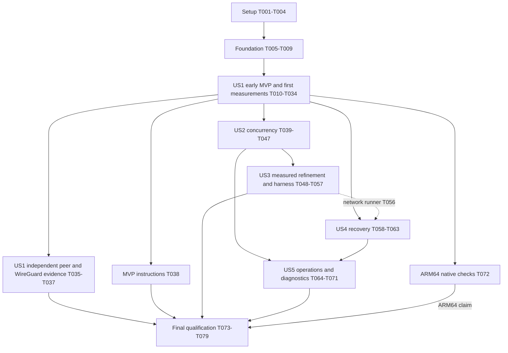

# Tasks: Remora MASQUE UDP Tunnel

**Input**: Design documents from `/specs/001-masque-udp-tunnel/`.
**Prerequisites**: [plan.md](plan.md), [spec.md](spec.md), [research.md](research.md), [data-model.md](data-model.md), [wire](contracts/masque-wire.md), [configuration](contracts/cli-config.md), [diagnostics](contracts/diagnostics.md) and [benchmark](contracts/benchmarks.md) contracts; constitution v1.0.0 and ADR-0001–0004.
**Created**: 2026-10-11. Completed tasks are marked only after their scoped checks; unchecked tasks remain planned work. Phase 1 completion is not tunnel or release acceptance.

**Tests**: Automated verification of every behavioral change and relevant failure modes is mandatory under Constitution V and review correction R6. No TDD ordering was requested: implementation and its checks follow actual dependencies, and applicable checks must pass before accepting an increment. Pure documentation receives static review. Never substitute self-interoperation or source inspection for independent interoperability or measured performance.

**Organization**: Setup and a small foundation precede five story phases in specification priority order. The first authenticated end-to-end MVP and immediate reproducible measurements are an internal checkpoint of US1; independent-peer/WireGuard qualification follows that checkpoint. Later tasks complete concurrency, performance, recovery and operations. Numeric targets remain release acceptance criteria; unmet early targets inform further work and do not halt normal development. ARM64 availability does not block initial x86_64 work.

## Format: `[ID] [P?] [Story] Description`

- All tasks start unchecked, with globally sequential IDs.
- `[P]` identifies work on separate files that can run together **after the named prerequisites**; it never overrides a dependency or authorizes concurrent edits to shared production modules.
- `[US1]`–`[US5]` map to the specification's stories. Setup, foundation and final tasks have no story label.
- File paths are repository-relative and exact; they identify files to create when absent. Use the current design artifacts for the complete referenced contract, not just the quoted constraint.
- Tests under `tests/<domain>/` are registered through `tests/<domain>.rs`; reusable fixture support lives in `tests/common/mod.rs`. The traffic tool is a separate test-only Rust package, and interoperability uses a separate Go module. Production remains one Rust package and one executable.

## Phase 1: Setup (Shared Infrastructure)

**Purpose**: Establish the reproducible x86_64 development path and assess existing I/O reuse before adding unsafe code.

- [X] T001 Initialize the single production package in `Cargo.toml`, `Cargo.lock`, `rust-toolchain.toml`, `src/lib.rs` and `src/main.rs`: Rust 1.99.0/edition 2024, quiche =0.30.0/BoringSSL, Tokio 1.53.2 current-thread features and the justified dependencies in research; declare Linux GNU x86_64/aarch64 targets without making ARM64 execution a setup prerequisite, and keep optional qlog disabled by default.
- [X] T002 [P] Record pinned C/C++/CMake/BoringSSL build prerequisites, build-image inputs and locked release commands in `tools/build/Dockerfile` and `docs/build.md` after T001; document how each input is reproduced without runtime privileges or changes to operator hosts.
- [X] T003 [P] Create native x86_64 locked build, rustfmt, Clippy `-D warnings` and implemented-contract test jobs in `.github/workflows/ci.yml` after T001; register the test entry points in `tests/protocol.rs`, `tests/io.rs`, `tests/security.rs`, `tests/lifecycle.rs` and `tests/e2e.rs`, with explicit reporting for privileged checks that run separately.
- [X] T004 [P] Assess the exact compatible Cloudflare datagram-socket source for truncation, mmsg, pktinfo/source selection and PMTU/error handling; record reusable parts versus the necessary local syscall boundary in `docs/adr/0002-runtime-and-linux-io.md` after T001, without adding another runtime/backend or claiming measured superiority.

**Checkpoint**: Locked project and x86_64 checks exist; the Linux adapter's reuse decision is documented. T002–T004 may proceed together after T001.

**Phase 1 evidence (2026-10-11)**: T001–T004 completed. Native x86_64 and the pinned build container passed locked release build, rustfmt, Clippy with warnings denied, and all-feature test-target compilation/execution (zero behavioral tests at this setup stage). The Dockerfile built successfully; its check commands ran with an unprivileged UID and read-only dependency cache. CI is configured but no hosted CI run is claimed. See [build evidence](../../docs/build.md) and [I/O assessment](../../docs/adr/0002-runtime-and-linux-io.md#phase-1-datagram-socket-reuse-assessment). At that checkpoint T005 onward remained unchecked; requirements-checklist markers were unchanged.

## Phase 2: Foundational (Blocking Prerequisites)

**Purpose**: Supply only validated settings, bounded storage, safe diagnostic primitives and test fixtures required by the first forwarding increment.

- [X] T005 Implement typed schema_version=1 settings and secure file loading in `src/config.rs` using the CLI/config contract: exactly one role, reject unknown fields/versions, relative paths, loopback exposure opt-in, regular private files checked at secure open without symlink substitution, canonical token text, PEM validation and checked numeric/FD-derived budgets; accept offload off/auto independently of implementation availability as the config contract requires; preserve the model constraint "Immutable after startup; restart replaces an entire policy generation" and expose no secret-bearing CLI/environment overrides.
- [X] T006 Implement the application/ciphertext/scratch pool and count/byte/FD/setup ledgers in `src/buffers.rs`, using contract defaults 8 MiB/4 MiB/2 MiB and explicit native DATAGRAM budgets; carry datagram offsets, lengths, directions, generations and deadlines under "Opaque bytes; zero length valid; no per-packet secret/payload diagnostic fields" and ledger constraint "Single-owner accounting; checked allocation/return, no saturating arithmetic hiding overshoot"; charge retained capacity before allocation and return ownership exactly once.
- [X] T007 [P] Establish fixed failure/drop enums, opaque process-scoped IDs, JSON event/snapshot schema and nonblocking writer primitives in `src/diagnostics.rs` after T005–T006: stdout status/stderr events, ordinary 20 events/s with burst 40, 1 MiB/1024-record queue with 256 KiB/256-record status reservation and a total 2 MiB diagnostic ceiling; prohibit raw config/header/payload/peer-error formatting and forwarding arbitrary upstream trace targets.
- [X] T008 [P] Build reusable fake-clock/scripted-I/O and child-process fixture support in `tests/common/mod.rs`, plus `scripts/validate/fixtures.sh`, after T005–T006: generated local CA/DNS SAN remora.test, random private token and canonical-text digest, explicit target permission, unique unprivileged ports, mode-0700 output directory, mode-0600 private files, no overwrite of existing directories and bounded runner-owned cleanup.
- [X] T009 Add foundation tests in `tests/security/config.rs`, `tests/io/buffers.rs` and `tests/security/diagnostic_primitives.rs` after T005–T008 for schema/permissions/symlink and arithmetic failures, zero-length/slab ownership, count-and-capacity exhaustion, queue reservations, safe error text and all-level secret sentinels; connect them to the registered test entry points and run the applicable x86_64 checks before accepting the foundation.

**Checkpoint**: The first story can use validated immutable configuration, finite storage, privacy-safe output and deterministic fixtures. Full telemetry, optional qlog/offloads, independent-peer matrices and ARM64 qualification are not foundation prerequisites.

**Phase 2 implementation evidence (2026-10-11, before independent review)**: The implementation originally recorded T005–T009 as completed. Native x86_64 and the updated pinned build container passed locked release build, rustfmt, Clippy with warnings denied and 33 unit/component/property/security tests. The fixture script passed shell syntax and real CA/SAN/private-file/no-overwrite checks. See [foundation validation](../../docs/validation/phase2.md) and [ADR-0005](../../docs/adr/0005-foundation-primitives.md). T010 onward remains unchecked; requirements-quality checklist markers are unchanged. CLI/forwarding, complete failure correlation, independent interoperability, benchmarks and ARM64 qualification are not claimed.

**Phase 2 independent review snapshot (2026-10-11, before corrections)**: Foundation acceptance was incomplete. Retain T005–T007; reopen T008 for surviving child-process descendants (F1), and T009 for the cleanup regression and missing configuration-parser property/fuzz coverage (F2). See the [full read-only review](../../docs/validation/phase2-review.md). Existing 33-test native/container passes remain historical evidence. All 40 readiness and 16 specification-quality criteria remain satisfied; they certify written requirements, not implementation acceptance. Correct F1/F2 and rerun affected checks before marking T008/T009 complete.

**Phase 2 correction evidence (2026-10-11)**: F1/F2 are corrected and T008/T009 complete again. Owned-group cleanup now observes leader exit without reaping, signals the group while its identifier is reserved, then reaps; four regression tests cover success/failure, timeout, Drop and invalid-deadline cleanup. Eight bounded parser properties cover config/credentials, host/authority and CIDR semantics. Native x86_64 and the existing pinned container passed locked release build, rustfmt, Clippy with warnings denied and all 45 tests. The successful-leader regression fails against the pre-fix guard in a scratch copy and passes against the fix. See [resolution evidence](../../docs/validation/phase2.md#review-finding-resolution). This closes the foundation checkpoint by implementation verification; no second independent audit is claimed. Requirements-quality markers and the original review report remain unchanged. T010 onward remains unchecked.

## Phase 3: User Story 1 — Securely Relay an Existing UDP Application (Priority: P1) — Early MVP

**Goal**: Deliver an authenticated application-agnostic client/server path, with correct unreliable forwarding and immediate reproducible baseline measurements.

**Independent Test**: An unprivileged client/server pair exchanges unchanged generic UDP payloads in both directions, including empty and maximum supported payloads, and negative cases produce zero monitored unauthorized destination datagrams. Two-stream close/EAGAIN and bounded diagnostics checks accompany first forwarding. Later in this phase, both independent peer directions and independently prepared WireGuard peers verify the supported profile.

### Implementation and required verification

- [ ] T010 [US1] Implement credential verification, target canonicalization, default-deny rules and bounded asynchronous resolution in `src/policy.rs`: constant-time SHA-256 comparison of canonical ASCII token text; enforce "Identity unique in config; token secret loaded only by client, digest only by server; identity not an unbounded metric label", "Exact host/port rule plus resolved-address permission; wildcard host/port permissions excluded initially" and "One pinned address/session; all DNS answers authorized before selection; no automatic target change"; normalize case/trailing dots and enforce "DNS names are ASCII canonical form; non-ASCII/zone identifiers and ambiguous numeric forms are rejected in v1." and "IP literals use standard parsed addresses, including normalized mapped addresses."; preserve "Port 1..65535; no multicast/broadcast/unspecified targets. Loopback/private/link-local require explicit numeric permissions; unscoped IPv6 link-local is rejected."
- [ ] T011 [P] [US1] Add policy unit/property and deterministic resolution tests in `tests/security/policy.rs` after T010 for missing/invalid/revoked tokens, canonical text versus decoded-byte hashing, duplicate IDs/digests, exact host/port/CIDR permissions, aliases, private/loopback/link-local, mixed/changed DNS answers, resolution failure/timeout/cancellation and ignored stale-generation completion.
- [ ] T012 [P] [US1] Implement CONNECT-UDP URI, required headers, request validation, HTTP Datagram encoding/demultiplexing and response acceptance in `src/masque.rs` after Phase 2: RFC 9298/RFC 6570 template constraints, encode/decode once, canonical default route and IPv6 substitution, bounded unique pseudo/auth headers, documented HTTP rejection statuses, informational responses and only valid final 2xx excluding 204/205/206; reject Content-Length (including zero), Content-Type and Transfer-Encoding with H3_MESSAGE_ERROR before eligibility, parse capsule-protocol Boolean/parameters/absence according to the wire contract (R2), and validate checked quarter-stream/Context ID framing before routing any HTTP Datagram.
- [ ] T013 [P] [US1] Add request/response/datagram codec contract and property tests in `tests/protocol/masque.rs` after T012 for template validation, encoding attacks, v4/v6 literals, duplicate/forbidden fields, 1xx/final status handling, all R2 negatives, absent/invalid capsule-protocol compatibility, checked quarter-stream association (H3_DATAGRAM_ERROR), truncated Context ID counted discard, unknown context and exact Context 0 payload/empty boundaries.
- [ ] T014 [US1] Implement bounded incremental Capsule parsing in `src/masque.rs` after T012: checked varints/association arithmetic, unknown-type streaming skip, complete Context ID within DATAGRAM Capsule length, Context 0 payload bound 65527 before unsupported-carrier discard, H3_MESSAGE_ERROR for malformed/incomplete FIN, H3_DATAGRAM_ERROR for the selected oversized semantic case, and continuation after fully skipped valid capsules without reliable payload forwarding (R3).
- [ ] T015 [P] [US1] Add Capsule fragmentation/property and conformance tests in `tests/protocol/capsules.rs` after T014: split at every byte, declared huge length without allocation, missing/truncated Context ID, incomplete FIN on skip paths, Context 0 lengths 65527/65528 at different varint widths, unknown-context semantics and valid unsupported carrier followed by another valid capsule; assert bounded retained state and no payload forwarding.
- [ ] T016 [US1] Implement the selected safe Linux socket/mmsg interface in `src/udp.rs` after T004 and Phase 2: nonblocking separate v4/v6/IPV6_V6ONLY sockets, recvmsg/sendmsg comparison path and recvmmsg/sendmmsg batch default 32/range 1..64, immediately available receive batches, pktinfo source/local metadata, RX overflow deltas, explicit kernel buffers, no-fragment PMTU policy and a reviewed CLOCK_MONOTONIC timerfd create/rearm/read interface; for deferred offloads accept auto with effective off/not_implemented, distinguish configured off, and do not fabricate capability probes; retain suffix after partial prefix sends/EAGAIN and reset reusable headers; document every unsafe necessity/borrow/alignment/lifetime invariant, including relay constraint "One live session; receives only configured peer; closure invalidates the association and releases resources within bounded cleanup".
- [ ] T017 [P] [US1] Add real Linux syscall and scripted error tests in `tests/io/linux_udp.rs` after T016 for zero-length UDP, partial acceptance, EAGAIN/EINTR/hard errors, mutable-header reuse, MSG_TRUNC/MSG_CTRUNC/malformed ancillary input, wildcard pktinfo/source selection, separate families, wrong-peer filtering, requested/effective kernel buffers, overflow wrap, timerfd deadline/rearm semantics, deferred-auto/configured-off state reporting without a capability probe, and EMSGSIZE without duplicate submission; document runner requirements for kernel-induced cases that cannot execute in ordinary CI.
- [ ] T018 [US1] Implement the public quiche QUIC/H3 adapter in `src/transport.rs` after T010/T014/T016: verified CA+server_name TLS before sending secrets, h3 ALPN, DATAGRAM/Extended CONNECT/settings processing, 0-RTT disabled, explicit queue/byte/control/window/QPACK limits, CUBIC and pacing, receive/send outer caps and PMTU/path events; process valid GOAWAY cutoffs by stopping excluded/new requests while existing accepted flows drain (replacement is completed in T059); bounded CID routing/issuance/retirement, HMAC Retry expiry/address/original-DCID validation and anti-amplification; preserve "One owner; connection generation never reused; request stream IDs unique within its connection" and disable active migration while allowing supported validated rebinding.
- [ ] T019 [P] [US1] Add transport/settings/admission tests in `tests/protocol/transport.rs` after T018 for verified/mismatched/expired/untrusted TLS, no credentials before trust, missing/late settings, absent required capabilities, early-data denial, malformed/unknown/version/undersized Initials, Retry expiry/address/DCID tampering, CID updates, finite source/admission state, H3/control limits and actual local/remote address metadata; include initial GOAWAY cutoff handling, refusal of new/excluded requests, accepted lower-ID stream continuation and no reassignment/replay before the MVP checkpoint, without requiring replacement recovery.
- [ ] T020 [US1] Implement sender-to-request and identity-to-relay state in `src/session.rs` after T010/T018: "One mapping/process initially; source tuple plus listener_id identifies local flow; fixed-size client latch survives flow cleanup until controlled restart", client "Starting -> AwaitingAcceptance -> Active" and server "Starting -> Authenticating -> Authorizing -> Active", and "Client map (listener_id, source IP/port) -> live generation; server map (connection generation, stream_id) -> accepted identity/target/socket"; allocate a distinct connected relay only after auth/policy, pin its approved target, keep setup traffic dropped/counted, set the permanent-rejection latch and use the 120000 ms valid-UDP inactivity default.
- [ ] T021 [US1] Implement the exclusive-owner current-thread loop in `src/reactor.rs` after T018/T020: AsyncFd readiness, bounded setup completions, rotating socket/session/connection work (32 per service visit, 256 total before timer/cancellation checks), explicit continuation on budget exhaustion, readiness clearing only on EAGAIN and reserved control/timer work; CLOCK_MONOTONIC timerfd schedules earliest pacing/transport/setup/expiry/stop deadline, with checked Instant-to-clock conversion and no busy spin or waiting to fill batches.
- [ ] T022 [US1] Integrate commitment, queue expiry and cancellation in `src/reactor.rs`, `src/transport.rs`, `src/session.rs` and `src/buffers.rs` after T021 (R1): purge a closing stream's cancellable native DATAGRAMs before next packet generation with a validated association predicate; enforce 20 ms application residence including conservative earliest-expiry purge of native queues; reserve ciphertext before quiche send and obey "Successful packet generation is transport commitment; immutable connection-owned output may mix streams/control, survives individual session close only on its original generation; FIFO and <=100 ms residence, never recreated or selectively rewritten"; honor SendInfo.from/to/at, unchanged generation-time deadline and exact accepted prefix, fail a truly output-stalled connection, and discard unsent old-generation output on replacement/stop.
- [ ] T023 [P] [US1] Add deterministic two-stream lifecycle/reactor tests in `tests/lifecycle/commitment.rs` and `tests/lifecycle/reactor.rs` after T022: close/expiry before generation discards cancellable data; close after generation with EAGAIN/partial sends preserves immutable mixed output only on its original association/deadline; no rewrite, packet recreation, unrelated-flow close or cross-generation replay; include blocked-cwnd native expiry, reserved control servicing, future pacing, edge-triggered continuation, late callbacks and shutdown during setup.
- [ ] T024 [US1] Wire the client/server/check-config/version/help commands and forwarding path in `src/main.rs` and `src/lib.rs` after T022: contract exit codes, safe bind defaults, no check-config network activity, no relay traffic before server acceptance commitment or client valid acceptance, dynamic negotiated payload ceiling, unchanged datagram boundaries including empty payloads, best-effort counted drops and graceful signal cancellation; expose none of the excluded VPN/fallback/admin features.
- [ ] T025 [US1] Integrate MVP counters, live failure classes and terminal status in `src/diagnostics.rs`, `src/reactor.rs` and `src/session.rs` after T024 (R5): record failures before cleanup/log attempts with "Fixed 256-entry ring within 64 KiB; independent of log bucket; completed output retires acknowledged entries, overflow is explicit coverage loss, not unbounded history" and snapshot constraint "No credentials, headers, payloads, user source tuples or target names; period one second; status queue reservation and writer acknowledgement preserve terminal correlation under ordinary event suppression"; keep one <=256 KiB status batch in flight, <=64 KiB chunks, coalesce only repeated same classes, retain newer updates across old ACKs and account all status/format/ACK storage within the 512 KiB non-qlog reservation.
- [ ] T026 [P] [US1] Add initial diagnostic correlation/privacy/bounds tests in `tests/security/diagnostics.rs` after T025 for all levels and supplied secrets/payloads, short-lived failures after event-bucket exhaustion and cleanup before snapshot, distinct pending classes, old ACK versus updated summary, reserved writer space and blocked/broken sink; require complete class/session correlation with zero coverage loss for in-capacity collection and explicitly failed/invalid coverage with bounded state for deliberate overflow.
- [ ] T027 [P] [US1] Build independent-direction test traffic generation/collection and a generic responder in `tools/traffic/Cargo.toml`, `tools/traffic/Cargo.lock` and `tools/traffic/src/main.rs` after Phase 2: commands for responder/sender/receiver, fixed test-only session/sequence/integrity payloads, empty/mixed sizes, one/32 sessions, independent simultaneous streams, sparse RTT probes, duplicate/reorder/corruption and generator-failure accounting; production Remora never interprets these payload fields.
- [ ] T028 [US1] Implement the test-only unencrypted client/server relay baseline in `tools/traffic/src/baseline.rs` after T027, wired through `tools/traffic/src/main.rs`: same two-leg role locations, destination/session association, I/O mode, limits/buffers and diagnostic settings as the tunnel; support both directions independently and simultaneously without using an echo-only capacity baseline or a shorter route.
- [ ] T029 [US1] Implement the early benchmark runner in `scripts/validate/bench.sh`, `tools/traffic/src/measurement.rs` and `benchmarks/mvp-x86_64.toml` after T028: immutable per-run manifest/counters/histogram/samples/summary, revision/locks/hardware/path/config/diagnostic settings and requested/effective offload states/reasons, optional frozen regression-policy/reference fields (absent for the first baseline), offered versus delivered traffic, RTT/CPU/RSS/drop statistics and owner-thread CPU/headroom; allow explicitly declared short/one-session MVP coverage, preserve failed/invalid results and never label it a full SC pass.
- [ ] T030 [P] [US1] Add benchmark-tool tests in `tools/traffic/tests/accounting.rs` after T029 for unique sequence accounting, datagram integrity, direction separation, probe/sample percentiles, declared drain window, generator enqueue failures and matching baseline/tunnel manifests; assert tools flag invalid topology/coverage rather than manufacture capacity or loss evidence; regression comparison fixtures reject missing/unmatched references or unfrozen policies, while initial baseline runs make no regression claim.
- [ ] T031 [P] [US1] Implement unprivileged process smoke/forwarding tests in `tests/e2e/forwarding.rs` and `scripts/validate/e2e.sh` after T024/T025/T027: local CA fixtures, IPv4/IPv6, empty/mixed/boundary sizes, two isolated senders, exact bidirectional byte/boundary equality, counted first-packet/setup loss, rejection/close behavior, no startup deadlock and complete runner-owned cleanup; runners implement the quickstart's `--fixtures`/`--scenario` interface.
- [ ] T032 [P] [US1] Implement monitored negative process tests in `tests/e2e/security.rs` after T024/T025/T027 for the applicable SC-002 matrix: missing/bad/revoked credential, trust mismatch/expiry/untrusted CA, forbidden/private/aliased/mixed/changed-DNS target, early-data attempts, malformed request and missing capabilities; capture controlled target traffic to require zero unauthorized datagrams and scan collected output for secret/payload sentinels.
- [ ] T033 [US1] Complete the first-forwarding x86_64 checks and explicit protocol/security/unsafe-boundary review in `scripts/validate/mvp.sh` and `docs/validation/mvp.md` after T009/T011/T013/T015/T017/T019/T023/T026/T030/T031/T032: locked build, formatting, Clippy and applicable automated tests; record revision, outcomes and unresolved evidence, including R1–R3/R5 and initial GOAWAY tests, without spawning the independent reviewer automatically or claiming broader release qualification.
- [ ] T034 [US1] Run and preserve the first paired x86_64 baseline/tunnel measurements in `benchmarks/results/mvp-x86_64/` with `scripts/validate/bench.sh` immediately after T033: each direction separately and simultaneous, delivered throughput/loss/RTT/CPU/RSS plus owner headroom, exact coverage/interval/topology and unmet targets; record pre-change reference variability and establish prospective workload-specific throughput/loss/p95 RTT/CPU/RSS regression bounds in the comparison manifest before subsequent critical-path changes, following the benchmark contract rather than inventing values now; document bottlenecks and next engineering choices in `docs/performance.md`, with no separate prototype, ARM64 dependency or retrospective target relaxation.

**Early MVP checkpoint (T034)**: Authenticated generic-UDP forwarding, enforceable isolation, first-forwarding contract tests (including initial GOAWAY), finite resources and safe status work on x86_64; reproducible early measurements exist. Continue normal implementation when release targets remain unmet. Optional qlog/offloads, full independent/WireGuard matrices and ARM64 evidence follow this checkpoint.

**Deferred US1 qualification (T035–T037)**: Implement/run these tasks when their prerequisites are available. A missing independent peer/toolchain or independently prepared WireGuard fixture may leave the corresponding qualification task unchecked with the limitation recorded; it does not prevent dependency-ready T039/T058 or publication of T038 after the checked T034 milestone. A failing check of implemented behavior is not missing external qualification and must be corrected before accepting its increment. The full US1/SC-001/FR-026 claims and final qualification still require the relevant evidence (or the explicitly allowed independent-peer limitation with alternative evidence); no unavailable test is counted as passed.

- [ ] T035 [P] [US1] Create the independent Go fixture in `tools/interop/go.mod`, `tools/interop/go.sum` and `tools/interop/main.go` after T034: Go 1.27.2, masque-go c1cf0e4dd6439aea94d5491b27439a4736f00246 and quic-go 0.63.0, both roles with compatible Bearer/target policy and normal CA validation; use Transport.DialAddr for numeric loopback dialing while retaining ServerName remora.test/RootCAs, and leave all wire framing to the independent libraries.
- [ ] T036 [US1] Implement and run both-role independent compatibility cases in `scripts/validate/interop.sh` and `tests/protocol/interop_cases.rs` after T035: positive v4/v6/empty/mixed/max/multiplexed traffic and the benchmark contract's role-specific negatives/settings/profile limits, plus R2/R3 conformance injections; record actual target byte/boundary evidence and peer/module/toolchain hashes in `docs/validation/interop.md`, with explicit limitations/alternative evidence if a required peer case is unavailable.
- [ ] T037 [P] [US1] Implement a runner for independently prepared WireGuard peers in `scripts/validate/wireguard.sh` and its operator-owned fixture interface in `docs/wireguard.md` after T034: verify handshake and bidirectional traffic for 30 minutes using peer counters and Remora evidence, document effective-payload MTU and external prerequisites, and never configure existing peers/keys/routes/firewalls from Remora; record generic UDP and WireGuard SC-001 results in `docs/validation/application-compatibility.md`.
- [ ] T038 [US1] Publish the working MVP build/run instructions and supported wire/trust/UDP guarantees in `README.md` and `specs/001-masque-udp-tunnel/quickstart.md` after T034 without waiting for external qualification; publish pending T035–T037 evidence explicitly and incorporate results as available (final documentation is T079); distinguish verified cases from pending release evidence, setup first-packet loss, committed-output recall limits and indistinguishable external UDP replies after tuple reuse/restart, with no fixed quarantine promise.

**US1 status**: The first implemented increment is accepted at T034 with its stated coverage; complete US1 qualification requires T035–T037 evidence, with a documented independent-peer limitation/alternative only where the specification permits it. Record pending qualification separately and retain its unchecked markers. Full performance and platform claims await final qualification; development follows the declared checkpoint graph.

## Phase 4: User Story 2 — Run Concurrent Sessions Without Interference (Priority: P1)

**Goal**: Complete 32-session isolation, bounded admission/churn and progress for admitted flows, extending the MVP's existing safe associations.

**Independent Test**: Thirty-two tagged sessions across multiple clients, senders and credentials share/distinguish destinations with zero cross-delivery. Closing, overloading or recreating one association leaves others usable. Ten-minute configured-budget saturation preserves ceilings and SC-009 probe progress without saturating the external link.

### Implementation and required verification

- [ ] T039 [US2] Complete concurrent session/identity/connection/setup/relay-FD admission and generation-safe cleanup in `src/session.rs`, `src/policy.rs` and `src/buffers.rs` after T034: count pending/active/cleanup against global limits, preserve one connected target socket per accepted stream and all quoted model relationships, reject newest arrivals on full queues and release closed associations without quarantine or retained payload reassignment; retain the fixed mapping rejection latch while accepted unrelated flows continue.
- [ ] T040 [US2] Extend scheduling/admission integration in `src/reactor.rs` and `src/transport.rs` after T039 for per-session deficit/round-robin progress before the small shared native queue, bounded connections/source buckets and setup work, reserved control servicing and per-connection output FIFO; a session fault must not close unrelated streams, while genuine shared-connection failure affects only that connection's flows.
- [ ] T041 [US2] Complete application-idle expiry in `src/session.rs` and `src/reactor.rs` after T040 (R4): 120000 ms of valid UDP activity in either direction, keepalives excluded, joint stream/socket close and bounded closed-resource reclamation distinct from idle retention; validate positive finite overrides and document shorter values as RFC SHOULD deviations with operational rationale.
- [ ] T042 [P] [US2] Add lifecycle/property/component tests in `tests/lifecycle/sessions.rs` after T041 for admission/debit/credit invariants, source/stream/connection generation uniqueness, duplicate/stale events, cancellation during DNS/cleanup, mapping latch surviving source churn and reconnect, sparse UDP activity inside two minutes, keepalive-only expiry, unrelated flow progress and joint stream/socket release.
- [ ] T043 [P] [US2] Add 32-session process isolation cases in `tests/e2e/concurrency.rs` after T041, wired to the existing concurrency runner: multiple processes/listener senders/credentials, identical and distinct destinations, both directions, reset/closure/individual overload and recreated flows; verify tagged byte equality and zero cross-delivery across live associations.
- [ ] T044 [P] [US2] Add controllable old-reply/stale-work cases in `tests/lifecycle/udp_reuse.rs` after T041 and document observed reuse behavior in `docs/adr/0001-transport-profile.md`: assert rejection of identifiable old queued responses/callbacks/closed-stream data, separately characterize indistinguishable authorized replies after tuple reuse/restart and same-tuple application restart, and never assert impossible unconditional external provenance or a 30-second quarantine guarantee (A1).
- [ ] T045 [P] [US2] Add admission/queue/malformed-input saturation and low-rate probe scenarios in `tests/e2e/overload.rs` after T041: 128-byte probes at one request/s/session, 10-minute budget saturation, finite diagnostics/FD/setup/queue state and >=99% responses within 1 second for each admitted probe under the responsive reference path, preserving exact failures and excluding external link exhaustion from the claim.
- [ ] T046 [P] [US2] Add 1000-cycle session churn and reclamation accounting in `tests/e2e/churn.rs` after T041: retained slab/native/control/diagnostic capacities and kernel socket memory recorded separately, bounded cleanup interval <=60 seconds, stable counts and no leaked FDs/listeners; report RSS against the warmed baseline and unchanged <=10 MiB release criterion rather than hiding retained capacity.
- [ ] T047 [US2] Run the US2 isolation/overload/churn suites and 30-minute isolation scenario through `scripts/validate/e2e.sh`, preserving revision/config/counters/outcomes in `docs/validation/concurrency.md` after T042–T046; investigate any unauthorized/cross-delivered traffic or unbounded growth before accepting the increment, compare affected implemented workloads against their frozen pre-change regression reference, and feed owner/control/fairness bottlenecks and regression outcomes into the existing performance record.

**Checkpoint**: US2's active/stale association guarantees and resource invariants are checked; external UDP provenance limits remain explicit. US2 needs the MVP checkpoint, not independent-peer or WireGuard tool availability.

## Phase 5: User Story 3 — Sustain Fast Bidirectional Traffic (Priority: P1)

**Goal**: Complete size/congestion behavior and the full reproducible performance methodology; refine the datapath from observed evidence.

**Independent Test**: Matching direct/tunnel runs distinguish separate and simultaneous directional throughput/loss/RTT, and size/impairment tests preserve payloads and responsiveness. The final candidate must meet SC-003/004/005/007 per run on each claimed target; early failures remain visible and guide engineering.

### Implementation and required verification

- [ ] T048 [US3] Complete changing outer/target payload ceilings and error-queue PMTU handling in `src/udp.rs`, `src/transport.rs` and `src/reactor.rs` after T047: query current writable DATAGRAM capacity and subtract only association/context prefixes, enforce configured/destination limits at enqueue and actual relay send, keep outer probes separate from application drops, reject complete outer messages above receive cap and prevent IPv4/IPv6 fragmentation without reliable fallback.
- [ ] T049 [P] [US3] Add dynamic-size/PMTU/burst/congestion tests in `tests/io/pmtu.rs` and `tests/e2e/sizes.rs` after T048: empty/at/above limits, path reduction between enqueue and send, EMSGSIZE and malformed metadata, blocked cwnd expiry, corruption/truncation/private-fragment prohibition and separate local/kernel/outer-loss counters.
- [ ] T050 [US3] Profile the working x86_64 path and run paired single-vs-mmsg, batch 1/8/16/32/64, CUBIC-vs-explicit bbr2_gcongestion (Reno diagnostic), pool/queue and pacing experiments through `scripts/validate/profile.sh` and `benchmarks/experiments.toml` after T048/T034; freeze the pre-change revision/manifest, workload-specific metric bounds, units and comparison/noise method before any candidate datapath change (T051); record syscalls/wakeups/allocations/copies, owner-thread CPU/headroom, 32-session fairness/control servicing, queue age, burst/lateness and delivery/resource trade-offs in `docs/performance.md` before selecting changes.
- [ ] T051 [US3] Implement only justified measured datapath refinements in `src/udp.rs`, `src/buffers.rs` and `src/reactor.rs` after T050, updating `docs/adr/0002-runtime-and-linux-io.md`: if outer GSO/GRO is selected, probe per socket/path, use only compatible already-due groups <=64 segments with optional shorter last segment, retain group ownership through partial/failing submission and split validated GRO in bounded 64 KiB scratch before quiche; otherwise accept auto with effective off and fixed reason not_implemented, without a capability probe or a hardware-unavailable claim; implemented auto reports requested/effective state and capability_unavailable/path_ineligible/enabled as appropriate. Sharding/io_uring/SO_TXTIME/backend changes require a recorded need and prospective ADR, not a mandatory implementation detour.
- [ ] T052 [P] [US3] Add targeted regression/offload ownership and fallback tests in `tests/io/offloads.rs` after T051: exercised selected changes, unknown/malformed GRO ancillary data, empty/mixed/probe/future-deadline baseline paths, logical segment versus syscall accounting, deferred implementation versus actual capability failure, requested/effective modes and fixed reason reporting without fabricated probes, EMSGSIZE, accepted-prefix preservation and no duplicate replay; compare off/auto natively only where implemented/supported, and mark unsupported cases explicitly.
- [ ] T053 [US3] Extend the runner/harness in `scripts/validate/bench.sh`, `tools/traffic/src/measurement.rs` and `benchmarks/reference-x86_64.toml` after T050 for the complete benchmark contract: one/32 sessions; 128/512/1200 bytes; matching separate/simultaneous sustainable baselines at <=0.1% loss; declared 1% bottleneck search steps; 50% subcapacity loss/RTT runs; >=five paired repetitions with randomized order, 60-second warmup/five-minute measurement, spread/sample counts, 500 Mbit/s/direction resource load and 1000-cycle churn.
- [ ] T054 [P] [US3] Add deterministic benchmark-result validation tests in `tools/traffic/tests/results.rs` after T053: each applicable run separately enforces >=80% throughput, <=0.1 percentage-point added loss, <=5 ms added p95 RTT, per-role peak RSS <=128 MiB/average CPU <=2 cores and churn <=10 MiB/<=60 seconds; fail/invalid on generator saturation, wrong topology/diagnostics, insufficient samples/pairs or bad clock evidence, with no averaging away failures or retrospective thresholds; validate separately frozen regression reference/policy and per-metric bounds, rejecting missing/unmatched evidence and preserving failed/inconclusive comparisons without changing SC criteria.
- [ ] T055 [US3] Run post-refinement paired x86_64 regression measurements with `scripts/validate/bench.sh`, retaining selected optimization A/B evidence in `benchmarks/results/refinement-x86_64/` after T049/T052/T054; compare against the frozen pre-change revision/reference-manifest selected before T051 (using T034 only when still applicable), enforce its predeclared per-metric regression bounds under matching workload/settings, preserve unsuccessful choices/results, and record remaining release-target gaps and next actions in `docs/performance.md`. Full final-revision reference qualification remains T077.
- [ ] T056 [P] [US3] Implement isolated network scenario setup/teardown in `scripts/validate/network.sh` after T048: controlled 1 Gbit/s/20 ms reference path plus 50/100 ms RTT, 0.1%/1% loss, asymmetry, bursts and reduced MTU, requiring capabilities only for runner-owned namespaces; record all qdisc/NIC/offload settings, reject generator/link mismatch, and never change production/operator network state.
- [ ] T057 [US3] Run size/impairment characterization through `scripts/validate/network.sh` after T049/T056, preserving outcomes in `docs/validation/network.md`: payload integrity, counted loss/pressure, responsive timer/control work and effective PMTU; disclose environment limits and avoid extending reference throughput guarantees to every impaired path.

**Checkpoint**: The measured datapath and complete reference methodology exist. First MVP measurements have already occurred; optional accelerations are evidence-driven. Full numerical qualification applies to the final release revision.

## Phase 6: User Story 4 — Recover After Connectivity Interruptions (Priority: P2)

**Goal**: Preserve local listeners, recover only through renewed trust/auth/policy, and bound unavailable traffic and retry work.

**Independent Test**: A 10-second blackhole/server restart is detected <=15 seconds from failure onset; new traffic resumes <=10 seconds after continuous restored availability, using the same listener without replay. Address changes and longer outages remain bounded; permanent identity/credential/policy/capability failures remain denied.

### Implementation and required verification

- [ ] T058 [US4] Complete client recovery state/timers in `src/session.rs`, `src/transport.rs` and `src/reactor.rs` after T034: "Starting -> Handshaking -> Negotiating -> Active", transient "Active/Handshaking/Negotiating -> Recovering -> Handshaking" with new generations, permanent Rejected scope and "Stopping -> Stopped"; preserve listeners, discard unavailable traffic/old state, revalidate all security, quiche 5000 ms idle/PTO rules, 2000 ms paced active-flow keepalive, 10000 ms authenticated-peer-progress watchdog, 5000 ms setup deadlines and 100 ms floor plus capped jitter <=2000 ms/<=10 attempts per second/one handshake in flight.
- [ ] T059 [US4] Implement GOAWAY draining and replacement request placement in `src/transport.rs` and `src/reactor.rs` after T058: respect stream-ID cutoff, keep accepted lower-ID flows on their original bounded draining connection, count draining and primary against global budgets, move only new/excluded requests to a fresh verified connection and never replay rejected/setup/outage payloads; distinguish validated NAT rebinding from fresh network-address recovery.
- [ ] T060 [P] [US4] Add fake-clock/scripted-I/O recovery tests in `tests/lifecycle/recovery.rs` after T059 for minimal RNG jitter/floor/capped exponent, repeated PTO/probe sends without authenticated progress, finite deadlines, permanent mapping latch despite cleanup/new senders, accepted unrelated streams, GOAWAY cutoffs/draining, replaced generations, cancellation and idle-versus-application activity separation.
- [ ] T061 [P] [US4] Add process/network recovery scenarios in `tests/e2e/recovery.rs` and `scripts/validate/recovery.sh` after T059/T056: blackhole/restart/address change/long outage, exact SC-006 timing origins, unchanged listener, zero outage replay, renewed TLS/auth/policy and revoked/permanent rejection remaining denied; wire the existing e2e recovery scenario to this runner and preserve measured outcomes in `docs/validation/recovery.md`.
- [ ] T062 [P] [US4] Add signal/shutdown tests in `tests/e2e/shutdown.rs` after T059: SIGINT/SIGTERM during Starting/Active/Recovering/setup, stop admission immediately, cancel all setup/retry work, discard unsent old ciphertext without extra transmission promises, consume writer flush within the shared <=5-second budget and verify released listeners/FDs/children; wire the e2e shutdown scenario.
- [ ] T063 [US4] Validate recovery/shutdown checks and compare the enabled watchdog/probe path against its frozen pre-change Remora reference and workload-specific regression policy using `scripts/validate/bench.sh` after T060–T062; retain evidence in `docs/validation/recovery.md` and `docs/performance.md`, including timing failures and local-drop/retry counters, without weakening trust or redefining the recovery profile to obtain a pass.

**Checkpoint**: US4 is independently verified on the MVP transport. Its implementation can follow T034 alongside US2/US3 on separate test files, but production edits to shared modules must be serialized.

## Phase 7: User Story 5 — Operate and Diagnose the Tunnel (Priority: P2)

**Goal**: Complete usable operator documentation, actionable bounded telemetry and optional privacy-safe QUIC diagnostics.

**Independent Test**: A clean supported Linux walkthrough establishes an authorized unprivileged session. Every in-capacity injected observable failure is class/session-correlated from collected diagnostics with zero coverage loss, including ordinary log suppression/early cleanup. Sentinels remain absent at every level; deliberate broken-sink/overflow cases report explicit gaps and remain bounded.

### Implementation and required verification

- [ ] T064 [US5] Complete operational counters, bounded histograms/live summaries, <=5-second QUIC stat sampling and fixed schema in `src/diagnostics.rs` with hooks in `src/reactor.rs`/`src/transport.rs` after T047/T063: all contract signals/drop enums, setup/Active/recovery/rejection/stop, queue/pool/FD high-water marks, batch/offload/pacing metadata including requested off/auto, effective off/on and configured_off/not_implemented/capability_unavailable/path_ineligible/enabled reasons, separate kernel overflow and outer loss estimates, session acceptance distinct from destination responsiveness, no arbitrary reason labels or indefinite session history.
- [ ] T065 [US5] Extend the entire failure-class/status-writer matrix in `tests/e2e/diagnostics.rs` and `tests/security/status_writer.rs` after T064: auth/policy/DNS/socket/connection/size/resource faults, suppressed events plus cleanup before collection, old ACK/new class, event/qlog reservation saturation, one status batch, repeat coalescing and ring/lost-sequence/output-failure counters; enforce SC-010's functioning collector/in-capacity zero-loss correlation separately from intentional blocked-sink/overflow robustness.
- [ ] T066 [US5] Implement optional fail-closed qlog filtering in `src/diagnostics/qlog.rs`, integrated through `src/diagnostics.rs`/`src/transport.rs`, after T064 and the MVP checkpoint: bounded incremental JSON-SEQ allowlist reconstructs only permitted transport/recovery fields before any persistence, drops every H3/header/raw-frame/payload/custom/unknown/reason-text field, disables on invalid/oversize/schema failure, forbids keylog/SSLKEYLOGFILE; enforce <=64 KiB scratch/connection, <=8 traced connections/512 KiB filter pool within total 2 MiB diagnostics, <=1000 events/s and <=1 MiB/s, <=16 MiB retained files per connection and <=128 MiB/process directory.
- [ ] T067 [P] [US5] Add qlog/privacy/pressure regressions in `tests/security/qlog.rs` after T066 for partial JSON-SEQ writes, huge/malformed/new-schema records, H3 Authorization and payload sentinels, all log levels/upstream trace targets, fail-closed output, scratch/queue/file/rate caps and churn/cardinality; prove raw upstream records never touch disk, even temporarily, and saturating qlog cannot consume reserved status capacity or block packet work.
- [ ] T068 [P] [US5] Complete Linux operator documentation and non-secret examples in `docs/operations.md`, `docs/troubleshooting.md`, `examples/client.toml` and `examples/server.toml` after T064: install/build/trust/token provisioning, target rules, check-config/exit codes, safe exposure, limits/PMTU/MTU, measured status meanings, controlled restart/revocation completion at old exit plus new readiness, deliberate rollback policy restoration, external UDP/committed-output limitations and independently managed WireGuard; preserve FR-029 scope and no secrets in argv/URLs/logs.
- [ ] T069 [P] [US5] Add config/update/provisioning walkthrough scenarios in `tests/e2e/operations.rs` after T064, using the existing fixture generator: candidate check-config performs no bind/peer traffic; unsafe permissions/occupied port fail clearly; atomically replace private files, stop old/start validated new, deny removed credentials/permissions after completion, attribute prior in-flight traffic and restore only the explicitly selected rollback policy; cleanup touches only runner-owned paths.
- [ ] T070 [US5] Run the clean-install and collected failure walkthrough through `scripts/validate/operations.sh` after T065/T067/T068/T069, updating `specs/001-masque-udp-tunnel/quickstart.md` and `docs/validation/operations.md` with actual commands/revisions and SC-010 evidence; require no elevated Remora runtime privileges, record prerequisites/unavailable observations and distinguish silent UDP nonresponse from an observed socket error.
- [ ] T071 [US5] Measure diagnostics off/default/verbose/filtered-qlog overhead and blocked-sink responsiveness using `scripts/validate/bench.sh` and `benchmarks/diagnostics.toml` after T070; enforce the prospective diagnostic-mode trade-off/metric bounds recorded before its critical-path changes and candidate measurements, using a matching pre-change reference; preserve results in `docs/performance.md`, including owner CPU, RSS, delivery/latency, queue/event/status loss and tracing caps, without accepting missing failure correlation as SC-010 success or delaying the already-completed MVP.

**Checkpoint**: The documented operations and failure classes are reproducible; optional diagnostics satisfy the same privacy and resource obligations as normal operation.

## Phase 8: Polish & Cross-Cutting Release Qualification

**Purpose**: Qualify the final supported behavior and targets with recorded evidence. These obligations do not become prerequisites for initial x86_64 implementation.

- [ ] T072 [P] Add native ARM64 locked build/unit/property/component/syscall/process jobs in `.github/workflows/arm64.yml` and a matching `benchmarks/reference-arm64.toml` after T034 as a runner becomes available; record actual native BoringSSL/Linux behavior and exact hardware, retain x86_64 independence, and treat cross-builds only as supplemental evidence before an ARM64 support claim.
- [ ] T073 [P] Add/run maintained fuzz targets in `fuzz/Cargo.toml`, `fuzz/fuzz_targets/masque.rs`, `fuzz/fuzz_targets/policy.rs`, `fuzz/fuzz_targets/ancillary.rs` and `fuzz/fuzz_targets/lifecycle.rs`, plus `.github/workflows/fuzz.yml`, after T010/T014/T016/T041/T052/T059: malformed lengths/fields/GRO/control input and lifecycle event sequences must remain bounded, panic-free and free of unauthorized/cross-generation forwarding; preserve crashing inputs/seeds/toolchain, with CI smoke and longer scheduled campaigns.
- [ ] T074 [P] Run applicable pure-Rust Miri/property ownership checks and document the syscall/FFI safety audit in `scripts/validate/safety.sh` and `docs/validation/safety.md` after T017/T023/T042/T052/T060; verify cancellation/borrows/slab lifetimes and selected offload ownership without claiming Miri qualifies real Linux syscalls or BoringSSL.
- [ ] T075 [P] Audit resolved Rust/Go dependency graphs, known applicable vulnerabilities and reproducible build inputs in `scripts/validate/dependencies.sh` and `docs/validation/dependencies.md` after T035 and final dependency changes: archive lock hashes/advisory timestamps and justified dependency purposes, remediate or explicitly mitigate applicable advisories before release, and verify both claimed native targets with the pinned build procedure.
- [ ] T076 Run final-revision locked formatting/Clippy/applicable automated suites and full functional/security/protocol/interop/operator/network qualification through `scripts/validate/release.sh` after US1–US5 and T073–T075, plus T072 before an ARM64 claim, for each target claimed: SC-001 generic/WireGuard 30 minutes, SC-002 monitored negatives/redaction, SC-006 recovery, SC-008 shutdown, SC-009 isolation/10-minute probes and SC-010 correlation; retain results/limitations in `docs/validation/release.md`, explicitly separating missing peer/privileged/native evidence from passes.
- [ ] T077 Run the final full reference benchmark matrix with `scripts/validate/bench.sh` and `benchmarks/reference-x86_64.toml`/`benchmarks/reference-arm64.toml` after T076 on each claimed native target, preserving immutable manifest/counters/histogram/samples/summary/profile/lock hashes in `benchmarks/results/release/`: enforce every applicable SC-003/004/005/007 threshold in each of >=five paired runs, report separate simultaneous directions, variance, owner-thread headroom, kernel memory and churn, and retain failures/invalid runs. An unavailable/unqualified ARM64 target cannot be claimed supported and must not erase x86_64 results.
- [ ] T078 Resolve release evidence against FR-001–029/SC-001–010 in `docs/validation/release.md` after T076–T077, recording explicit protocol/security/unsafe/performance review, residual risks and known profile/provenance limitations; fix failures with targeted regressions and repeat affected qualification on the changed revision, or prospectively review architecture/target changes before a release claim. Do not change reviewer-owned checklist markers or treat planning readiness as successful runtime acceptance.
- [ ] T079 Finalize the verified build/operation/WireGuard/compatibility/performance instructions and changelog in `README.md`, `docs/build.md`, `docs/operations.md`, `docs/wireguard.md`, `docs/performance.md`, `CHANGELOG.md` and `specs/001-masque-udp-tunnel/quickstart.md` after T078; state the actual qualified targets/evidence, remaining limitations and migration/revocation behavior, and statically check document links/commands without adding unrelated deployment automation.

## Dependencies & Execution Order

### Phase dependencies and completion graph

- Setup precedes foundation; only T005–T009 are common blocking prerequisites. T012/T016 and other story implementation do not require completed later acceptance tools.
- Default single-contributor execution follows task IDs and P1 story order subject to actual prerequisites. The accepted T034 checkpoint explicitly permits moving to dependency-ready US2/US4 while T035–T037 remain pending external qualification; complete T038 from available evidence without waiting for them. This is an allowed incremental transition, not a full US1 acceptance claim or a general permission to skip failing tasks. T034 remains the first measurement checkpoint before complete later matrices, qlog and ARM64 evidence.
- US2 and US4 implementation may start after T034; US1 compatibility work may continue independently. US3 requires US2's completed concurrency behavior for 32-session characterization. US4's process/network scenario requires T056; deterministic recovery work does not.
- US5 completeness requires concurrency/recovery behavior for its failure/status matrix; minimal safe diagnostics and correlation already accompany the MVP. Optional qlog never delays first forwarding.
- T072 can start after T034 whenever a native runner is available. Missing ARM64 evidence blocks its support claim at release qualification, not development or x86_64 measurements.
- T073–T075 can grow alongside implemented behaviors rather than waiting for all stories. T076/T077 qualify the final revision; missing ARM64 qualification does not prevent recording x86_64 results, but remains pending before any ARM64 claim. All earlier evidence remains explicitly incremental. Applicable constitution checks accompany each accepted behavioral increment.
- Shared production files (`src/reactor.rs`, `src/transport.rs`, `src/session.rs`, `src/diagnostics.rs`, `src/udp.rs`) require serialized edits/integration across stories. Branching or separate test files does not make conflicting production changes parallelizable.

### Within each user story

Validated types/ownership and codecs precede transport/reactor integration; applicable automated checks accompany their behavior; process tests follow executable behavior; measurements follow a working checked path. Required tests pass before increment acceptance. An explicit later TDD request may change test-first order, without changing coverage. Each task's named prerequisites and the explicit T034 transition remain authoritative when working out of ID order. After the initial baseline, freeze a workload-specific pre-change regression reference/policy before critical-path changes and run applicable paired checks before accepting the affected logical increment (T047/T055/T063/T071); record incomplete evidence honestly and never relax release criteria.

## Parallel Execution Examples

These examples are scheduling opportunities, not instructions to spawn subagents. The independent reviewer is invoked only on explicit user request.

| Story | Prerequisites | Tasks that can proceed together | File separation |
|-------|---------------|----------------------------------|-----------------|
| US1 | T010/T014 complete | T011 and T015 | `tests/security/policy.rs` versus `tests/protocol/capsules.rs` |
| US1 | T024/T025/T027 complete | T031 and T032 | `tests/e2e/forwarding.rs` + runner versus `tests/e2e/security.rs`; production modules stable |
| US1 | T034 complete | T035 and T037 | Go fixture versus WireGuard runner/docs |
| US2 | T041 complete | T042, T043, T045 and T046 | Separate lifecycle/concurrency/overload/churn test files |
| US3 | T048 complete | T049 and T056 | PMTU/size tests versus network runner |
| US3 | T051/T053 complete | T052 and T054 | Offload tests versus test-only benchmark result validator |
| US4 | T059/T056 complete | T060, T061 and T062 | Separate deterministic recovery, process recovery and shutdown suites |
| US5 | T064 complete | T065, T068 and T069 | Diagnostic tests, operator examples/docs and update tests |
| US5 | T066 complete, other prerequisites met | T067 and pending T068/T069 | Qlog tests versus documentation/update tests |

Tests that need exclusive CPU/network resources or mutate a shared fixture run in isolated environments or sequentially; parallel authoring does not justify contaminated performance measurements. Foundation T007/T008 and final T072–T075 also have disjoint outputs once their prerequisites are met.

## Implementation Strategy

### MVP first

Complete setup/foundation, then T010–T033 for the checked authenticated client/server path and baseline/load tool. Immediately perform T034 on a recorded x86_64 environment. Use limited declared coverage if needed, preserving all results. This is the normal product implementation, not a separate feasibility prototype, and failed numeric targets do not impose a new development stop.

### Incremental delivery

After the MVP checkpoint, continue dependency-ready concurrency/isolation, recovery and other work in the graph above, completing independent compatibility qualification as its external prerequisites become available. Keep T035–T037 pending and explicitly scoped if they cannot run; full US1/release acceptance still requires the applicable evidence. Preserve security, standards, cancellation/commitment and resource tests for every change. qlog/offloads are later bounded work; adopt performance complexity only when measurements justify it. Add native ARM64 checks during this process without withholding initial x86_64 progress.

### Release qualification

Run the complete unchanged acceptance matrix on the final candidate and each claimed native platform; preserve failures and unavailable evidence. Release targets are acceptance criteria, not already achieved guarantees. Do not publish/deploy from this task list automatically. Only affected checks need repeating after corrective changes, and a final performance claim must identify the revision it actually measured.

## Requirement and Review Traceability

| Requirement / decision | Main tasks and evidence |
|------------------------|-------------------------|
| FR-001/003/004; SC-001 | T016–T024, T027/T031, T037, T076 |
| FR-002/005/026; standards and independent compatibility | T012–T019, T035/T036, T073/T076 |
| FR-006/007/008/009; SC-002 | T005/T010/T011/T018/T019/T032, T061/T069, T075/T076 |
| FR-010/011/013/014; A1 and R1 | T020–T023, T039–T047, T058–T062; committed-output bounds distinct from external UDP provenance |
| FR-012/015/016/028; SC-007/009 | T006/T016/T018/T021–T023, T039–T057, T077 |
| FR-017/018/019; SC-006 | T020/T039, T058–T063, T076 |
| FR-020/024; SC-008 | T005/T016/T017/T024/T031/T062/T069, T076 |
| FR-021/022/023; R5 and SC-010 | T007/T025/T026, T064–T071, T076 |
| FR-025/029; clean operation and excluded scope | T024/T037/T038/T068–T070/T079 |
| FR-027; SC-003/004/005; A2 | T027–T030/T034, T050–T055/T071/T077; early x86_64 measurement and native ARM64 before its claim |
| R2/R3 response and Capsule corrections | T012–T015/T023/T036/T076 |
| R4 two-minute application idle | T020/T041/T042/T060 |
| R6 constitutional behavioral tests | T009 and each story's contract/failure tests, T033/T073/T074/T076; mandatory verification, TDD only on explicit request in generation and execution |
| Analyze C1/C2 | T029/T030/T034 and per-increment T047/T050/T054/T055/T063/T071 regression policies; initial GOAWAY tests in T019 required by T033 |
| Analyze I1/I2/U1 | Actual test dependencies and T034/deferred T035–T037 transition; offload auto contract in T005/T016/T017/T051/T052/T064 |
| SC-001–SC-010 final qualification | T076–T078 with the immutable targets in spec.md/contracts/benchmarks.md |

## Notes

- All checkboxes represent implementation tasks and start unchecked. The custom requirements checklist has separate reviewer ownership; task generation does not evaluate or modify its markers.
- A1/A2 and R1–R6 remain accepted design requirements. No fixed socket quarantine, disposable feasibility prototype, pre-implementation benchmark or dual-architecture development gate is introduced.
- Missing runner/peer/collector evidence is recorded honestly; a failing or invalid run cannot be relabelled as a pass. Existing numerical thresholds remain unchanged.
- Commit completed logical groups under the user's chosen Git workflow; optional extension hooks do not override disabled auto-commit configuration.
- Files and tools in task descriptions are planned outputs. This invocation creates only this task list and performs proportional document/format checks.
